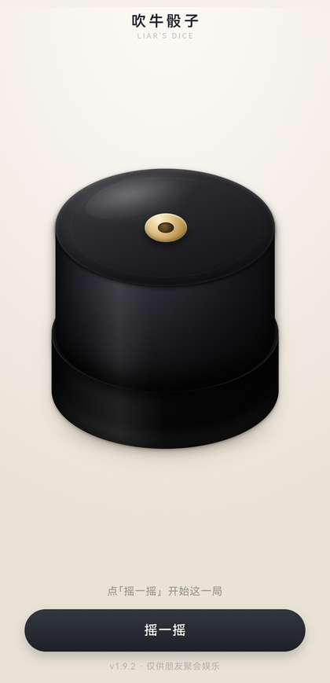
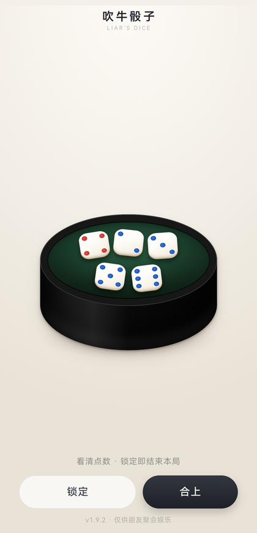
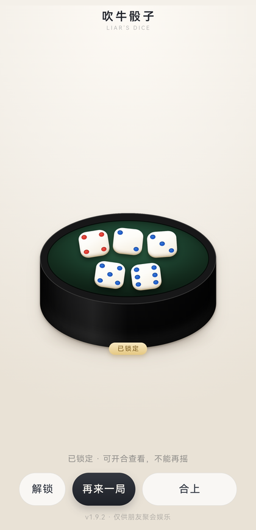
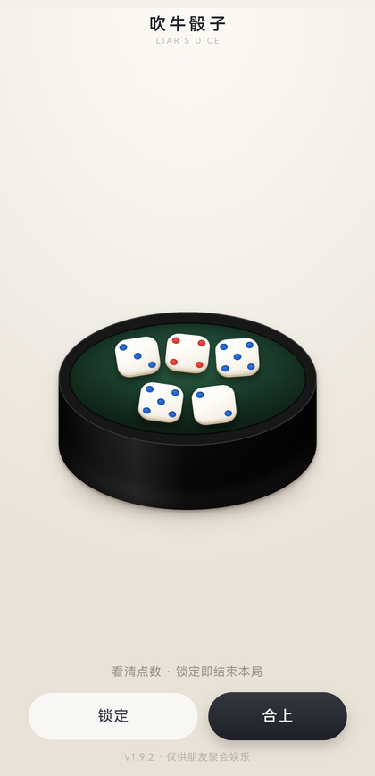
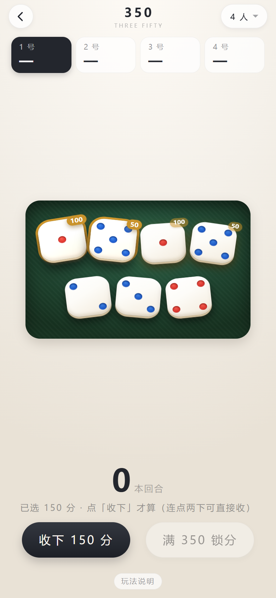
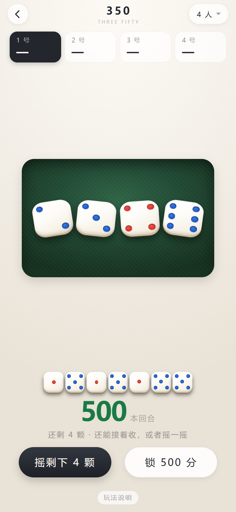
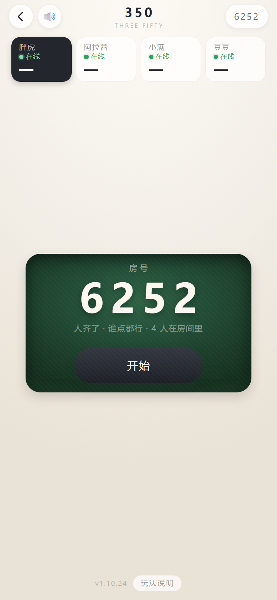
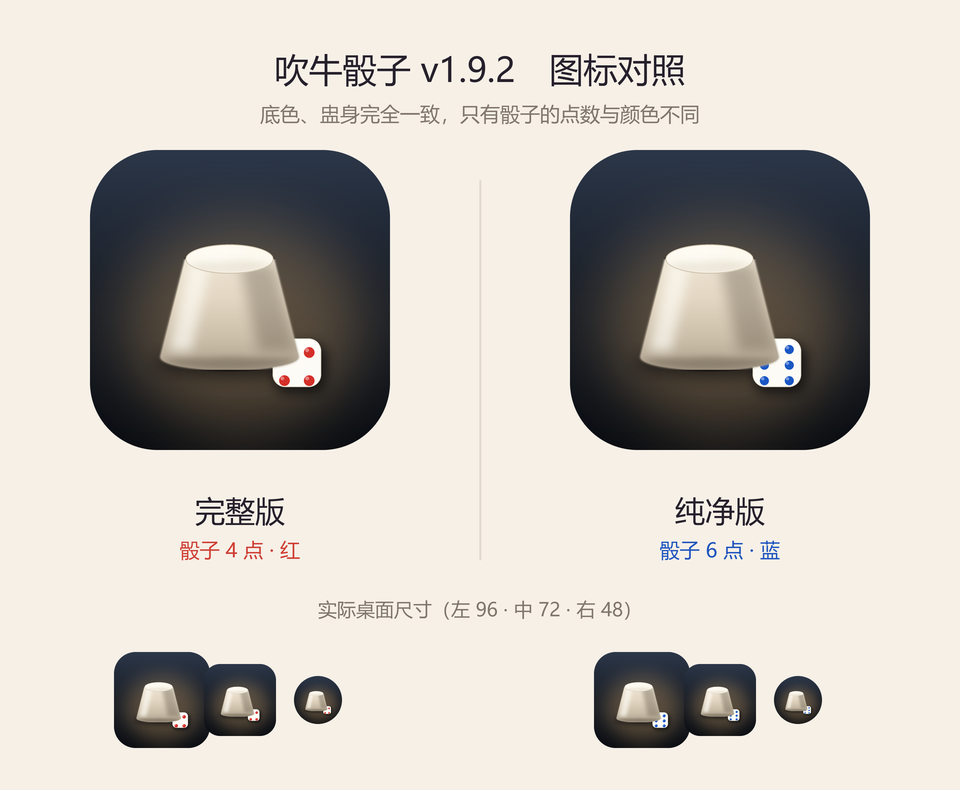
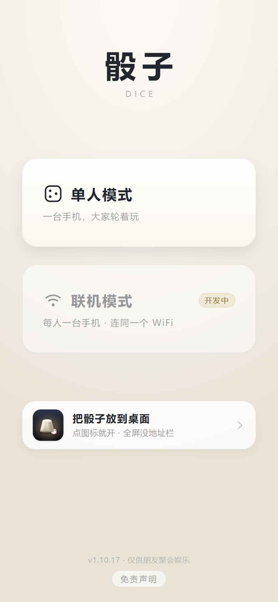
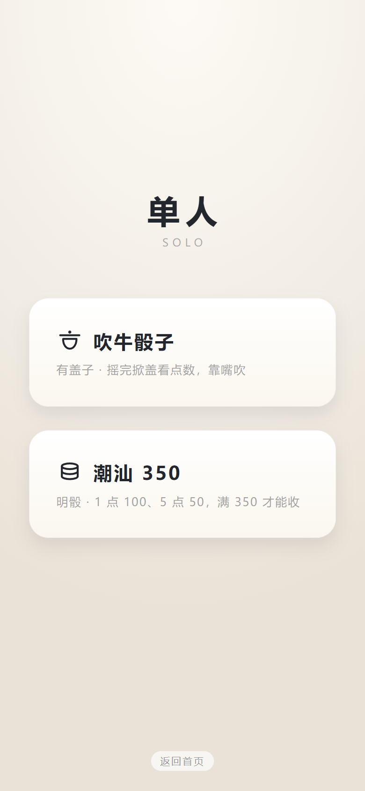

# 吹牛骰子 · 安卓 App

> [!CAUTION]
> **仅供个人娱乐 · 禁止任何违法用途**
>
> 朋友聚会时用的小玩具，**严禁用于赌博、变相赌博、抽头渔利、开设赌场、诈骗欺瞒取财等任何违法违规用途**。
> 完整版含「一键豹子 / 顺子 / 改点」等辅助功能，**仅限朋友之间的玩笑**，不得用于任何涉及真实利益的场合。
>
> 本项目按 **AS IS（「现状」）** 提供，不附带任何担保。因下载、安装、使用本项目（**含二次开发、二次分发的版本**）
> 而产生的一切后果**由使用者自行承担**，作者不承担任何责任。二次开发、修改后分发，请**注明出处**并**保留本声明**。
> 原仓库：https://github.com/cbywyz/liars-dice-apk
>
> 完整条款 → [docs/terms.md](docs/terms.md)

1 个骰盅 + 5 颗骰子（2~10 可调）的聚会小工具。**首页选模式 → 进去选玩法 → 开打**：

| 模式 | 是什么 |
|---|---|
| **单人 · 吹牛骰子** | 摇一摇 → 盖子合着 → 掀盖看点数（可停半开）→ 锁定，骰子 2~10 颗可调 |
| **单人 · 350** | 不要盖子，明骰直接摇。1 点 100、5 点 50，满 350 才能收手，封顶 700，人数开局后还能改 |
| **联机 · 350** | 各看各的手机，不用连同一个 WiFi、不用指定主机。2~12 人，报 4 位房号进房 |

罚酒的规矩也写进去了：**爆掉自己喝 1 杯、出豹子其他人喝、整局最低的喝 2 杯**。两个玩法里都有「玩法说明」按钮，规则写在 App 里，不用每次开局口头讲一遍。

**用在哪**：玩骰子喝酒的酒局。碰上喝不了的时候——要开车、在吃药、身体不舒服、明早还得早起——用完整版把点数控住，少输几杯，不至于扫了整桌的兴。

**单机完全离线，联机才联网**：单人两个玩法没有后端、没有网络请求、没有登录、没有充值，飞行模式也能摇。只有「联机模式」要连一台服务器，不点联机就一个请求都不会发。

  
  
  
  

  盖着等摇 → 开盖看点数 → 锁定本局　　（最右是纯净版，界面和完整版完全一样）

  
  
  

  350 点要拿的 1 和 5 → 收下的骰子一颗颗摆到分数上面 → 联机报房号等人

## 两个版本，装哪个都行，可以同时装

| | 完整版 | 纯净版 |
|---|---|---|
| 图标 | 骰子 **4 点（红）** | 骰子 **6 点（蓝）** |
| 包名 | `com.cbywyz.liarsdice` | `com.cbywyz.liarsdice.clean` |
| 功能 | 三个模式都有，另有一组隐藏的豹子 / 顺子 / 改点 | 三个模式都有，**没有隐藏功能** |

两版只有这三处不同。应用名（都叫「吹牛骰子」）、页面标题、底栏版本号完全相同；包名不同，所以互不覆盖，可以装在同一台手机上。
**两版的联机能进同一个房间**（`net.js` 是同一个文件，实测过），以后要防着谁偷偷改点数，就让全桌都装纯净版。

  

## 打开先选模式

  
  

  首页选模式 → 进去再选玩法

二级页面（选玩法 / 吹牛 / 350）**左上角都有一个「←」箭头**，点它回上一层；**安卓的返回键、侧滑返回手势也一样能一层一层退**。

## 怎么装 · 怎么玩

| 想怎么用 | 怎么做 |
|---|---|
| **网页版（推荐）** | 打开 <https://cbywyz.github.io/liars-dice-apk/> 就能玩；iPhone 用 Safari「分享 → 添加到主屏幕」，安卓在浏览器菜单里选「安装应用」。加完图标、名字、启动画面跟 APK 一样，打开也全屏无地址栏，**更新还不用重装** |
| 纯净版网页 | <https://cbywyz.github.io/liars-dice-apk/clean/> |
| **APK** | 本仓库 **Releases** 里两个包：`liars-dice-<版本>.apk`（完整版）、`liars-dice-clean-<版本>.apk`（纯净版）。传到安卓手机上点开，首次安装允许「未知来源」即可 |

> 签名证书是固定的（`keystore/`），后续版本可以直接覆盖安装，不用卸载。
>
> [!NOTE]
> **Release 里的 APK 停在 `1.10.22`**，比网页版旧：那一版没有联机，隐藏功能的入口也还是老办法（直接长按标题）。
> 想玩到最新的、包括联机，直接用网页版 —— 加到桌面之后用起来跟 APK 没区别。

## 细节都在分页里

首页只放概览，长内容各自一页 —— 想看哪块点哪块：

| 文档 | 讲什么 |
|---|---|
| [玩法 A · 吹牛骰子](docs/play-liar.md) | 摇 / 掀盖 / 半开 / 锁定的操作表，骰子 2~10 颗怎么摆 |
| [玩法 B · 350](docs/play-f350.md) | 计分、不点就不拿、爆掉、豹子、交接、断点续玩，以及**喝多少** |
| [玩法说明与点数概率](docs/rules.md) | App 里那张说明卡片长什么样，豹子 / 爆掉的概率怎么算 |
| [联机 · 潮汕 350](docs/play-net.md) | 开房、房号、掉线回位、踢人、重开投票，服务器放在哪 |
| [隐藏设置（完整版才有）](docs/hidden.md) | **首页连点 7 下开总闸**，长按标题出面板，三格隐形区 |
| [网页版 · 离线 · 加到桌面](docs/web.md) | 两个地址、Service Worker 怎么离线、按机型给安装步骤 |
| [结构与发版](docs/build.md) | 目录结构、网页源码在哪、改完怎么发、发 APK 之前要做什么 |
| [完整免责条款](docs/terms.md) | 用途限制、责任免除、二次开发与转载 |

## 免责声明

三条，就三句：**只能朋友之间娱乐**、**不得用于任何非法用途**、**其他功能与本工具无关**。
本项目未上架任何应用商店，签名证书随仓库公开，仅供个人侧载；任何第三方修改、重新打包的版本均**不代表作者**，作者不对其内容与安全性负责。

**下载、安装或使用即视为你已阅读并同意**完整条款 → [docs/terms.md](docs/terms.md)
