# 聚会骰子与扑克 · 单机 4 + 联机 5

> [!NOTE]
> 仅供朋友聚会娱乐 · 禁止任何违法用途 · 完整条款见页尾

一台手机轮着玩，或各看各的手机联机；飞行模式也能开一桌。九个玩法，单机和联机各有各的打法。

  

骰子、扑克与木塞——一桌聚会的全部家当

## 玩法 · 单机 4 个

**完全离线**：没有后端、没有网络请求、没有登录、没有充值，飞行模式也能摇。

  
  
  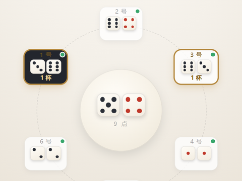
  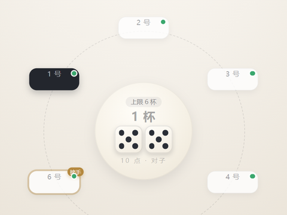

吹牛骰子 · 摇 → 掀盖 → 半开 → 锁定　|　潮汕 350 · 明骰满 350 收手　|　找朋友 · 公骰点谁谁喝　|　七八九 · 公杯攒着等人喝

- **吹牛骰子** — 摇一摇 → 盖子合着 → 掀盖看点数（可停半开）→ 锁定；骰子 2~10 颗可调
- **潮汕 350** — 不要盖子，明骰直接摇。1 点 100、5 点 50，满 350 才能收手，封顶 700
- **潮汕 找朋友** — 每人的 2 颗明骰一直摊在桌上，中间 2 颗公骰点到谁谁喝
- **七八九** — 两颗明骰全场轮流摇：7 加公杯、8 喝公杯**当前存量**一半、9 喝光重倒；两个 1 指一人罚 1 杯（单独记、不动公杯），对子掉头，封顶 6 杯随时可调

罚酒规矩写在 App 里：**爆掉自己喝 1 杯、出豹子其他人喝、整局最低的喝 2 杯**；找朋友那边是**被公骰点到就喝、一模一样双倍**；七八九没有胜负，公杯攒着等人摇到 8 或 9 才喝。

## 玩法 · 联机 5 个

**不用连同一个 WiFi，也不用指定谁当主机**：报一个 4 位房号就坐下，2~12 人。只有这五种玩法要联网，不点联机一个请求都不会发。

  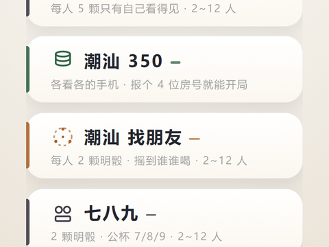
  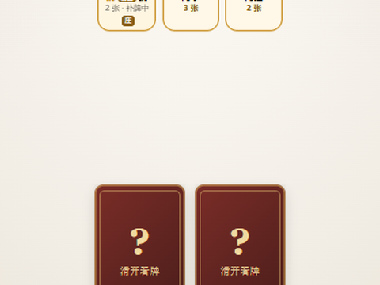
  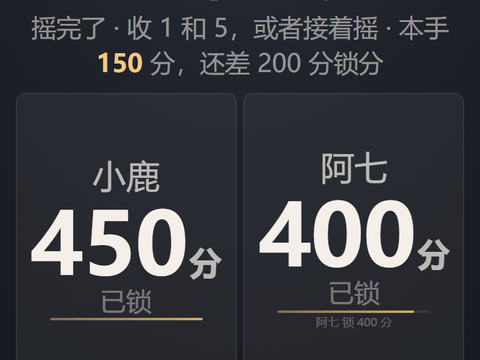
  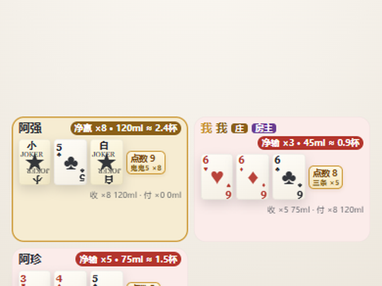

联机选玩法 → 木塞坐庄控开 → 公共屏 → 摊牌桌

- **吹牛骰子 · 暗骰** — 每人 5 颗只有自己看得见：摇完自己就锁 → 面对面叫点 → 2/3 点「开牌」摊开核对 → 2/3 点「下一把」
- **潮汕 350** — 明骰，桌上七颗大家看同一副；轮到你点哪颗拿哪颗，满 350 才能收
- **潮汕 找朋友** — 每人 2 颗明骰摊开，中间公骰点到谁谁喝，一模一样双倍
- **七八九** — 点数、公杯、杯数都在服务器上算；明骰轮流摇，两个 1 指人、对子掉头；公杯上限房主改、其他玩家 2/3 同意，都要下次开局才生效
- **木塞 · 潮汕扑克** — 55 张含白牌第三鬼，服务端发牌保手牌私密；木塞（个位 0）赢双鬼。坐庄模式庄家最后补牌、逐家点开；木塞鱼大吃小、2/3 投票一起开。两种玩法差别见 [木塞 vs 木塞鱼](docs/play-muse.md)

联机玩法共用同一套房间能力：

- **本局记录** — 页脚「记录」，最多 30 条：谁进房、谁摇出几点、公骰撞到谁、谁喝了一杯（七八九没有这一页）
- **桌上的人** — 名字、杯数、掉线标记。**请人出去**：掉线的谁都能请；在线的房主一点就走，其他人**发起投票**（在线的 2/3 同意，45 秒作废，投过再点一下是撤回）
- **重开一桌** — 同样要在线的 2/3 点头，不再由房主一人说了算
- **退出这一桌** — 随时能走；座位和那一手留着，凭房号 + 本机记号回来还是原位

  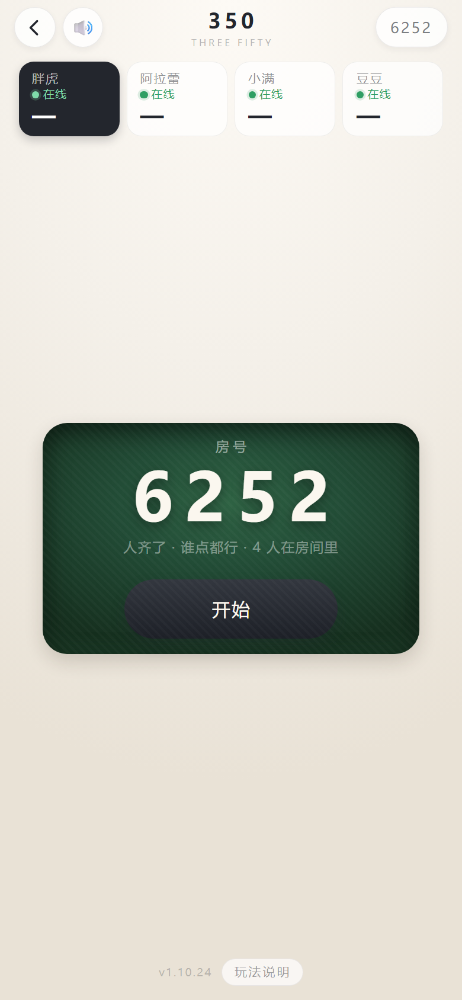
  
  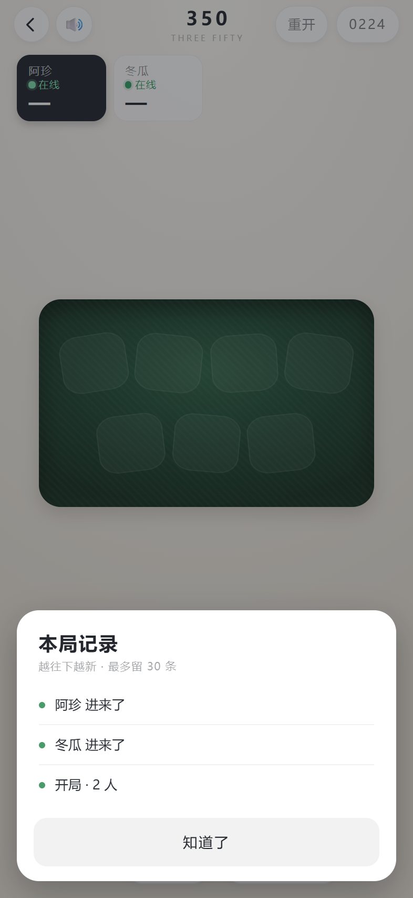
  

报房号坐下 → 牌桌 → 本局记录 → 桌上的人

### 摆桌上 · 公共屏

面对面坐着打，还可以再摆一块屏：找台旧手机或 pad 搁在桌子中间，输一次房号，轮到谁、各家几杯、谁临时休息了多久、重开 / 踢人投票还差几票剩几秒、刚发生什么，全在那块屏上，隔着一张桌子也看得清。

它**只看不玩** —— 摇骰、看牌还在各自手机上，大屏上一个能点的东西都没有，也不占座位。人少时卡片补一条进度和最近一次动作，12 个人时自动收成名字 / 数字 / 状态三行，不挤成一团。

  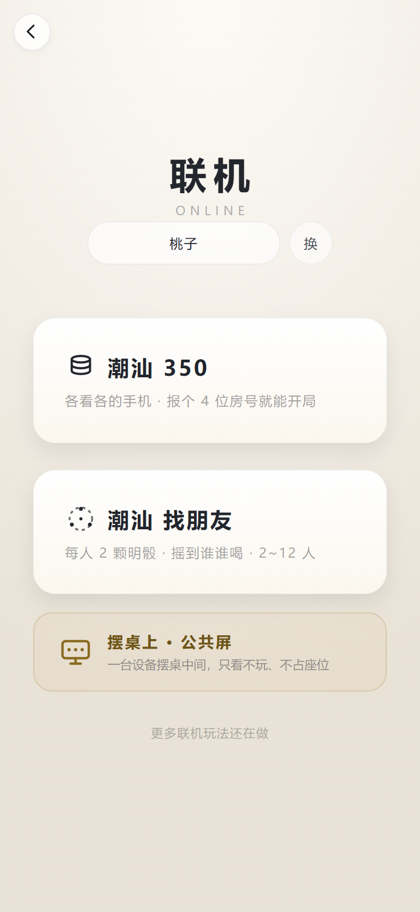
  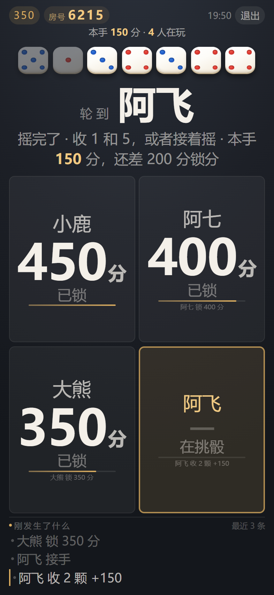
  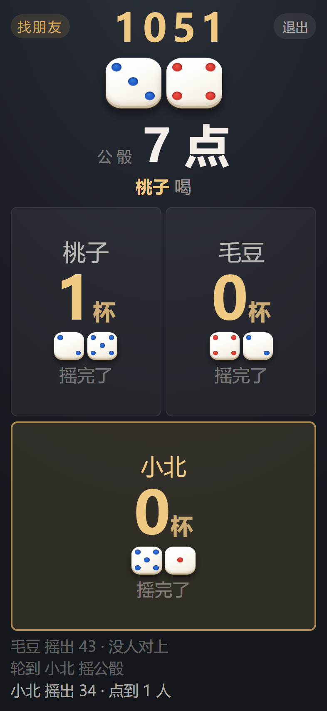

## 打开先选模式

  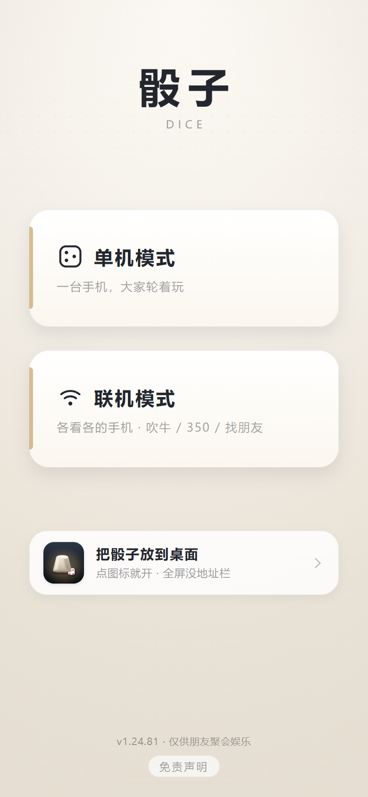
  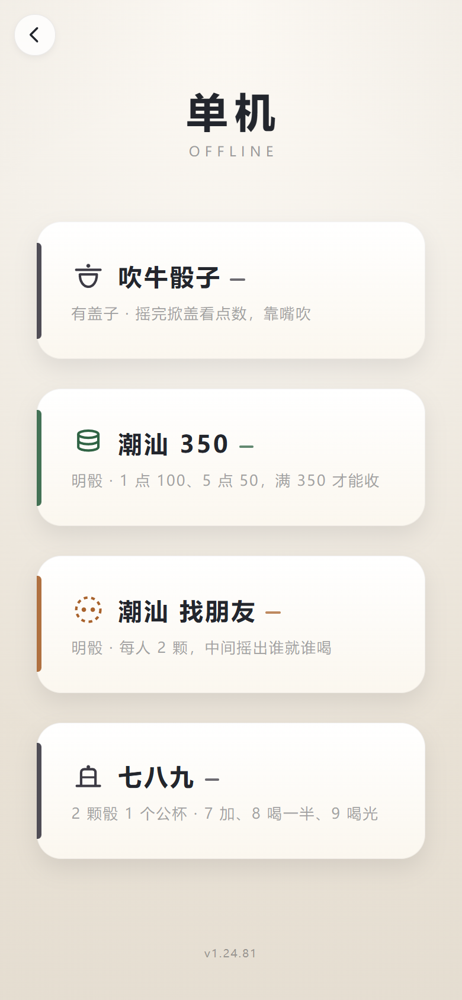
  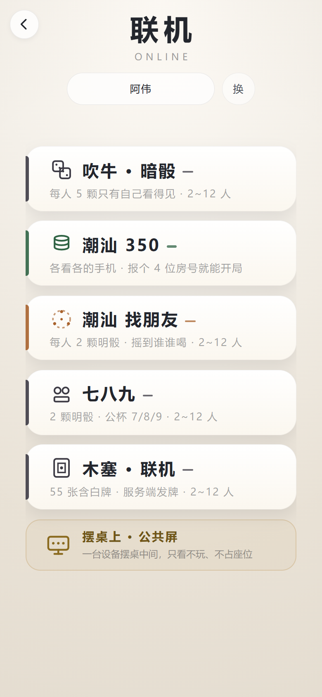

首页选模式 → 单机四个 / 联机五个 → 再进牌桌

二级页面（选玩法 / 吹牛 / 350 / 找朋友 / 七八九）**左上角都有一个「←」箭头**，安卓的返回键、侧滑手势也一样能一层一层退。

## 两个版本，装哪个都行，可以同时装

只有三处不同，包名不同所以**互不覆盖、可以同装在一台手机上**：

- **图标** — 完整版骰子 4 点（红）· 纯净版骰子 6 点（蓝）
- **包名** — `com.cbywyz.liarsdice` · `com.cbywyz.liarsdice.clean`
- **功能** — 都是九个玩法；完整版另有一组隐藏的豹子 / 顺子 / 改点，纯净版**没有**

**两版的联机能进同一个房间**（各联机玩法的客户端代码两版一致）；要防着谁偷偷改点数，就让全桌都装纯净版。

  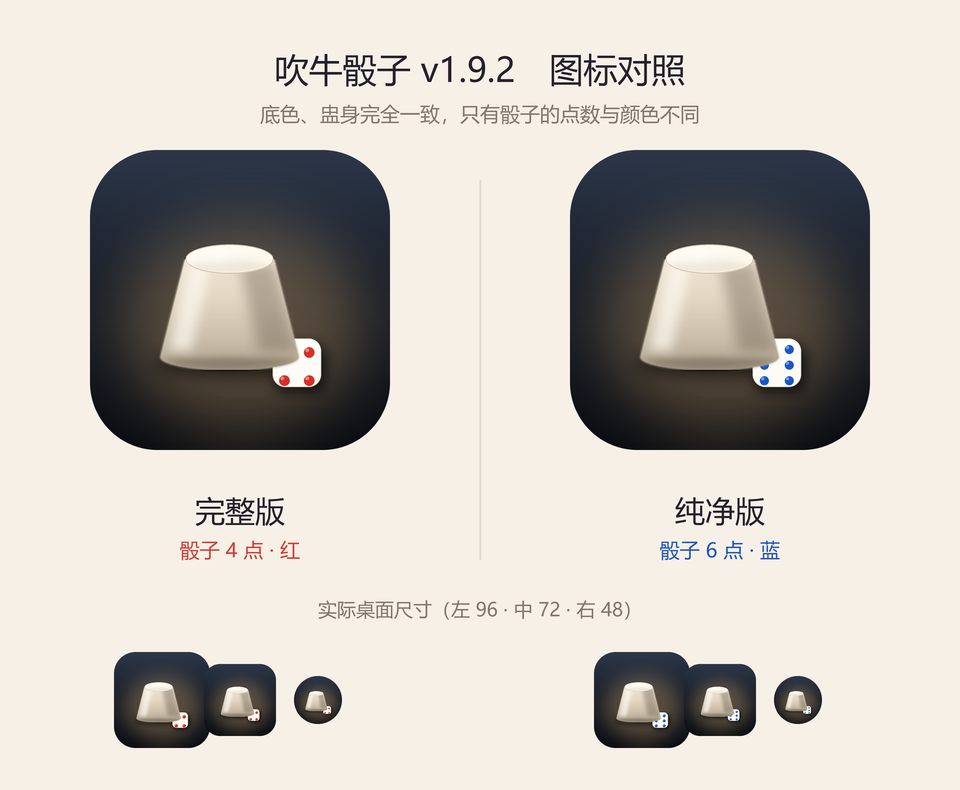

## 怎么装

- **网页版（推荐）** — 跑在我自己的一台服务器上，**地址不写在这儿**（不打算公开）。拿到链接后手机浏览器打开即可：iPhone 用 Safari「分享 → 添加到主屏幕」，安卓在菜单里选「安装应用」；加完图标、名字、启动画面跟 APK 一样，打开全屏无地址栏，**更新还不用重装**
- **发给别人的那个地址就是纯净版**（根路径，页面和源码里都没有任何调试入口）
- **完整版**在同一个地址的 `/ld-9x4k2m/`（随机路径，别人猜不到也搜不到），只有你自己知道，调试时用
- **APK** — 本仓库 **Releases** 里两个包：`liars-dice-<版本>.apk`（完整版）、`liars-dice-clean-<版本>.apk`（纯净版）。传到安卓手机上点开，首次安装允许「未知来源」即可；签名证书固定（`keystore/`），后续版本直接覆盖安装，不用卸载

> [!NOTE]
> **Release 里的 APK 停在 `1.10.21`**，比网页版旧：那一版没有联机，隐藏功能的入口也还是老办法。
> 想玩最新的、包括联机，直接用网页版 —— 加到桌面之后用起来跟 APK 没区别。

## 最近更新

**当前版本 `v1.24.83`**（每个页面页脚都能看到）。完整历史、每版配图 → [更新说明](docs/changelog.md)；网页版刷新一下就是最新，不用重装。

- **v1.24.83** **纯净版木塞入口开放**：对外链接点「木塞 · 联机」不再弹「正在开发，待完善」，直接进建房 / 进房门页，五种玩法全都能玩。
- **v1.24.82** **首页联机卡副标题补齐**：改成「各看各的手机 · 五种玩法」，不再只列吹牛 / 350 / 找朋友，七八九和木塞也算进来了；GitHub 首页 Hero 换成 AI 聚会插画，替掉原来的截图九宫格。
- **v1.24.81** **修掉「对面掉线后摊牌页永远卡 1/2」**：吹牛「下一把」人数保护曾把掉线误当休息、拦着不让洗牌，现在只把真预约休息的人腾出分母，掉线和炸弹都算还在局里。全套 8 个测试文件 1085 条全绿。

## 细节都在分页里

| 文档 | 讲什么 |
|---|---|
| [玩法 A · 吹牛骰子](docs/play-liar.md) | 单机：摇 / 掀盖 / 半开 / 锁定；**联机那半篇**：发骰子 → 摇完就锁 → 2/3 开牌 → 2/3 下一把 |
| [玩法 B · 350](docs/play-f350.md) | 计分、不点就不拿、爆掉、豹子、交接、断点续玩，以及**喝多少** |
| [玩法说明与点数概率](docs/rules.md) | App 里那张说明卡片长什么样，豹子 / 爆掉的概率怎么算 |
| [联机 · 潮汕 350](docs/play-net.md) | 开房、房号、掉线回位、踢人、重开投票；公共屏怎么摆 |
| [联机 · 潮汕 找朋友](docs/play-find.md) | 明骰点名怎么走、对上几杯、11 正豹的附加 |
| [木塞 · 潮汕扑克](docs/play-muse.md) | 55 张含白牌第三鬼、服务端发牌保私密、木塞赢双鬼、坐庄 / 大吃小两种打法 |
| [隐藏设置（完整版才有）](docs/hidden.md) | **首页连点 7 下开总闸**，长按标题出面板 —— 各玩法的调试入口都在这一页 |
| [网页版 · 离线 · 加到桌面](docs/web.md) | Service Worker 怎么离线、按机型给安装步骤 |
| [结构与发版](docs/build.md) | 目录结构、网页源码在哪、改完怎么发 |
| [更新说明](docs/changelog.md) | 每个版本改了什么，配截图 |
| [完整免责条款](docs/terms.md) | 用途限制、责任免除、二次开发与转载 |

## 页尾 · 免责声明

> [!CAUTION]
> **仅供个人娱乐 · 禁止任何违法用途**
>
> 朋友聚会时用的小玩具，**严禁用于赌博、变相赌博、抽头渔利、开设赌场、诈骗欺瞒取财等任何违法违规用途**。
> 完整版含「一键豹子 / 顺子 / 改点」等辅助功能，**仅限朋友之间的玩笑**，不得用于任何涉及真实利益的场合。
>
> 本项目按 **AS IS（「现状」）** 提供，不附带任何担保。因下载、安装、使用本项目（**含二次开发、二次分发的版本**）
> 而产生的一切后果**由使用者自行承担**，作者不承担任何责任。二次开发、修改后分发，请**注明出处**并**保留本声明**。
>
> 原仓库：https://github.com/cbywyz/liars-dice-apk · 完整条款 → [docs/terms.md](docs/terms.md)

三条，就三句：**只能朋友之间娱乐**、**不得用于任何非法用途**、**其他功能与本工具无关**。
本项目未上架任何应用商店，签名证书随仓库公开，仅供个人侧载；任何第三方修改、重新打包的版本均**不代表作者**。

**下载、安装或使用即视为你已阅读并同意**完整条款 → [docs/terms.md](docs/terms.md)
