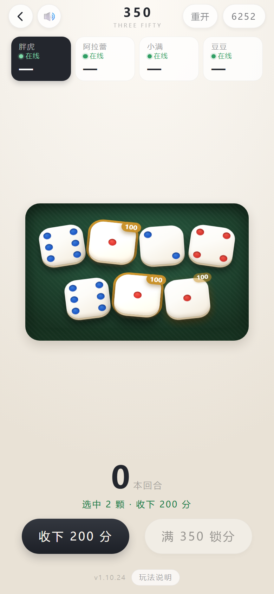
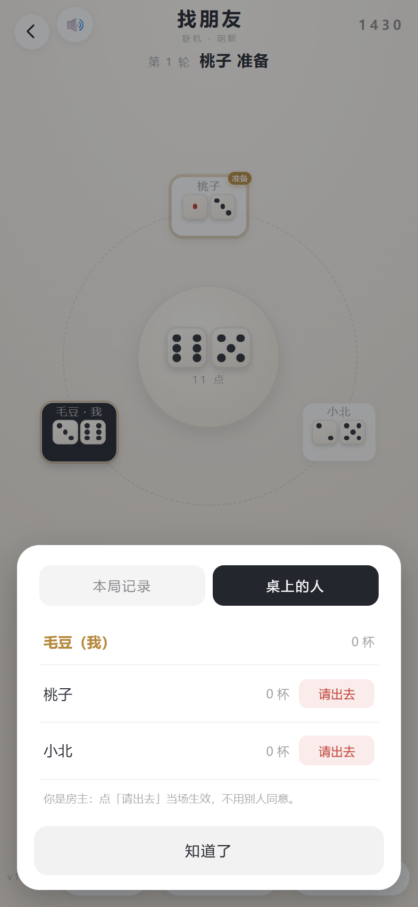
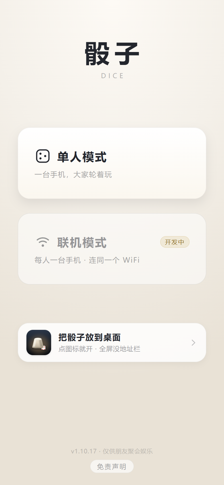
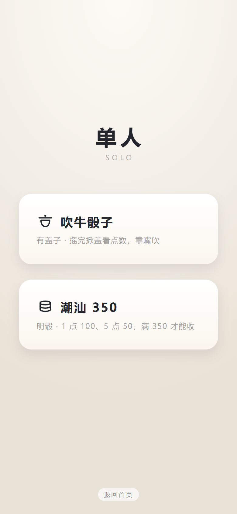
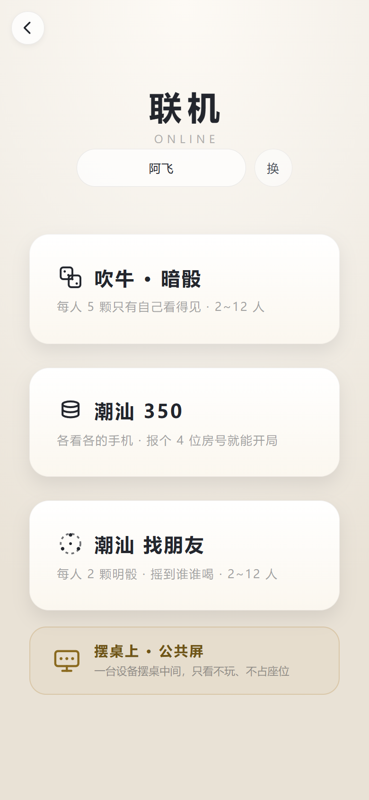
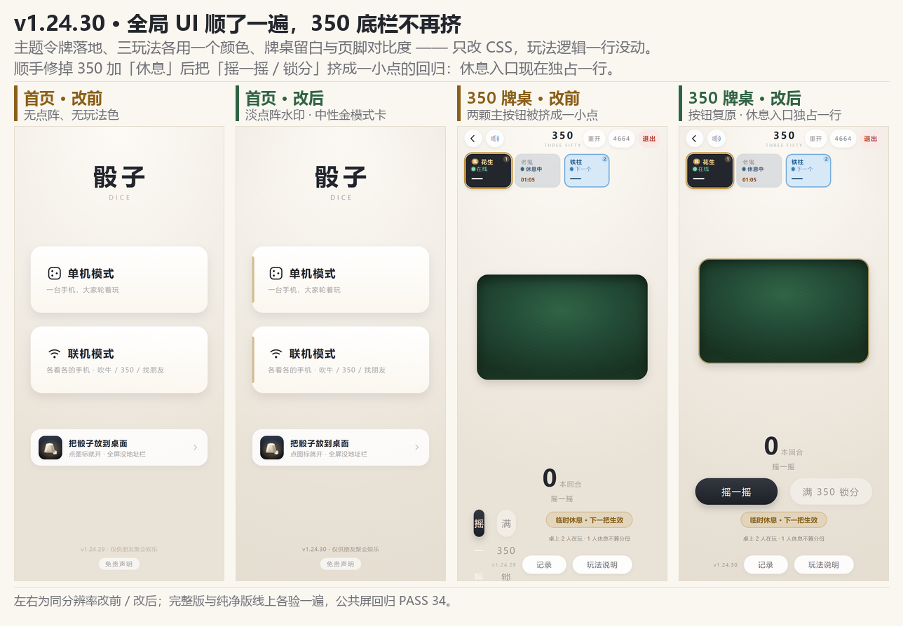
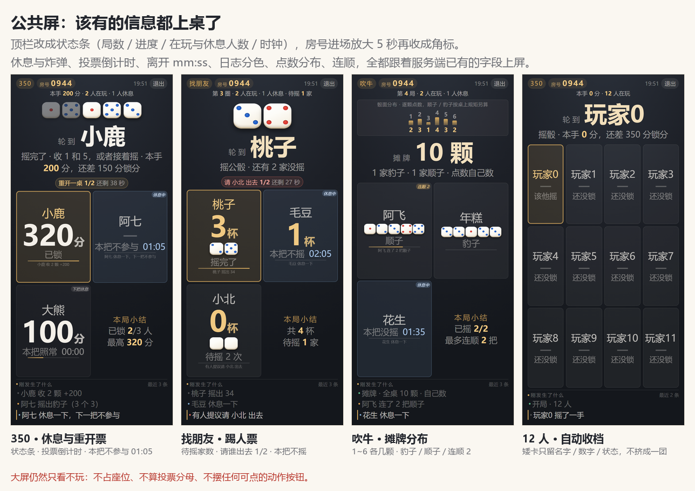
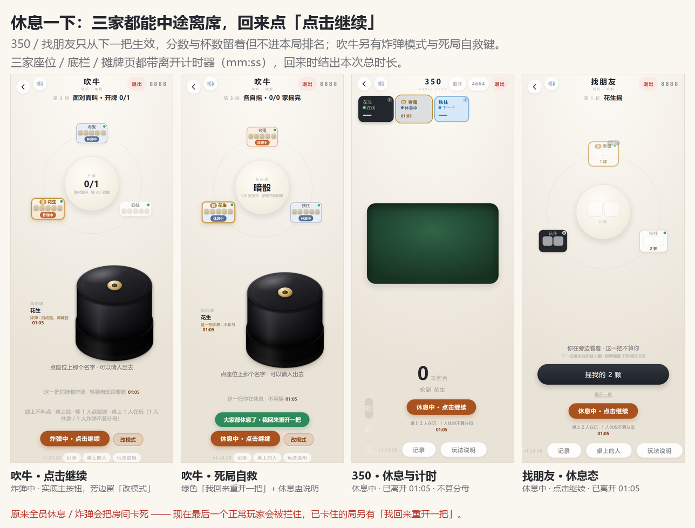
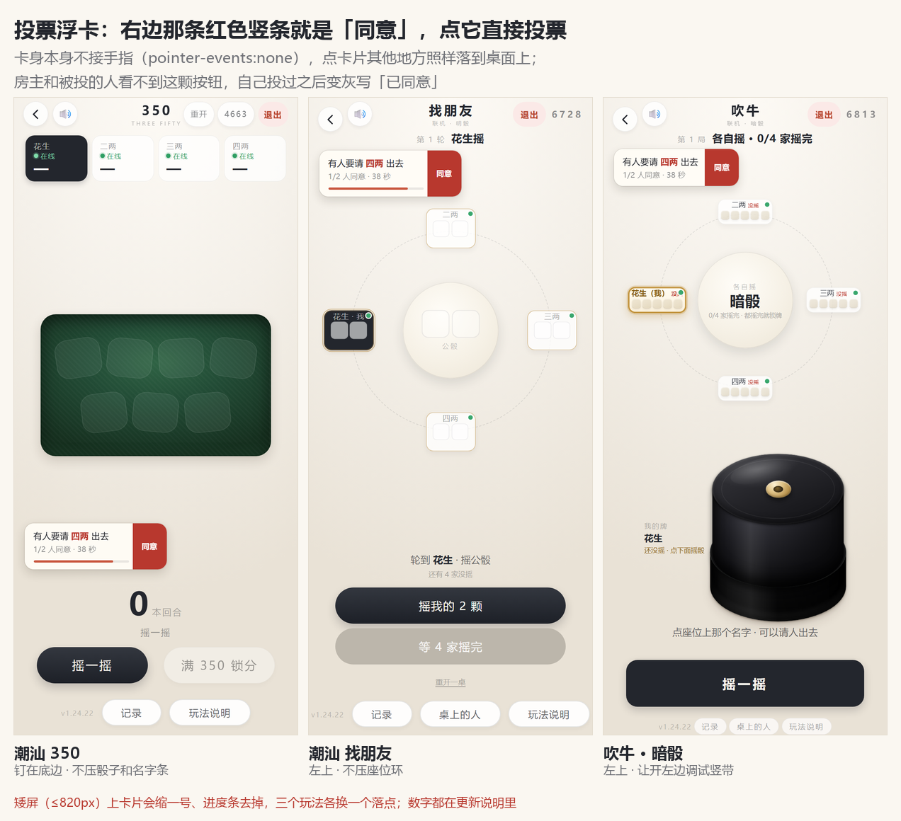

# 吹牛骰子 · 安卓 App

> [!CAUTION]
> **仅供个人娱乐 · 禁止任何违法用途**
>
> 朋友聚会时用的小玩具，**严禁用于赌博、变相赌博、抽头渔利、开设赌场、诈骗欺瞒取财等任何违法违规用途**。
> 完整版含「一键豹子 / 顺子 / 改点」等辅助功能，**仅限朋友之间的玩笑**，不得用于任何涉及真实利益的场合。
>
> 本项目按 **AS IS（「现状」）** 提供，不附带任何担保。因下载、安装、使用本项目（**含二次开发、二次分发的版本**）
> 而产生的一切后果**由使用者自行承担**，作者不承担任何责任。二次开发、修改后分发，请**注明出处**并**保留本声明**。
>
> 原仓库：https://github.com/cbywyz/liars-dice-apk · 完整条款 → [docs/terms.md](docs/terms.md)

1 个骰盅 + 5 颗骰子（2~10 可调）的聚会小工具：**单机三个玩法、联机三个玩法**，首页选模式，进去就开打。

## 六个玩法

### 单机 · 一台手机，大家轮着玩

**完全离线**：没有后端、没有网络请求、没有登录、没有充值，飞行模式也能摇。

- **吹牛骰子** — 摇一摇 → 盖子合着 → 掀盖看点数（可停半开）→ 锁定；骰子 2~10 颗可调
- **潮汕 350** — 不要盖子，明骰直接摇。1 点 100、5 点 50，满 350 才能收手，封顶 700
- **潮汕 找朋友** — 每人的 2 颗明骰一直摊在桌上，中间 2 颗公骰点到谁谁喝

罚酒规矩写在 App 里：**爆掉自己喝 1 杯、出豹子其他人喝、整局最低的喝 2 杯**；找朋友那边是**被公骰点到就喝、一模一样双倍**。

### 联机 · 各看各的手机

**不用连同一个 WiFi，也不用指定谁当主机**：报一个 4 位房号就坐下，2~12 人。只有这三种玩法要联网，不点联机一个请求都不会发。

- **吹牛骰子** — 每人 5 颗只有自己看得见：摇完自己就锁 → 面对面叫点 → 2/3 点「开牌」摊开核对 → 2/3 点「下一把」
- **潮汕 350** — 明骰，桌上七颗大家看同一副；轮到你点哪颗拿哪颗，满 350 才能收
- **潮汕 找朋友** — 每人 2 颗明骰摊开，中间公骰点到谁谁喝，一模一样双倍

三个联机玩法共用同一套牌桌功能：

- **本局记录** — 页脚「记录」，最多 30 条：谁进房、谁摇出几点、公骰撞到谁、谁喝了一杯
- **桌上的人** — 名字、杯数、掉线标记。**请人出去**：掉线的谁都能请；在线的房主一点就走，
  其他人**发起投票**（在线的 2/3 同意，45 秒作废，投过再点一下是撤回）
- **重开一桌** — 同样要在线的 2/3 点头，不再由房主一人说了算
- **退出这一桌** — 随时能走；座位和那一手留着，凭房号 + 本机记号回来还是原位

  
  
  
  

  报房号坐下 → 牌桌 → 本局记录 → 桌上的人

### 摆桌上 · 公共屏

面对面坐着打，还可以再摆一块屏：找台旧手机或 pad 搁在桌子中间，输一次房号，
轮到谁、各家几杯、谁临时休息了多久、重开 / 踢人投票还差几票剩几秒、刚发生什么，
全在那块屏上，隔着一张桌子也看得清。顶栏是两行状态条（第几局 / 本手进度 /
几人在玩几人休息 / 本地时间），房号进场先放大念 5 秒，再收成角标。

它**只看不玩** —— 摇骰、看牌还在各自手机上，大屏上一个能点的东西都没有，也不占座位
（4 个人重开还是 3 票，不会因为多一块屏变成 4 票）。人少时卡片补一条进度和最近一次动作，
12 个人时自动收成名字 / 数字 / 状态三行，不挤成一团。

  
  
  

  入口 → 350 打到一半 → 找朋友（公骰 + 各家那两颗）

## 打开先选模式

  
  
  

  首页选模式 → 单机三个玩法 / 联机三个玩法 → 再进牌桌

二级页面（选玩法 / 吹牛 / 350 / 找朋友）**左上角都有一个「←」箭头**，安卓的返回键、侧滑手势也一样能一层一层退。

## 两个版本，装哪个都行，可以同时装

只有三处不同，包名不同所以**互不覆盖、可以同装在一台手机上**：

- **图标** — 完整版骰子 4 点（红）· 纯净版骰子 6 点（蓝）
- **包名** — `com.cbywyz.liarsdice` · `com.cbywyz.liarsdice.clean`
- **功能** — 都是六个玩法；完整版另有一组隐藏的豹子 / 顺子 / 改点，纯净版**没有**

**两版的联机能进同一个房间**（`net.js` 是同一个文件）；要防着谁偷偷改点数，就让全桌都装纯净版。

  

## 怎么装

- **网页版（推荐）** — 跑在我自己的一台服务器上，**地址不写在这儿**（不打算公开）。拿到链接后手机浏览器打开即可：
  iPhone 用 Safari「分享 → 添加到主屏幕」，安卓在菜单里选「安装应用」；加完图标、名字、启动画面跟 APK 一样，
  打开全屏无地址栏，**更新还不用重装**
- **纯净版网页** — 同一个地址下的 `/clean/`
- **APK** — 本仓库 **Releases** 里两个包：`liars-dice-<版本>.apk`（完整版）、`liars-dice-clean-<版本>.apk`（纯净版）。
  传到安卓手机上点开，首次安装允许「未知来源」即可；签名证书固定（`keystore/`），后续版本直接覆盖安装，不用卸载

> [!NOTE]
> **Release 里的 APK 停在 `1.10.21`**，比网页版旧：那一版没有联机，隐藏功能的入口也还是老办法。
> 想玩最新的、包括联机，直接用网页版 —— 加到桌面之后用起来跟 APK 没区别。

## 最近更新

**当前版本 `v1.24.45`**（每个页面页脚都能看到）。完整历史、每版配图 → [更新说明](docs/changelog.md)；
网页版刷新一下就是最新，不用重装。

- **v1.24.45** 「再来一局」按钮上的投票进度改写成紧凑的「再来一局 · 1/2」（跟吹牛
  「下一把 · 1/2」同款）—— 上一版的整句太长，按钮字被挤出去。
- **v1.24.44** **350 联机「再来一局」改成 2/3 投票**：4 人要 3 票、3 人要 2 票、2 人要 2 票，
  45 秒没人接着点作废、投过再点撤回；休息中的人不进分母也点不了，新一局开了之后
  休息快照跟着生效（真不参与、起表、队列摘除）。见 [更新说明](docs/changelog.md)。
- **v1.24.43** 350 调试的「给 1 / 给 5」加了两道闸：**装填上限 2 颗**（1 和 5 合计，
  装满再点不收，面板写「已装满」）；**残局只给一颗**（这一摇只剩 ≤2 颗时最多硬塞 1 颗，
  避免两颗全被指定、经常开出一对一样的）。见 [隐藏设置 · 联机 350](docs/hidden.md)。
- **v1.24.42** 吹牛骰子的「点数概率」页里**混进了 350 的两个数**，这版改掉：入口那行原来写
  「豹子 1/2187 · 爆掉 5.85%」—— `1/2187` 是 `3⁷`、`5.85%` 是 `(2/3)⁷`，那是 **7 颗明骰**
  一个 1 一个 5 都没有的概率，**吹牛是 5 颗、也没有「爆掉」这回事**，写在这儿就是错话。
  现在入口写「5 颗豹子 1/1296」，赔率页里也补了一条：5 颗全一样是 6/6⁵ = **1/1296 ≈ 0.077%**
  （一千三百把一回），n 颗全一样就是 6/6ⁿ —— 原来那页从头到尾没讲过豹子是多少。
  350 那边一个数都没改（它的 `1/46656` 正豹、`1/2187` 爆掉本来就是对的）。
  **判定、摇骰、计分一行没动。**

  
 

  另外把 **350 的「调试功能」面板**怎么开、五格在牌桌哪一片、四功能各自什么口径，
  连同前两套（单机吹牛 / 联机吹牛 / 找朋友）一起归到 [隐藏设置](docs/hidden.md) 那一页了
  —— 以前四种玩法的暗门散在各版更新说明里，找起来得翻半天。

- **v1.24.41** 350 那条**混合豹子提示**补上了「为什么」：点开就有一页把道理摆清楚 ——
  1 和 5 是**一颗一颗累计收**上来的，收满第 7 颗那一刻桌上必然全是 1 和 5，这时
  7 颗清一色只有 **1/64**、混着的 **63/64（约 98%）**。以前那页写「约两千把才遇见一次」，
  那是**一把摇 7 颗**的数，跟实际玩法对不上；这回按「累计收满」重算，结论那句也单独拎出来高亮。
  「我知道了」以前点过一次就再也不出现，现在**每次重新进房都会再摆一次**，这一把点过就收起。
  **规则、判定、计分、摇骰概率一行没动**。

  

- **v1.24.39** 联机 350 的牌桌下方多了一条**规则提示**：「混合豹子不算豹子（如 1515151）·
  只认 7 颗一样的正豹」，右边一颗「我知道了」，点过就消失、以后不再弹。
  以前这条只写在「玩法说明」里，桌上当场看不见，摇出 1515151 就要吵一遍。
  **规则、概率、计分一行没动**。

- **v1.24.38** 内部整理与文档更新：**玩法、规则、概率、计分一行都没动**，
  页面上普通玩家看不出任何区别。完整版 / 纯净版线上 48 个文件逐文件核对一致。

- **v1.24.37** 350 只认正豹这条规则不变，改的是**把它说到明面上**：一把摇出 1115555 这种
  「满堂 1/5」时，提示直接写清「这手 500 分 · 不是豹子」；收齐 7 颗同样标「满堂 1/5 全收完」。
  以前判定一直只认清一色，但屏幕上不说话，桌上就有人以为被系统赖掉、要求整局重开。
  玩法说明补上「这手 400~650 分，本来就是高分」；顺手清掉文件头一条写着「7 颗全是 1 和 5 = 豹子」
  的过时注释。**摇骰概率、计分、豹子判定一律没动**（仍是六面等概率、正豹才算豹子）。
  完整版 / 纯净版线上 48 个文件逐文件核对一致。

- **v1.24.36** 修掉一个 3 人局实测出来的吹牛真 bug：两人错峰休息、其中一人点「继续」后，
  「下一把」票还按本把在玩的人算 —— 要回来的人没按钮、没票权，反倒要等那个预约休息的人点完
  才能洗牌。现在分母 / 投票资格 / 按钮统一按「下一把会上桌的人」算，点继续的人立刻能投，
  下一把要休息的人不用再替别人点；开牌票分母保持原样。完整版 / 纯净版线上 48 个文件逐文件核对一致。

- **v1.24.35** 又一轮深入体检，按「真 bug → 清理 → 便捷」顺序修，**玩法规则一行没动**：
  找朋友 / 吹牛玩家掉线且票够时不再被 350 的清理逻辑搅坏牌桌（掉线删人按玩法分派）；
  三家分享链接各认各的 `?g=` 标记，吹牛 / 找朋友的房号不会被 350 抢走；按住盅盖切走窗口
  不再自动开盅泄点；公共屏投票倒计时断线重连后基准会重新对齐；服务端落盘日志统一截断，
  切页时把上一桌的定时器与浮层收干净。另外三处进房说明写清牌桌上也能改名，
  350 右上角常住房号点一下即可复制。完整版 / 纯净版线上 48 个文件逐文件核对一致。

- **v1.24.34** 全局体检后的一轮加固，**玩法规则一行没动**：单机摇骰时切到后台再回来，
  不再卡在「摇骰中」；四套联机的连接层修掉「手动连之前排队着的退避重连把新连接又关一次」，
  建房加了 in-flight 锁（快速连点不再建出多间空房），吹牛补上回前台主动重连；三家进房统一按
  房号校验玩法，输错会直接说清那是哪一家的房间。另外补齐 PWA 描述、放开双指缩放、给极小字号
  加了 11px 下限、音效开关支持键盘；服务端消息入口加顶层兜底，发版清单新增自动断言脚本。
  完整版 / 纯净版线上 48 个文件逐文件核对一致。

- **v1.24.33** 「临时离开」收尾：以前点「继续」之后，那句离开时长当场就没了，同桌来不及看清
  一共歇了多久。现在改成**跟着牌局走** —— 本把 + 下一把都摆「本次离开 mm:ss」和「刚回来」，
  第三把自然收；不用 20 秒定时器，也不加秒表。别人的座位卡、摊牌大表、公共屏同样看得到，
  回来的日志永久带上总时长，给刚才没抬头的补一眼。玩法规则没变；完整版 / 纯净版线上各验一遍，
  公共屏回归 PASS 34、真房间协议 FAIL 0。

  

    
  

- **v1.24.32** 休息入口三态长得太像，「下把生效，点击继续」这种状态和动作挤一行也难懂 ——
  拆成**状态牌只讲状态、按钮只讲动作**两层，四态四档颜色：默认淡金描边、挂起淡橙、
  生效深橙实底、已点继续绿。

- **v1.24.31** 修掉「点了休息就马上开始倒计时」：那一下只是登记意愿，本把照常打完、人还没离开。
  计时起点挪到**下一把真正生效**那刻（吹牛炸弹同理），挂起态不再摆 mm:ss。

- **v1.24.30** 把全局 UI 顺了一遍：先加一套**主题令牌**（颜色 / 圆角 / 阴影 / 动效统一收口，
  7 个 CSS 共 151 处纯色等价换掉，令牌化那一步拍图确认零像素回退，也给以后深色模式留了口子）；
  **三个玩法各配一个颜色**（吹牛墨蓝 / 350 深绿 / 找朋友暖橙，卡片色条、图标、标题短横线同色），
  首页加一层极淡点阵水印、350 桌布一圈金压线、吹牛摊牌「我」那行加金竖条，页脚小字也提了对比度。
  只改 CSS，玩法逻辑一行没动。顺手修掉一个回归：v1.24.28 给 350 加「休息」后，
  底栏那颗入口挤进「摇一摇 / 锁分」同一行，把两颗主按钮压成一小点 —— 现在休息入口**独占一行**，
  按钮各回一半宽。

  

    
  

- **v1.24.29** 摆在桌中间那块**公共屏补上了该有的信息**：谁在休息 / 挂炸弹、离开了多久、
  重开或踢人投票还差几票剩几秒，全都上屏；日志按事件类型分色，最新一条镶金竖条。
  房号收成角标（进场先放大念 5 秒），腾出的顶栏改成两行状态条：第几局、本手进度、
  几人在玩几人休息、本地时间。卡片按宽度分三档 —— 人少时补进度条和最近一次动作，
  12 人时只留名字 / 数字 / 状态；奇数人右下角空位换成一张虚线「本局小结」，不再把末位拉成一整行。
  吹牛摊牌多了**1~6 各几颗**的客观骰面分布（顺子 / 豹子按桌上规矩另算），豹子也跟手机端一样标出来了。
  顺手修掉摊牌五颗骰子顶出卡片、大字区在爆了时还写「还差 X 分锁分」这几处。

  

    
  

- **v1.24.28** 「休息」补到另外两家：**联机 350 / 找朋友也能中途歇一把**，只从下一把生效、
  分数和杯数留着但不进本局排名，回来点「继续」也是下一把恢复；找朋友轮到休息的人当庄会自动跳过。
  三家都加了**离开计时器** —— 座位 / 底栏 / 摊牌页 / 桌上的人都会显示「已离开 mm:ss」，
  回来时给一句本次总时长。吹牛摊牌页**豹子也标出来了**（紫色，跟金色顺子一眼分得开）。
  挂起时那颗按钮从「点这里改」换成实底大按钮「**点击继续**」，点一下直接回来，旁边留小的「改模式」。
  还修掉一个真会卡死的毛病：全场都休息 / 挂炸弹时原来洗不了下一把，现在既会拦住最后一个正常玩家、
  也给了「我回来重开一把」的自救键；休息的人盅里不再摆五颗空白骰子，改成一句说明。

  

    
  

- **v1.24.27** 联机吹牛加两种「临时离开」：**休息** —— 下一把起占着座位、不摇也不计骰子；
  **炸弹** —— 下一把起不用自己点，别人摇完自动跟着摇、够 2/3 票自动跟着摊，骰子照样算数，
  但不占开牌人数。两种状态都**从下一把生效**，回来点「继续」也是下一把恢复；离开期间连顺冻结。
  座位卡整张换色、挂实心状态牌，摊牌大表和「桌上的人」各标一份，同桌一眼看得出谁不在圈里。
  2 人桌有人休息会停在摊牌页等他回来，不洗出只有一个人的局。
- **v1.24.26** 不发新玩法，专修会悄悄出错的地方：给 `[hidden]` 加了全局兜底（这个坑前后踩过四次）、
  补上公共屏 css/js 漏掉的版本戳、纯净版自检从 3 个文件扩到 18 个；服务端房间散场洗得更干净、
  并发建房不再撞同一个房号；29 个验收脚本里早就删掉的 `#netJoin` 步骤一次清完。
- **v1.24.25** 联机三家：**桌上点自己那张卡就能改名**（350 / 吹牛双击，找朋友长按），
  不用退回上一层；**同一桌不许重名** —— 同名进房自动变「胖虎2」，主动改成别人的名字会被拦住；
  座位卡右上角**标了这一把的出手序号**（谁先摇谁是 1）；一局打完那张卡不再把文字切掉半行，
  大字换成金色，人多了榜单自己滚；修掉「交接屏上挂着上一把排名」的毛病。
  350 的入口页也改成跟另外两个玩法一样 —— 房号输入框常驻，不用点一下才展开。
- **v1.24.24** 350 联机两处：**下一个出手的那张卡换成淡蓝底**，状态灯那一行直接写
  「下一个」（绿点照旧，掉线的还是红点）—— 以前只有「正在打的是他」是深色卡，后面还排着谁
  得自己数人头；**结算榜同分不再排反**了，三个人都锁 500 时按说好的「最后一个拿到这个分数的
  人背」（原来是先锁的排在头一行，正好相反）。
- **v1.24.23** 联机三家牌桌上，**自己那张卡一眼就能认出来了**：粗金边 + 金名字 +
  名字前面一颗实底金「我」牌。以前 350 **什么标记都没有**（只有「轮到谁」会翻成深色卡，
  别人轮到时自己那张和别人的一样），找朋友只有一圈很淡的细金边，吹牛是名字后面跟一句
  同色的「（我）」。牌子统一挂在名字最前面 —— 昵称被省略号截断时也不会跟着丢。

  

    
  

- **v1.24.22** 投票卡上**多了一条竖着的「同意」**，不用再进「桌上的人」补票；卡身仍然
  `pointer-events: none`，只有这条按钮接手指（点卡片其他地方照样是桌面）。房主和被投的人
  看不到这颗按钮，投过之后变灰写「已同意」。三张卡的位置全部重量过：吹牛从 45.5% 挪到左上
  （原来正压调试热区），矮屏那一档的上界从 700 提到 820、把 701~820 这段补上
  （原来 720 上会压座位 35px）。

  

    
  

- **v1.24.21** 有人发起踢人投票时，**全场左边浮一张小卡片**：要请谁出去、几票、还剩几秒。
  以前只有打开「桌上的人」才看得见，45 秒作废了别人才发觉。卡片不接手指
  （`pointer-events: none`），点它正中间照样是桌面；到点自己收，人被请走立刻收。
- **v1.24.20** 撤回 v1.24.19 的摇骰动画，**回到点一下立刻出结果**。做出来只是骰子点数在跳、
  没有真正的摇动 / 转动画面，用户看过后否掉（「这不就是简单的点数跳动的画面而已吗」）。
- **v1.24.19** 试过给公骰 / 350 加摇骰过程（先滚 1.5 秒、再一颗一颗停），已被 v1.24.20 整段撤回。
- **v1.24.18** 修掉**电脑上鼠标拖不动单机吹牛的盖子**：舞台手势以前只认触摸，
  桌面浏览器不派发 `touch` 事件，所以只能点「开盖」按钮；联机版用 `pointer` 事件则一直正常。
  现在补上鼠标拖拽，跟手机一样 1:1 跟手、任意高度能停，点一下仍是全开 / 全关。
- **v1.24.17** 撤掉上一版的 3D 立体骰子，**恢复原来只显示一面的 2D 骰子**。
  用户实测「特别难看，还不如原来的 2D 呢」。其余功能（开盖不闪、盖子不变形等）不变。
- **v1.24.16** 试过盅内 3D 骰子，已被 v1.24.17 整段撤回，详见更新说明。
- **v1.24.15** 修掉**单机开盖时骰子闪一下**：骰子的淡入动画被重播了一次
  （松手瞬间已经显示好的骰子掉回透明又淡入一遍），联机版没这问题。
  现在只在真正「隐藏 → 显示」时播一次，合上再打开照常有入场动画。
- **v1.24.14** 修掉上一版**盖子后翻变形**：开到 75% 会被拉成带尖角的扁飞碟。逐帧核对录屏后确认
  对方的盖子本来就是形状不变地垂直升起，于是撤掉 3D 旋转，回到干净的 1:1 抬起；
  **从头到尾都能停**（90%、98% 也定格）、点一下开关、半开点骰改点都不变。
- **v1.24.13** 盖子改成「从头到尾都能停」（去掉 85% 自动补到全开）。当时按口述加的「向后翻开」
  已被 v1.24.14 撤回 —— CSS 画的 2D 盖子贴图一做透视旋转就会变形。
- **v1.24.12** 单机 / 联机的**骰盅盖子改成 1:1 跟手**：拖到哪停在哪，任意高度都能定格，
  不再吸附回全开 / 全关，也不补缓动；点一下仍是开 / 关快捷方式。点骰改点在半开时照常可用。
- **v1.24.11** 修掉联机吹牛左上角那颗 🔊：它原来一下点着两个开关、正负抵消，按了没反应；
  现在关掉是真关（声音全停，五颗 🔊 一起变）。
- **v1.24.10** 装填别人之后，被挑中那张卡的**在线绿点改成自己轻轻呼吸**：颜色、位置、大小全不变，
  只有塞牌的人看得出来（下面这张图底部就是它四种状态）；掉线时仍是红。
- **v1.24.4 ~ v1.24.9** 「装填别人」只改随机挑中的那一位，没摇就这一把生效、摇过了顺延到下一把；
  顺子 / 豹子 / 好牌三档 + 三格自定义；摊牌页不再列逐点统计；自己那张卡描金边、放大一号。
- **v1.24.2** 联机吹牛也能**投票踢人**，调试面板跟单机走同一道暗门。

  

  长按顶栏那行字 = 面板；左边竖带是三格；图底部说明「被装填的人那颗绿点会呼吸」（虚线框只是画给你看的，App 里隐形）

想用隐藏功能省几杯——要开车、在吃药、明早还得早起——打开完整版把点数控住就行，不至于扫了整桌的兴。

## 细节都在分页里

| 文档 | 讲什么 |
|---|---|
| [玩法 A · 吹牛骰子](docs/play-liar.md) | 单机：摇 / 掀盖 / 半开 / 锁定；**联机那半篇**：发骰子 → 摇完就锁 → 2/3 开牌 → 2/3 下一把 |
| [玩法 B · 350](docs/play-f350.md) | 计分、不点就不拿、爆掉、豹子、交接、断点续玩，以及**喝多少** |
| [玩法说明与点数概率](docs/rules.md) | App 里那张说明卡片长什么样，豹子 / 爆掉的概率怎么算 |
| [联机 · 潮汕 350](docs/play-net.md) | 开房、房号、掉线回位、踢人、重开投票；公共屏怎么摆 |
| [联机 · 潮汕 找朋友](docs/play-find.md) | 明骰点名怎么走、对上几杯、11 正豹的附加 |
| [隐藏设置（完整版才有）](docs/hidden.md) | **首页连点 7 下开总闸**，长按标题出面板 —— **四种玩法全在这一页**：单机吹牛（装填 / 三格 / 点骰改点）· 联机吹牛（+ 装填别人）· 找朋友五项 · 350 四功能 |
| [网页版 · 离线 · 加到桌面](docs/web.md) | Service Worker 怎么离线、按机型给安装步骤 |
| [结构与发版](docs/build.md) | 目录结构、网页源码在哪、改完怎么发 |
| [更新说明](docs/changelog.md) | 每个版本改了什么，配截图 |
| [完整免责条款](docs/terms.md) | 用途限制、责任免除、二次开发与转载 |

## 免责声明

三条，就三句：**只能朋友之间娱乐**、**不得用于任何非法用途**、**其他功能与本工具无关**。
本项目未上架任何应用商店，签名证书随仓库公开，仅供个人侧载；任何第三方修改、重新打包的版本均**不代表作者**。

**下载、安装或使用即视为你已阅读并同意**完整条款 → [docs/terms.md](docs/terms.md)
