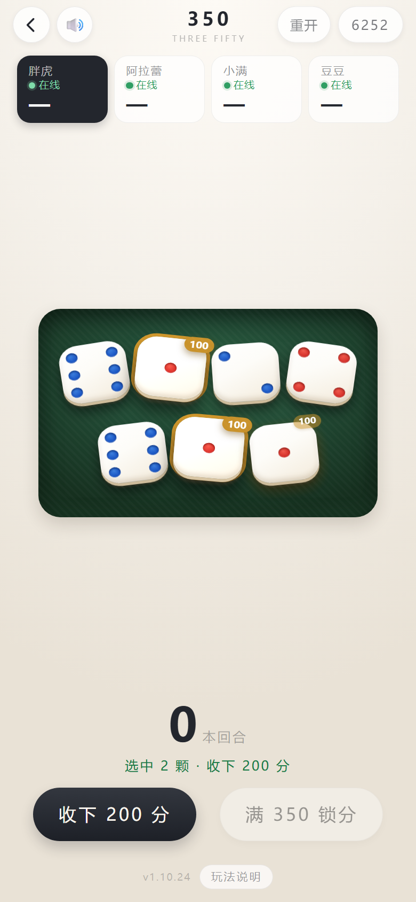
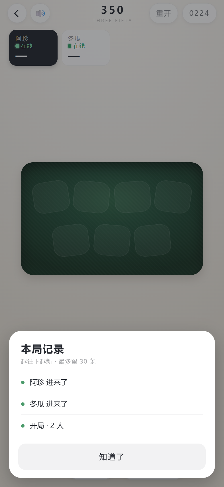
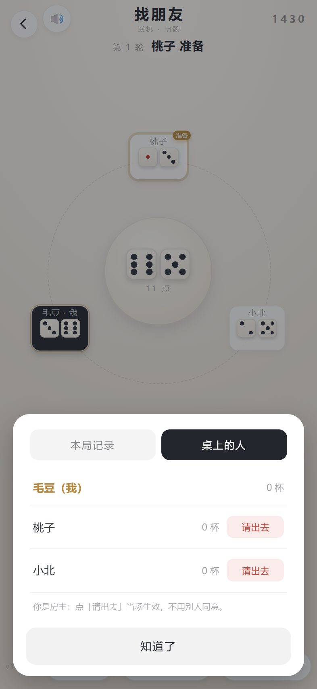
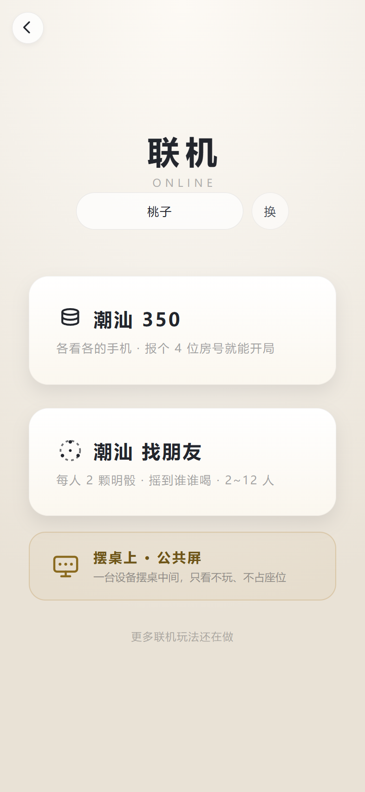
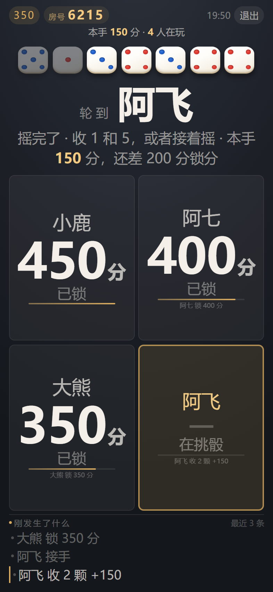
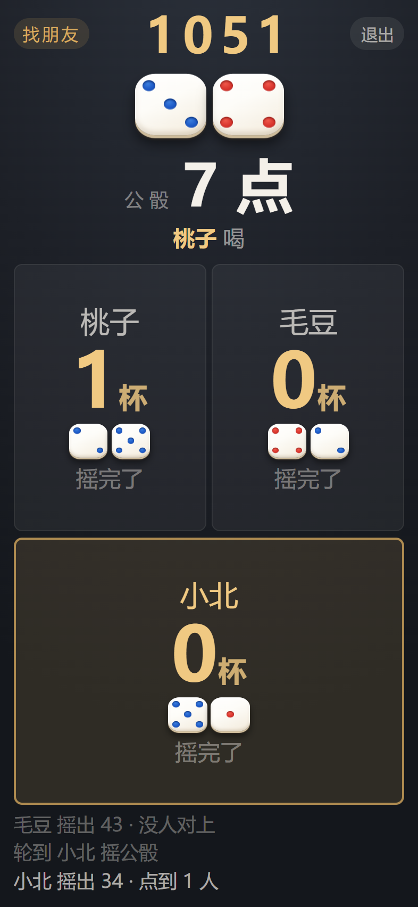
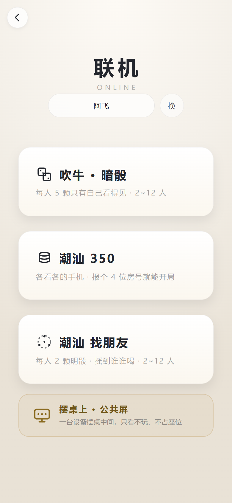
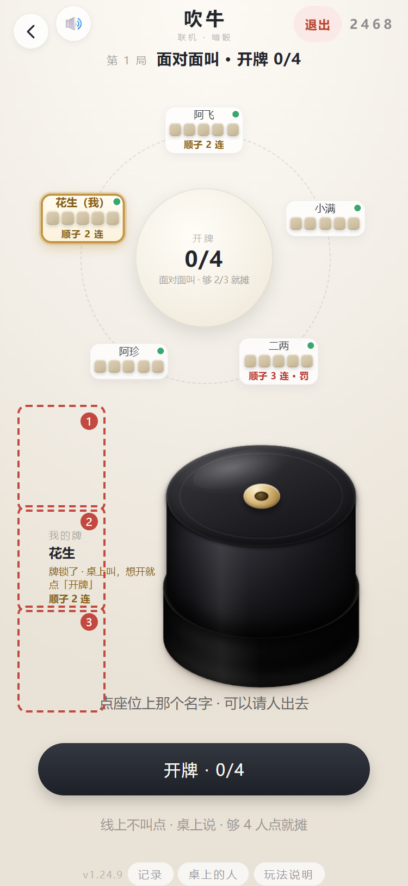

# 吹牛骰子 · 安卓 App

> [!CAUTION]
> **仅供个人娱乐 · 禁止任何违法用途**
>
> 朋友聚会时用的小玩具，**严禁用于赌博、变相赌博、抽头渔利、开设赌场、诈骗欺瞒取财等任何违法违规用途**。
> 完整版含「一键豹子 / 顺子 / 改点」等辅助功能，**仅限朋友之间的玩笑**，不得用于任何涉及真实利益的场合。
>
> 本项目按 **AS IS（「现状」）** 提供，不附带任何担保。因下载、安装、使用本项目（**含二次开发、二次分发的版本**）
> 而产生的一切后果**由使用者自行承担**，作者不承担任何责任。二次开发、修改后分发，请**注明出处**并**保留本声明**。
>
> 原仓库：https://github.com/cbywyz/liars-dice-apk · 完整条款 → [docs/terms.md](docs/terms.md)

1 个骰盅 + 5 颗骰子（2~10 可调）的聚会小工具：**单机三个玩法、联机三个玩法**，首页选模式，进去就开打。

## 六个玩法

### 单机 · 一台手机，大家轮着玩

**完全离线**：没有后端、没有网络请求、没有登录、没有充值，飞行模式也能摇。

- **吹牛骰子** — 摇一摇 → 盖子合着 → 掀盖看点数（可停半开）→ 锁定；骰子 2~10 颗可调
- **潮汕 350** — 不要盖子，明骰直接摇。1 点 100、5 点 50，满 350 才能收手，封顶 700
- **潮汕 找朋友** — 每人的 2 颗明骰一直摊在桌上，中间 2 颗公骰点到谁谁喝

罚酒规矩写在 App 里：**爆掉自己喝 1 杯、出豹子其他人喝、整局最低的喝 2 杯**；找朋友那边是**被公骰点到就喝、一模一样双倍**。

### 联机 · 各看各的手机

**不用连同一个 WiFi，也不用指定谁当主机**：报一个 4 位房号就坐下，2~12 人。只有这三种玩法要联网，不点联机一个请求都不会发。

- **吹牛骰子** — 每人 5 颗只有自己看得见：摇完自己就锁 → 面对面叫点 → 2/3 点「开牌」摊开核对 → 2/3 点「下一把」
- **潮汕 350** — 明骰，桌上七颗大家看同一副；轮到你点哪颗拿哪颗，满 350 才能收
- **潮汕 找朋友** — 每人 2 颗明骰摊开，中间公骰点到谁谁喝，一模一样双倍

三个联机玩法共用同一套牌桌功能：

- **本局记录** — 页脚「记录」，最多 30 条：谁进房、谁摇出几点、公骰撞到谁、谁喝了一杯
- **桌上的人** — 名字、杯数、掉线标记。**请人出去**：掉线的谁都能请；在线的房主一点就走，
  其他人**发起投票**（在线的 2/3 同意，45 秒作废，投过再点一下是撤回）
- **重开一桌** — 同样要在线的 2/3 点头，不再由房主一人说了算
- **退出这一桌** — 随时能走；座位和那一手留着，凭房号 + 本机记号回来还是原位

  
  
  
  

  报房号坐下 → 牌桌 → 本局记录 → 桌上的人

### 摆桌上 · 公共屏

面对面坐着打，还可以再摆一块屏：找台旧手机或 pad 搁在桌子中间，输一次房号，
房号、轮到谁、各家几杯、刚发生什么就全在那块屏上，隔着一张桌子也看得清。

它**只看不玩** —— 摇骰、看牌还在各自手机上，大屏上一个能点的东西都没有，也不占座位
（4 个人重开还是 3 票，不会因为多一块屏变成 4 票）。

  
  
  

  入口 → 350 打到一半 → 找朋友（公骰 + 各家那两颗）

## 打开先选模式

  
  
  

  首页选模式 → 单机三个玩法 / 联机三个玩法 → 再进牌桌

二级页面（选玩法 / 吹牛 / 350 / 找朋友）**左上角都有一个「←」箭头**，安卓的返回键、侧滑手势也一样能一层一层退。

## 两个版本，装哪个都行，可以同时装

只有三处不同，包名不同所以**互不覆盖、可以同装在一台手机上**：

- **图标** — 完整版骰子 4 点（红）· 纯净版骰子 6 点（蓝）
- **包名** — `com.cbywyz.liarsdice` · `com.cbywyz.liarsdice.clean`
- **功能** — 都是六个玩法；完整版另有一组隐藏的豹子 / 顺子 / 改点，纯净版**没有**

**两版的联机能进同一个房间**（`net.js` 是同一个文件）；要防着谁偷偷改点数，就让全桌都装纯净版。

  

## 怎么装

- **网页版（推荐）** — 跑在我自己的一台服务器上，**地址不写在这儿**（不打算公开）。拿到链接后手机浏览器打开即可：
  iPhone 用 Safari「分享 → 添加到主屏幕」，安卓在菜单里选「安装应用」；加完图标、名字、启动画面跟 APK 一样，
  打开全屏无地址栏，**更新还不用重装**
- **纯净版网页** — 同一个地址下的 `/clean/`
- **APK** — 本仓库 **Releases** 里两个包：`liars-dice-<版本>.apk`（完整版）、`liars-dice-clean-<版本>.apk`（纯净版）。
  传到安卓手机上点开，首次安装允许「未知来源」即可；签名证书固定（`keystore/`），后续版本直接覆盖安装，不用卸载

> [!NOTE]
> **Release 里的 APK 停在 `1.10.21`**，比网页版旧：那一版没有联机，隐藏功能的入口也还是老办法。
> 想玩最新的、包括联机，直接用网页版 —— 加到桌面之后用起来跟 APK 没区别。

## 最近更新

**当前版本 `v1.24.13`**（每个页面页脚都能看到）。完整历史、每版配图 → [更新说明](docs/changelog.md)；
网页版刷新一下就是最新，不用重装。

- **v1.24.13** 骰盅盖子从「整块向上拉升」改成**绕盖沿向后翻开**，而且**从头到尾都能停**：
  以前拖过 85% 会被自动补到全开，现在 90%、98% 也照样定格在手指离开那一帧。
  点一下开 / 关、半开点骰改点都不变。
- **v1.24.12** 单机 / 联机的**骰盅盖子改成 1:1 跟手**：拖到哪停在哪，任意高度都能定格，
  不再吸附回全开 / 全关，也不补缓动；点一下仍是开 / 关快捷方式。点骰改点在半开时照常可用。
- **v1.24.11** 修掉联机吹牛左上角那颗 🔊：它原来一下点着两个开关、正负抵消，按了没反应；
  现在关掉是真关（声音全停，五颗 🔊 一起变）。
- **v1.24.10** 装填别人之后，被挑中那张卡的**在线绿点改成自己轻轻呼吸**：颜色、位置、大小全不变，
  只有塞牌的人看得出来（下面这张图底部就是它四种状态）；掉线时仍是红。
- **v1.24.4 ~ v1.24.9** 「装填别人」只改随机挑中的那一位，没摇就这一把生效、摇过了顺延到下一把；
  顺子 / 豹子 / 好牌三档 + 三格自定义；摊牌页不再列逐点统计；自己那张卡描金边、放大一号。
- **v1.24.2** 联机吹牛也能**投票踢人**，调试面板跟单机走同一道暗门。

  

  长按顶栏那行字 = 面板；左边竖带是三格；图底部说明「被装填的人那颗绿点会呼吸」（虚线框只是画给你看的，App 里隐形）

想用隐藏功能省几杯——要开车、在吃药、明早还得早起——打开完整版把点数控住就行，不至于扫了整桌的兴。

## 细节都在分页里

| 文档 | 讲什么 |
|---|---|
| [玩法 A · 吹牛骰子](docs/play-liar.md) | 单机：摇 / 掀盖 / 半开 / 锁定；**联机那半篇**：发骰子 → 摇完就锁 → 2/3 开牌 → 2/3 下一把 |
| [玩法 B · 350](docs/play-f350.md) | 计分、不点就不拿、爆掉、豹子、交接、断点续玩，以及**喝多少** |
| [玩法说明与点数概率](docs/rules.md) | App 里那张说明卡片长什么样，豹子 / 爆掉的概率怎么算 |
| [联机 · 潮汕 350](docs/play-net.md) | 开房、房号、掉线回位、踢人、重开投票；公共屏怎么摆 |
| [联机 · 潮汕 找朋友](docs/play-find.md) | 明骰点名怎么走、对上几杯、11 正豹的附加 |
| [隐藏设置（完整版才有）](docs/hidden.md) | **首页连点 7 下开总闸**，长按标题出面板：装填 / 装填别人 / 三格自定义 + 找朋友五格 |
| [网页版 · 离线 · 加到桌面](docs/web.md) | Service Worker 怎么离线、按机型给安装步骤 |
| [结构与发版](docs/build.md) | 目录结构、网页源码在哪、改完怎么发 |
| [更新说明](docs/changelog.md) | 每个版本改了什么，配截图 |
| [完整免责条款](docs/terms.md) | 用途限制、责任免除、二次开发与转载 |

## 免责声明

三条，就三句：**只能朋友之间娱乐**、**不得用于任何非法用途**、**其他功能与本工具无关**。
本项目未上架任何应用商店，签名证书随仓库公开，仅供个人侧载；任何第三方修改、重新打包的版本均**不代表作者**。

**下载、安装或使用即视为你已阅读并同意**完整条款 → [docs/terms.md](docs/terms.md)
