# 吹牛骰子 · 安卓 App

> [!CAUTION]
> **仅供个人娱乐 · 禁止任何违法用途**
>
> 本项目是朋友聚会时用的小玩具，**严禁用于赌博、变相赌博、抽头渔利、开设赌场、诈骗欺瞒取财等任何违法违规用途**。
> 完整版含「一键豹子 / 顺子 / 改点」等辅助功能，**仅限朋友之间的玩笑**，不得用于任何涉及真实利益的场合。
>
> 本项目按 **AS IS（「现状」）** 提供，不附带任何担保。因下载、安装、使用本项目（**含二次开发、二次分发的版本**）
> 而产生的一切后果，**由使用者自行承担，作者不承担任何责任**。
>
> 二次开发、修改后分发，请**注明出处**并**保留本声明**。原仓库：https://github.com/cbywyz/liars-dice-apk
>
> 完整条款见 → [免责声明与使用条款](#免责声明与使用条款)

1 个骰盅 + 5 颗骰子（2~10 可调）的聚会小工具。**三层：首页选模式 → 单人里选玩法 → 进去玩**：

- **首页**：单人模式 / 联机模式（**联机目前是占位**，点了只会提示"还在做"）
- **单人模式**：进去是**玩法选择页**，吹牛骰子和 350 各一张卡，上次玩过的会挂个「上次玩的」角标
- **吹牛骰子**：摇一摇 → 盖子合着 → 掀盖看点数（可停半开）→ 锁定，骰子数量 2~10 颗可调
- **350**：不要盖子，明骰直接摇。1 点算 100、5 点算 50，满 350 才能收手，封顶 700，**人数开局后还能改**，
  收下的骰子会一颗颗摆在「本回合」分数上面，和桌上的一样大，桌上剩的还能接着收；退出再进来还是原样。
  罚酒的规矩也写进去了：**爆掉自己喝 1 杯、出豹子其他人喝、整局最低的喝 2 杯**

两个玩法里都有一个**「玩法说明」**按钮，规则写在 App 里，不用每次开局口头讲一遍。

**用在哪**：玩骰子喝酒的酒局。碰上喝不了的时候——要开车、在吃药、身体不舒服、明早还得早起——用完整版把点数控住，少输几杯、把酒挡掉，不至于扫了整桌的兴。

**完全离线**：没有后端、没有网络请求、没有登录、没有充值。APK 里不含 `INTERNET` 权限，飞行模式也能玩；
网页版靠 Service Worker 把整套文件存在本机，**联网打开过一次之后断网也能摇**。

<p align="center">
  
  
  
  
</p>
<p align="center">
  <sub>盖着等摇 → 开盖看点数 → 锁定本局　　（最右是纯净版，界面和完整版完全一样）</sub>
</p>

**另一个玩法 · 350**（不要盖子，明骰直接摇）：

<p align="center">
  
  
  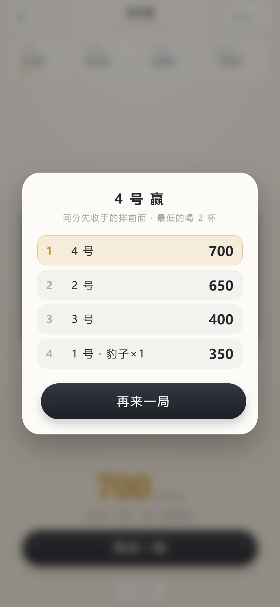
</p>
<p align="center">
  <sub>点要拿的 1 和 5 → 收下的骰子一颗颗摆到分数上面，桌上剩的还能接着收 → 满 350 才能收手，封顶 700</sub>
</p>

## 两个版本，装哪个都行，可以同时装

| | 完整版 | 纯净版 |
|---|---|---|
| 图标 | 骰子 **4 点（红）** | 骰子 **6 点（蓝）** |
| 包名 | `com.cbywyz.liarsdice` | `com.cbywyz.liarsdice.clean` |
| 功能 | 吹牛骰子 + 350 两个玩法，另有隐藏的顺子 / 豹子 / 改点 | 吹牛骰子 + 350 两个玩法，没有隐藏功能 |

两版只有这三处不同。**两个玩法两版都有**；差别只在完整版多那几个隐藏功能。
应用名（都叫「吹牛骰子」）、页面标题、底栏版本号完全相同；包名不同，所以互不覆盖，可以装在同一台手机上。

两版图标的底色和盅身完全一样，只有那颗骰子不同：完整版 4 点、纯净版 6 点，点色沿用 App 里「1、4 是红点，其余蓝点」的规矩。

<p align="center">
  
</p>

两版装在一起时，应用列表里会出现两个同名「吹牛骰子」图标，靠骰子面分辨（4 点红 / 6 点蓝）；要看准确，长按图标进「应用信息」，包名末尾带 `.clean` 的是纯净版。

## 打开先选模式

<p align="center">
  
  
</p>
<p align="center">
  <sub>首页选模式 → 单人里再选玩法</sub>
</p>

- **单人模式**：一台手机，大家轮着玩。点进去是**玩法选择页**，两张卡写清了每个玩法的一句话规则，上次玩过的会挂「上次玩的」角标（只提示，不自动跳进去）
- **联机模式**：**现在不能点，是个占位**。真做的时候主机必须是安卓端（只有 App 能监听端口），其他人用手机浏览器连同一个 WiFi —— 也就是说 iPhone 只能当客户端，做不了主机
- **怎么退**：二级页面（选玩法 / 吹牛 / 350）**左上角都有一个「←」箭头**，点它回上一层；
  底部不再摆返回文字链，那一行留给「玩法说明」。三层各管各的，不在玩法之间横跳。
  **安卓的返回键、侧滑返回手势也一样能一层一层退**（以前单页应用不产生历史记录，侧滑一下就退出 App 了，
  现在每切一层都压一条记录，退到底再按才退出）

## 怎么装

1. 打开本仓库的 **Releases**，最新一版里有两个 APK：
   - `liars-dice-<版本>.apk`　完整版
   - `liars-dice-clean-<版本>.apk`　纯净版
2. 传到安卓手机上点开安装
3. 首次安装会被系统提示「未知来源应用」，允许即可（自签名应用都会这样）

> 签名证书是固定的（`keystore/`），所以后续版本可以直接覆盖安装，不用卸载。

> [!IMPORTANT]
> **下载、安装或使用即视为你同意本文末尾的[免责声明与使用条款](#免责声明与使用条款)**：
> 仅供个人娱乐，禁止赌博、诈骗等任何违法用途，使用后果由你自己承担。

## 结构

```
app/src/main/java/com/cbywyz/liarsdice/MainActivity.java   一个 WebView 壳（两版共用）
app/src/full/assets/www/                                    完整版的界面与逻辑
app/src/clean/assets/www/                                   纯净版的界面与逻辑
app/src/full/res/mipmap-*/ic_launcher.png                   完整版图标（骰子 4 点）
app/src/clean/res/mipmap-*/ic_launcher.png                  纯净版图标（骰子 6 点）
app/src/main/res/values/styles.xml                          主题
docs/shots/                                                 README 里的截图
LICENSE                                                    许可条款（摘要，全文见本文末）
.github/workflows/build.yml                                 GitHub Actions 云端编译
```

界面是用网页写的，壳只负责全屏加载 `assets/www/index.html`。同一份代码：
- 打成 APK 给安卓装
- 用手机浏览器打开、或 Safari「添加到主屏幕」，iPhone 也能玩

### 网页源码在哪

APK 里的 `assets/www` 是从仓库外的两个源码目录同步来的（`liars-dice-h5` / `liars-dice-h5-clean`），
纯净版由 `make_clean_h5.py` 从完整版自动裁剪生成 —— 改了完整版，跑一遍脚本纯净版就跟着更新。

## 玩法 A · 吹牛骰子（默认）

| 操作 | 效果 |
| --- | --- |
| 摇一摇 | 骰盅抖动 1.6s + 音效（只有这一步出声），点数此时生成，盖子保持合着 |
| 开盖 | 盖子整块垂直抬起，露出骰子 |
| 上滑骰盅 | 跟手掀盖，松手停在哪就是哪，可以半开当挡板 |
| 合上 | 盖子盖回去，点数不丢，可反复开合 |
| 锁定 | 本局定板：不能再摇，盅口亮金边 + 金色「已锁定」；盖子仍可开合 |
| 解锁 / 再来一局 | 解锁继续，或开新局（上一把点数还留着，点「开盖」能翻出来） |

骰子配色按传统：**1 点、4 点是红点**，其余蓝点，1 点单独放大。

底栏有「玩法说明」和「换玩法」两个入口：前者是这一份规则的口头版，后者退回玩法选择页。

### 骰子数量 2~10 颗

<p align="center">
  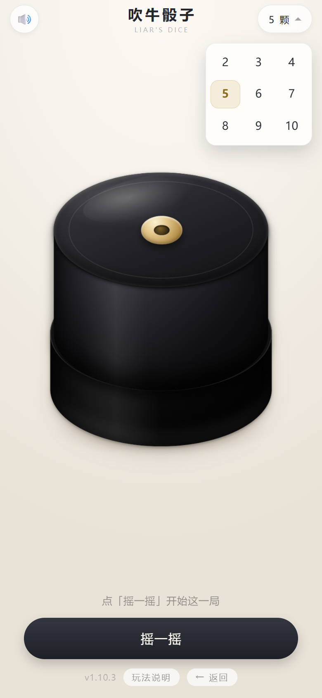
</p>

点顶部右侧的「5 颗」，**按钮下面原地展开 2~10 共 9 档**（3×3 排好，不用再弹一整屏的框）。
选完立刻生效，骰子按新数量重新摆位；已经摇过的那把会清掉，提示「已改成 N 颗 · 点『摇一摇』开始」。
数量记在本地，下次打开还是上次选的。

每个数量的骰子边长和间距是**单独算的**，不是把一套尺寸等比缩放：
2 颗摆成一行，7~8 颗摆成 4+4，9~10 颗摆成 5+5。骰子带 9° 倾斜，算可用面积时按旋转后的包围盒扣，
所以角不会戳出桌面，10 颗也不会挤成一坨。

## 玩法 B · 350

**不要盖子，明骰直接摇。** 开局先选人数（**4~12 人**），然后轮流来。

| 规则 | 说明 |
| --- | --- |
| 骰子 | 固定 **7 颗** |
| 计分 | **1 点 = 100 分，5 点 = 50 分**；2 / 3 / 4 / 6 不计分 |
| 一轮怎么走 | 摇完**自己点**要拿走的 1 和 5 —— 点过的才算拿走，没点的留在桌上继续摇，**拿走的不会补**。**7 颗全收光这一回合就结束**：没骰子可摇，直接锁分换下一位 |
| 爆掉 | 一把里**一个 1 也没有、一个 5 也没有**（且不是豹子）→ 本回合分清零，**等你按「清零重摇」**才拿回 7 颗继续。不换人，也不自动清屏。**摇的人喝 1 杯；但如果这一把是 7 颗全摇，要喝双倍 2 杯** |
| 收手 | **满 350 分才能锁**，锁了就轮到下一位 |
| 换人 | 锁完**不立刻**轮到下一家摇：桌面盖住、写着「轮到 X 号」，**他自己点「我来了」**才开摇 —— 手机在桌上传来传去也不会误点 |
| 封顶 | **700 分**，到顶自动锁，不用手动点 |
| 豹子 | 7 颗**清一色**（点数全一样，**1~6 都算**）→ 记 1 次豹子，**骰子停在桌上给选择**。**1 或 5 的豹子**两个出口：①「**收下 N 分**」= 这一把的 1 和 5 全算分（7 颗最少 350、最多 700），收完直接锁分换下一位；②「**清零重摇**」= 分数归零、拿回 7 颗，还是他摇。**2 / 3 / 4 / 6 的豹子一分不收**（这几个点数本来就不计分），只剩「**接着摇**」：分数原样留着、拿回 7 颗继续。**摇的人不喝，台上其他人每人 2 杯** |
| 胜负 | 比锁定的最终分数，高者胜；**同分时先收手的排前面**，**分数最低的喝 2 杯** |

<p align="center">
  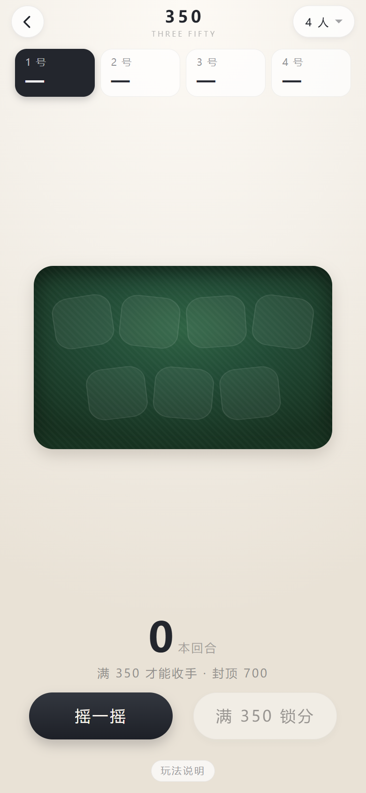
  
  
</p>
<p align="center">
  <sub>开局 7 颗空位 → 点要拿走的 1 和 5（不点就不拿）→ 四人结算排名</sub>
</p>

### 输赢 · 喝多少

350 在桌上本来就是罚酒的玩法。App 只算分，杯数照老规矩来：

| 什么时候 | 谁喝 | 喝多少 |
| --- | --- | --- |
| **爆掉** —— 一把里一个 1 一个 5 都没有（且不是豹子） | 摇的人自己，躲不掉 | **1 杯** |
| **7 颗全摇还爆掉** —— 这一把桌上满 7 颗、一个都没收 | 摇的人自己 | **双倍 · 2 杯** |
| **豹子** —— 7 颗清一色，1~6 都算 | 台上其他所有人 | 每人 **2 杯** |
| **整局打完** —— 分数最低的那个 | 最后一名 | **2 杯** |

爆掉那条的「双倍」是冲着**满手一把就空**去的：7 颗全摇、一个 1 一个 5 都没出，等于这一把白摇，
桌上通常当加倍罚。已经收走几颗、剩 5 颗 6 颗再爆，就只算一杯。

**豹子一条线，六种点数都算。** 以前只认 1 和 5 的清一色（`1111111` / `5555555`），
理由是不想让人白捡；后来发现反了 —— 2/3/4/6 这几个点数**收不走**，只可能出现在「一把摇出 7 颗」
那一下，概率比 1/5 的豹子还低（`6/6⁷ = 1/46656`，四万七千把一回），以前却掉进「爆掉」里白喝一杯。
现在它按豹子算：自己不喝，一桌人端杯，只是**一分不收**（这几个点数本来就不计分），
所以弹窗里没有「收下」，只有一个「**不收了 · 接着摇**」—— 分留着，拿回 7 颗继续。

豹子这一条的关键是**摇的人不喝**：一桌人端杯，他自己只拿牌。

至于**要不要这一把的分**，App 把选择权交回桌上：1 和 5 的豹子，认账就「收下 N 分」锁分走人
（全桌喝照旧），不认就「清零重摇」继续搏 —— 这一手的分数在 350~700 之间，收不收都不亏，看谁敢赌下一把。

**摇出豹子会直接弹一个选择框**，点了才继续（1/5 的豹子两条路，2/3/4/6 的只有「接着摇」）：

<p align="center">
  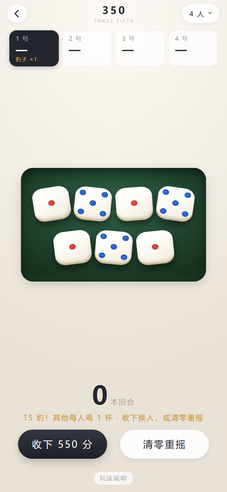
</p>
<p align="center">
  <sub>弹窗里写着这一把值多少分、是什么豹子，<b>还把这一手 7 颗摆出来</b>（桌面被挡住了，不用歪头从缝里看）—— 点空白处关不掉，必须选一个</sub>
</p>

以前只在底栏换两个按钮，摇完盯着桌上数骰子的人根本不会往下看，回过神来就以为「摇出豹子没得选」。
弹窗里把这一把的分数放大到整个卡最大的一行，隔着桌子也看得见；底栏那两个同名按钮还在，
两边走的是同一份代码，不会出现「底栏收下 550、弹窗收下别的数」这种两张皮。

**两种来路，一个出口**：① 一把摇出 7 颗清一色（六种点数都算）；② 这一回合一颗颗把 7 颗**全收下来**。
后者只可能是 1 和 5 —— 7 颗往往分两三次摇完，收满第 7 颗的那一刻以前会直接把回合翻篇
（分数进本回合、骰子变回 7 个空位），豹子判定压根没跑，所以总有人反馈「我明明收齐了一手 1，
为什么不弹」。现在两种都先弹选择框，点「收下」才锁分换人；整轮收齐的那种会在副标题里多标一句
「整轮 7 颗收齐」。混着 1 和 5 的七颗（比如 `1115555`）**不算豹子** —— 一回合收满必然是这形状，
要是也算，桌桌都在喝；它只是普通的一手大牌，照常点着收分。

所以打到中后段会有人专门去**拼豹子** —— 反正手气不好、分也追不上，干脆搏一把全桌陪你喝。
这也是 350 比闷头算分好玩的地方：桌上多了一个「要不要赌一把」的选择。

**豹子和爆掉都不自动翻篇**：摇出来那一刻骰子就停在桌上，等玩家自己选，
谁看够了谁按 —— 一桌人得先看清是哪种豹子、该几个人端杯，再继续。

杯数是**默认值**，开局前按自己的量说好，能加能减；喝不了酒的喝水、喝饮料一样算数。
App 不记谁喝了多少，也记不了 —— 桌上说好的规矩比 App 重要。

### 人数开局后还能改

<p align="center">
  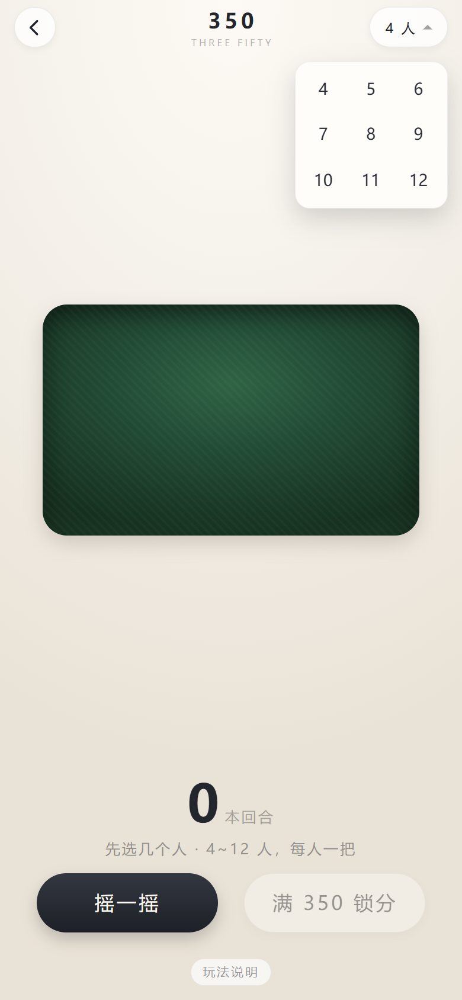
  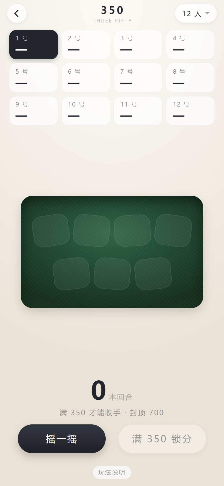
</p>
<p align="center">
  <sub>右上角两个按钮：「重开」（点两下才清分）和「N 人」（原地展开 4~12）→ 12 人排成 3 行，一屏全看得见</sub>
</p>

顶栏右上角那个「**N 人**」就是入口。**点一下就在按钮下面原地展开 4~12 共 9 档，选哪个当场生效**，
不用再找一个「开始」按钮确认：

- 换了人数 → **重开一局**，分数全部清零、回到 1 号，提示「已改成 N 人 · 重新开局」
- 人数没变 → 只收起下拉，**局不动**（点开看一眼不至于把分丢了）
- 点面板外面的空白处也能收起，收起不等于改人数
- 人数记在本地，下次打开还是上次选的；第一次进来下拉会自动摊开，先选人再摇

**一桌最多 12 个人，一屏全看得见**：顶部的记分条是**一排 4 个、多了往下折行**的栅格，
12 人正好 3 行（1–4 / 5–8 / 9–12），不用左右划去找几号。人少的时候就是一行 4 个，
卡片宽度不变，换人数不会让布局跳来跳去。

### 爆掉了不会自动清屏

<p align="center">
  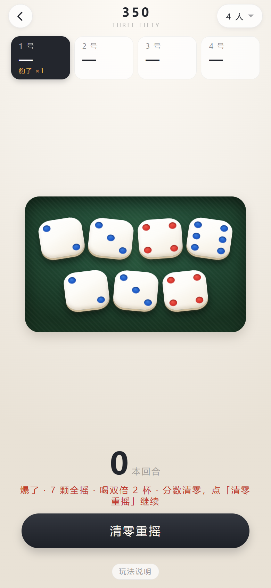
</p>

摇出来**一个 1 和一个 5 都没有**的时候，本回合的分数清零 —— 但桌上的 7 颗骰子**不会自己消失**。
提示也把话说全了，还分了档：「**爆了 · 喝 1 杯 · 分数清零**」；如果是 **7 颗全摇**爆的，
直接写「**爆了 · 7 颗全摇 · 喝双倍 2 杯**」。省得新上桌的人还要问一句「这个要不要喝、喝几杯」。

以前这里是 1.6 秒后自动拿回 7 颗，看着利索，实际一桌人经常还没看清点数就没了，
只能听别人说「你去拿 7 颗」。现在改成：结果停在桌上，按钮只剩一个「**清零重摇**」，
**谁看够了谁按**，没按之前画面一直不动。按了才拿回 7 颗、还是同一个人继续摇。

顺带解释一下为什么爆掉时旁边那个「锁分」按钮也一起收起来了：本回合分数已经是 0，
锁无可锁，留个灰按钮在旁边只会让人以为还能点。

### 豹子也停在桌上，收不收你说了算

<p align="center">
  
</p>

豹子以前是**替玩家做决定**的：要么瞬间翻篇（骰子变回 7 个空位、分数归零，一桌人还没数清就没了），
要么一律清零 —— 明明摇出全桌最大的一手，分却不算数。

现在豹子跟爆掉一样**停在桌上**，1 和 5 的豹子多给一个选择：

- **收下 N 分**：这一把的 1 和 5 全算分，7 颗最少 350、最多 700（到顶按 700 封），
  收完直接锁分、换下一位。**喝酒照旧** —— 豹子该谁喝还是谁喝，跟收不收分无关
- **清零重摇**：分数归零、拿回 7 颗，**还是同一个人摇**，接着搏

2 / 3 / 4 / 6 的豹子一分不收，弹窗里主按钮直接是「**不收了 · 接着摇**」：
分数原样留着、拿回 7 颗、人也不换 —— 它换不来分，但全桌照样端杯。

<p align="center">
  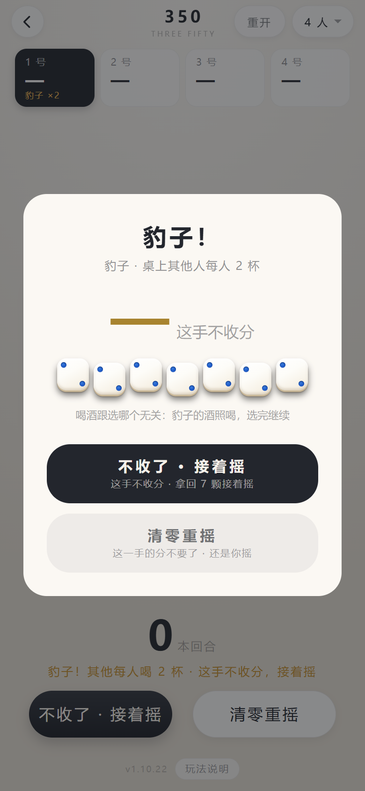
</p>
<p align="center">
  <sub>七个 2 也是豹子：不涨分、不换人，但一桌人得端杯 —— 以前这一手掉进「爆掉」，还得自己喝一杯</sub>
</p>

按哪个由桌上定：分够了想稳一手就收，落后想翻盘就清。App 只把两条路摆在按钮上。

- 一个都不按就退出 App，回来还是这一步：骰子、提示、豹子标记、两个按钮都在
- 提示用金字写明「**豹子！其他每人喝 2 杯**」，玩家卡上同时记下「豹子 ×1」
- 这一步不改任何判定 —— 记豹子、清零、喝几杯，都和以前一样，只是把「收不收」和「看多久」还给玩家

### 「不点就不拿」是什么意思

这是 350 最不一样的地方，也是先想清楚才写得对的一条：

计分的骰子（1 和 5）**不会自动收走**。摇完它们只是亮一下、角上标个分数，**你点哪颗才算拿走哪颗**。

为什么要这样？因为拿走一颗就少一颗骰子，桌上**不会补**。7 颗变 6 颗，下一把摇出 100 分的机会就少一份。
所以有时候**宁可不要那 50 分**，把 5 留在桌上凑数量、继续搏 1 点。拿不拿，自己权衡。

点错了再点一次就取消（**要隔开一下**，见下条）。按钮上的分数实时跟着变（「收下 150 分」），
一颗没选时按钮是灰的、点不动 —— 这样不会出现「手滑点了收分、分被拿走还没反应过来」。

**连点两下同一颗 = 直接收下**，省掉「点骰子再用另一只手按钮」的两步。收的是当前选中的全部骰子，
所以想只收一颗就别先点别的。两次点击超过 320 毫秒就是两次独立点击，第二次照常是取消选中。

**收了一颗，还能接着收**：双击拿走一颗 1 之后，桌上剩下的 5 照样亮着、照样能点、能双击 ——
这一把摇出来的 1 和 5 可以一颗一颗收干净，不用为了收第二颗再摇一次（摇一次点数就全变了）。
一颗都没选的时候，主按钮自己变成「**摇剩下 N 颗**」，不想收了直接摇；点了骰子又变回「收下 N 分」。

> 这条是 2026-11-09 修的一个手感问题。以前收完一颗，相位立刻切到「等他摇」，
> 剩下的骰子看着还带着金边和 50 的角标，其实已经点不动了 —— 双击的习惯一上来就会撞上，
> 白白丢掉已经摇出来的点数。

**7 颗全收光，这一回合就到头了**：桌上没骰子可摇，所以收满第 7 颗的时候直接**替你锁分、换下一位**
（收满 7 颗最少也是 7 个 5 = 350 分，本来就够锁）。锁完提示一行「某某 · 7 颗全收完，锁 450 分」。

> 这是 2026-11-10 修的一个漏洞（用户截图撞见）：以前收光 7 颗会「拿回 7 颗接着摇」——
> 骰子都收进兜里了，又从哪儿摸出 7 颗？等于凭空补一袋，收光再摇、摇光再收，分数能一路往上刷。
> 真实玩法里 7 颗收完这一把就结束，没有补骰子这回事。

三种状态在视觉上是分开的：**能计分的**有暖光和半透明分数角标，**已经点了的**加实心金边、
整体抬起并提亮，**还没摇的**只是一个淡色空位。

摇骰子有声音（复用吹牛那颗 `shake.mp3`），不用看着屏幕也知道摇了。

### 收下的骰子摆在桌子和分数之间

<p align="center">
  
</p>

收分的时候那些 1 和 5 从桌上消失，只剩下一个往上跳的数字。一回合打完，
谁也说不清这五百分是摇了几把、收了几个 1 几个 5 凑出来的。

现在每收一颗，**桌面和分数之间那块空当里就多一颗骰子**，按收的先后从左往右排开：

- **和桌上的骰子一样大**（都是 16vw 上下，393 宽的屏上约 63px）：那颗 1 是从桌上拿走的，
  落到这里还是原来那么大，一眼就能对上号
- 摆不下就按可用高度自动算：先试「排成一行」，再试「均分两行」，两种都算一遍取骰子更大的那个，
  所以 7 颗时是一行 4 颗 + 一行 3 颗，14 颗时也能塞进来，**不会压到桌上，也不会压到分数**
- 屏幕特别矮（比如 375×667 的老机型）会整体缩一点，但最少也有 6vw，看不清就失去了意义
- 只管本回合：换人、爆掉、豹子、重开，都跟着分数一起清掉
- 新收的那颗有个轻轻落下的小动画，一眼看出刚才是哪一颗进的分

分数和骰子是两张对得上的账：下面那行数字就是上面这排骰子加出来的，
点「收下 150 分」的时候，分数涨 150，上面也正好多出对应的骰子。

### 换人的时候，桌子先盖一下

<p align="center">
  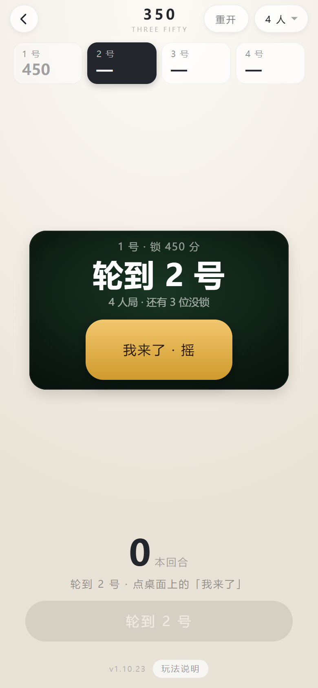
</p>

以前锁完分，底栏**立刻**就是「摇一摇」，下一家的名字只在记分条上换个高亮 ——
可手机这时候还在桌上传递：上一位手还没挪开、下一位已经伸手过来，
随便碰一下就把这一回合的 7 颗摇了。骰子白摇是小事，人以为是自己的回合就开摇，
**顺序一乱，后面全跟着乱**。

现在换人是单独一步：桌面盖住，大字写着「**轮到 2 号**」，上面一行小字交代
「1 号 · 锁 450 分」，底栏那颗「摇一摇」换成灰的「轮到 2 号」点不动。
他自己点一下金色的「**我来了 · 摇**」，桌子才揭开、底栏才换回「摇一摇」。

- 盖层只在**换人**时出现。开局第一把不盖：刚选完人数，手机就在先手那个人手上
- **爆掉、清零重摇不盖**：那还是同一个人在摇，没有交接
- 最后一位锁完直接出排名，不再多一次点击
- 交接这一步也存着：这时候退出 App，回来还是「等他接手」，不会白送一个可以摇的回合

> 2026-11-10 用户提的：「换人的时候是不是需要有一个交接画面呢，
> 不然如果有人不小心又点了下一家的摇一摇，这不坏了顺序」。

### 打一半退出去了，回来接着打

<p align="center">
  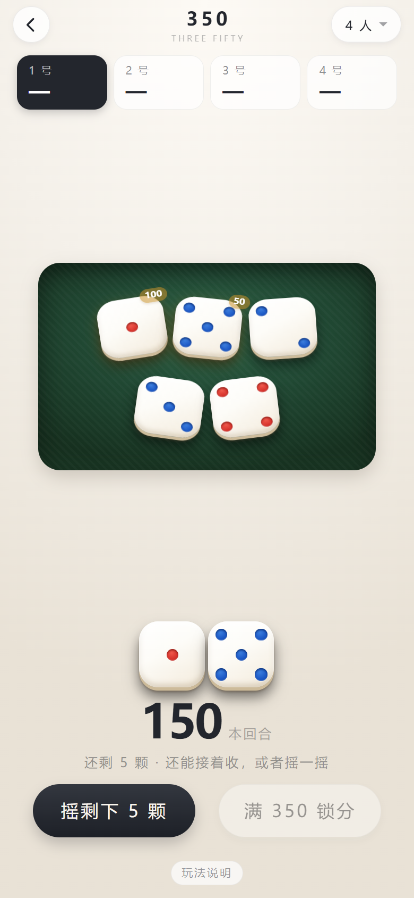
</p>

以前这里有个坑：玩到一半退出 App，再进来是「**本回合 200 分 + 桌上 7 个骰子**」——
分数还在，骰子却是新摆的，看着像重新开了一局，也不知道这 200 分算不算数；
想干脆重开一局，翻遍页面又找不到按钮。

现在**手牌、已经收下的那排骰子、本回合分数一起存着**，退出前什么样，回来还是什么样：

- 没来得及收的 1 和 5 照样带着角标、照样点得动，接着收就行
- 主按钮跟着上一次的状态走：刚才收过就是「摇剩下 N 颗」，还没收过就是「点骰子收分」
- 旧版本留下的「只有分数、没有骰子」的存档会被认出来，本回合那个分数直接清掉。
  宁可重摇，也不让一个孤零零的数字挂在那儿让人猜
- 真想推倒重来：点右上角的「**重开**」—— 点第一下只把按钮换成「确定重开？」，**3 秒内再点一下**才真清分
  （分数抹掉不可逆，手指在顶栏滑一下不该把一桌人的分清零）

## 玩法说明

<p align="center">
  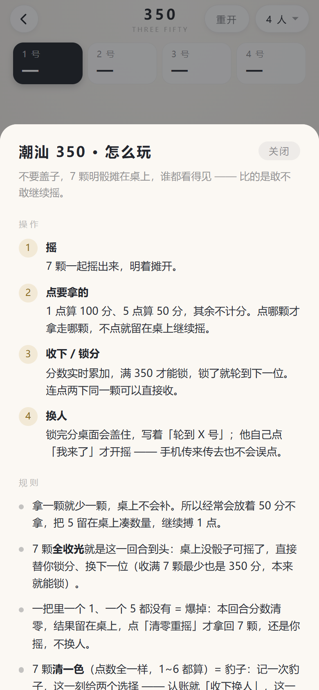
  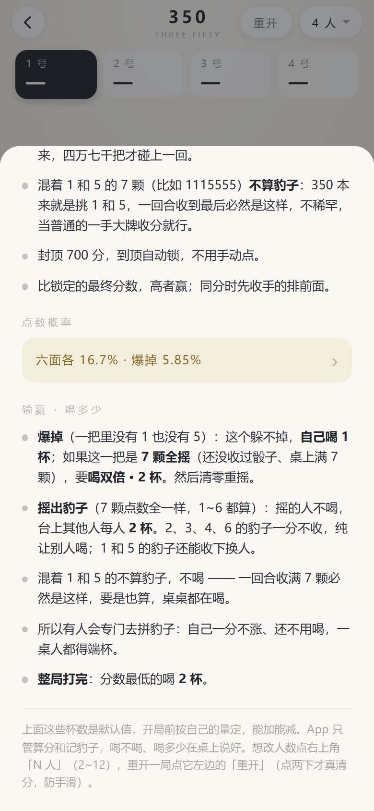
</p>
<p align="center">
  <sub>同一个说明层：上面是操作和规则 → 往下滚是「输赢 · 喝多少」</sub>
</p>

**概率单独一页**：整段数字塞进玩法会把规则拉得很长，所以玩法里只留一行入口
（「六面各 16.7% · 爆掉 5.85%」），点进去单独看，顶上有「‹ 返回玩法」。

<p align="center">
  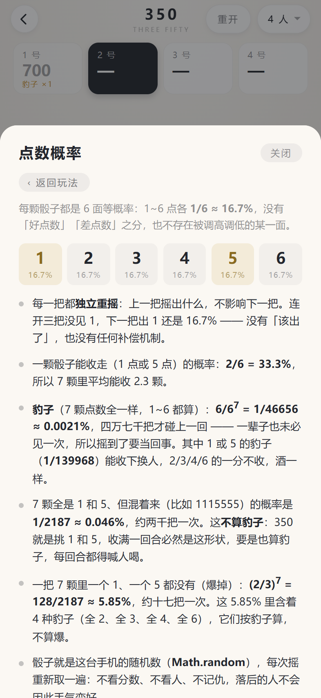
</p>
<p align="center">
  <sub>六个面各 1/6 ≈ 16.7%（六格一样高）；1 颗能收走 33.3%；豹子（1~6 都算）1/46656 ≈ 0.0021%；
  混着的 1/5 是 1/2187 ≈ 0.046%（不算豹子）；爆掉 128/2187 ≈ 5.85% —— 每把独立，没有「该出了」也没有补偿</sub>
</p>

两个玩法页底栏都有「玩法说明」，从底部升起一张卡片：上面是**操作**（分步骤，配序号），
下面是**规则**（计分、爆掉、封顶、胜负怎么算），末尾一句补充说明。

内容按玩法各写各的，讲的是 App 里真的实现了的规则：

- **吹牛骰子**：App 只管摇和盖，所以说明写的是桌上通用的叫点打法 —— 1 点万能、轮流往上叫、
  不信就开、斋了 1 就只是 1。各地讲究不一样的地方，最后一句专门提醒「开打前先说好」
- **350 规则**：完全按代码里的判定写 —— 1 点 100、5 点 50、不点就不拿、一炮无分清零、
  7 颗清一色（**1~6 都算**）记豹子、满 350 才能锁、封顶 700、同分先收手的排前面
- **350 输赢**：多一段「**输赢 · 喝多少**」—— 爆掉自己 1 杯（**7 颗全摇爆掉双倍 2 杯**）、
  豹子其他人各 2 杯、整局最低的 2 杯，并注明杯数只是默认值，开局前按自己的量定；
  规则里也写清了豹子那一步的选择（收下换人 / 清零重摇，2/3/4/6 的豹子只能接着摇）

摇出豹子、摇到爆掉的时候，底部那行提示也把杯数一起说了：**「豹子！其他每人喝 2 杯 · 收下换人，或清零重摇」**、
**「豹子 · 其他每人喝 2 杯 · 这手不收分，接着摇」**、**「爆了 · 喝 1 杯 · 分数清零」**、
**「爆了 · 7 颗全摇 · 喝双倍 2 杯」**；
结算页标题下面写着「同分先收手的排前面 · **最低的喝 2 杯**」。
不用翻说明，当下就知道该谁端杯。

点右上角「关闭」或卡片外面的空白都能收起来；内容超过一屏时可以滚，每次打开都从顶上开始。

## 隐藏设置（完整版才有）

> ⚠️ 这一节的功能是给**酒局上挡酒**用的（见开头「用在哪」），**只能在朋友之间的玩笑里用**。拿它去骗钱、设局、做赌具，都是违法的，后果自负 —— 见文末[免责声明与使用条款](#免责声明与使用条款)。

**长按顶部标题「吹牛骰子」1.2 秒**打开设置面板：一键豹子（1–6）、随机顺子 / 12345 / 23456、
开盖后点骰改点、骰盅下方三格隐形区的总闸、音效。

<p align="center">
  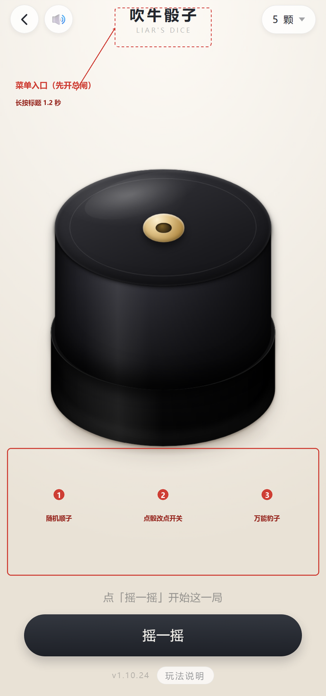
  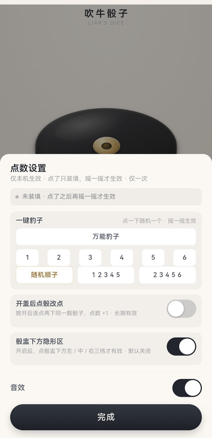
</p>
<p align="center">
  <sub>左：两个「看不见的入口」　　右：长按标题后弹出的面板</sub>
</p>

**两个入口在界面上都没有任何提示**，第一次用建议对着上图找：

| 入口 | 在哪 | 怎么用 |
|---|---|---|
| 设置面板 | 顶部标题「吹牛骰子」 | 长按 **1.2 秒**（按一下只是标题，没反应） |
| 三格隐形区 | 骰盅下方那块空白桌面 | 左 1/3 = 随机顺子，中 1/3 = 点骰改点开关，右 1/3 = 随机万能豹子；单击就生效 |


- **一键豹子 / 顺子**：点了只「装填」，**不会当场改当前这把** —— 摇一摇才出这个点数；
  只要还没开盖，摇多少次都是它；开盖之后装填解除，下一把恢复真随机
- **豹子认定：1 是万能牌** —— 去掉所有 1 之后剩下的全相同即算豹子，所以 `11333`(3的豹子) / `14444`(4) / `11122`(2) / `11111`(1) 都算
- **完全不弹字**：点了就是静默装填，只有握着手机的人感到一下轻震
- **三格隐形区（要先开总闸，默认关闭）**：

  | 位置 | 作用 |
  |---|---|
  | 左 1/3 | 装填**随机顺子** |
  | 中 1/3 | **点骰改点**开关（开＝两下轻震，关＝一下） |
  | 右 1/3 | 装填**随机万能豹子** |

  单击就生效，不用按住；从这块地方往上拖，照旧是掀盖手势。
  三种手感互不混淆：装填＝一下短震、开关打开＝两下、开关关闭＝一下长震。
- **开盖后点骰改点**：长期开关。打开后掀开盖子，连点两下同一颗骰子，点数 +1（6 之后回 1）

## 网页版（两个地址）

| 版本 | 地址 |
|---|---|
| 完整版 | https://cbywyz.github.io/liars-dice-apk/ |
| 纯净版 | https://cbywyz.github.io/liars-dice-apk/clean/ |

### 其实网页版比 APK 省事

同一套代码，网页版加到桌面之后用起来跟 APK 没区别 —— 而且**更新不用重装**：

| | 网页版（加到桌面） | APK |
|---|---|---|
| 图标 / 名字 / 启动画面 | 一样 | 一样 |
| 打开是不是全屏无地址栏 | 是（`display: standalone`） | 是 |
| 断网能不能玩 | **能**（第一次联网打开过之后，整套文件存在本机） | 能（文件就在包里） |
| 发新版怎么更新 | **直接刷新就是最新**，不用重装、不用清缓存 | 得下一次新的 APK 覆盖安装 |
| 发给朋友 | 发个链接就行 | 得传 APK 文件，安卓还会弹「未知来源」 |
| 占多少空间 | 约 200 KB 缓存 | 约 270 KB |
| 首次打开 | 要联网下载一次 | 装完就能用 |

所以**日常推荐直接用网页版加到桌面**。还留着 APK 的理由就两条：
一是想彻底不碰浏览器（有些机型把「添加到桌面」管得很严），二是需要把安装包发给别人、或者在没有网络的环境里装机。

<p align="center">
  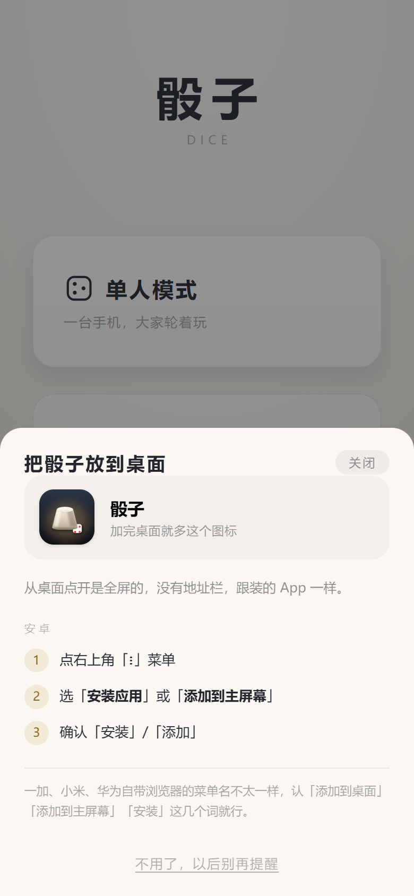
  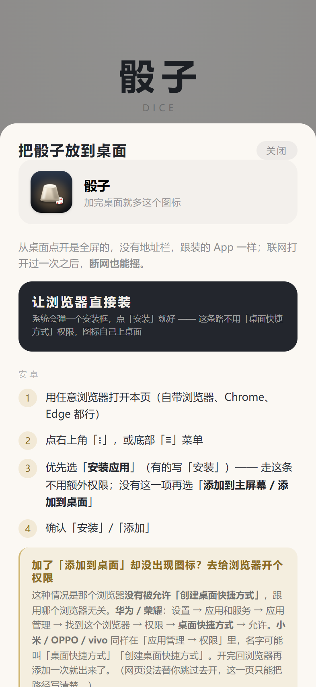
</p>

### 离线是怎么做到的

`sw.js` 是个 Service Worker，**装到桌面后第一次联网打开时**把页面、两个玩法脚本、样式、音效一起存进
`Cache Storage`（约 200 KB）；之后断网打开直接读本机那份。策略是**网络优先**：

- 联网：每次都去拿最新部署 → **刷新即最新**，这条不能被缓存破坏
- 慢网：1.5 秒还没回来就先拿缓存顶上，不让用户对着白屏等
- 断网：直接读缓存，能进 350、能摇、能收分

缓存名里带提交号（`liars-dice:full:<commit>`），每次部署名字都变，浏览器就当成一个新 SW 重新装一遍，
`activate` 里把上一版删掉 —— 不用手动清缓存。完整版和纯净版在同一个域名下共用 `Cache Storage`，
所以缓存名分了 `full` / `clean` 两组，`activate` **只删自己这一组**的旧版，两版都装着也不会互相清掉。

实测（`_real/test_pwa.py`，真断网真刷新）：SW 激活、缓存键不带 query、断网 reload 出画面、
断网进 350 摇出 7 颗、改了文件再刷新拿到新版、两版缓存并存 —— 16 条全过。

| 设备 | 怎么装 |
|---|---|
| iPhone / iPad | Safari 打开链接 → 底部**分享** → **添加到主屏幕** → 桌面出现图标，全屏、无地址栏、断网可玩 |
| 安卓（不想装 APK） | 浏览器打开链接，菜单里选「安装应用」（优先）或「添加到主屏幕」 |
| 电脑 | 直接当网页玩 |

iPhone 不能装 `.apk`，那是系统限制；要做真正的 iOS App 需要 Mac + Xcode + 每年 99 美元开发者账号，不值当。

### 首页就有「把骰子放到桌面」

上面那张表不用记：网页版首页底部自带一条入口，点开按机型给步骤。

- **iPhone / iPad**：讲 Safari 的「分享」按钮在哪，并直说**只能用 Safari** —— iOS 不允许别的浏览器加桌面图标
- **安卓**：讲右上角菜单里的「安装应用 / 添加到主屏幕」，**任意浏览器都行**（自带、Chrome、Edge 一样走）；
  菜单叫法不一样，认这几个词就行。只有「加完桌面没图标」时才需要去开「桌面快捷方式」权限
- **从微信 / QQ 点开的**：先教怎么「在浏览器打开」，内置浏览器里根本没有这一项
- 浏览器能走系统安装框的（Chrome / Edge），这一页最上面会多一颗「让浏览器直接装」，点一下就是系统的安装框

已经是从桌面图标打开的（`display-mode: standalone`），或者点过「不用了，以后别再提醒」，这条就不再出现。
**APK 里也不会出现** —— App 本身就是装好的，再劝人加桌面纯属添乱（`file://` 下直接跳过）。
加完**图标、名字、启动画面都跟 APK 一样**，打开也是全屏无地址栏 —— 网页版和 App 用起来几乎分不出来。

<p align="center">
  
  
  
</p>
<p align="center">
  <sub>首页底部一条入口 → 点开按机型讲步骤，图标先给你看一眼</sub>
</p>

两条实测出来的经验，都写在这一页里了：

- **优先走「安装应用」**（浏览器菜单里那一项）。Chromium 系装的是 WebAPK，**图标由系统自己放到桌面**，
  不碰「创建桌面快捷方式」这个权限。浏览器支持系统安装框时，这一页最上面会多一颗
  「**让浏览器直接装**」，点一下就是系统的安装框
- **「添加到桌面」加完桌面却没图标**，不是浏览器不行，是它**没有被允许「创建桌面快捷方式」**：
  华为 / 荣耀在 设置 → 应用和服务 → 应用管理 → 该浏览器 → 权限 → 桌面快捷方式 → 允许；
  小米 / OPPO / vivo 同样在「应用管理 → 权限」里。**同一个 Edge，授权之后就能加**（实测）
- 网页**没法替你跳进系统设置页**（Android 不允许网页拉起 settings intent），所以这一段只把路径写清楚，
  另外给一颗「复制网址」，方便换浏览器打开

### 第一次打开先弹免责声明

第一次打开会先压一层免责声明，点「我知道了」之后不再自动弹；之后从首页底部那颗
**「免责声明」**随手能再看。点空白处只收起来、不算看过 —— 手滑点掉的那次不该把说明吞掉。

三条，就三句：**只能朋友之间娱乐**、**不得用于任何非法用途**、**其他功能与本工具无关**，
外加一句分数只存在本机。**不提钱、不提酒、不点名隐藏功能、不放仓库链接** ——
这是给桌上朋友看的一句话说明，不是分发协议；弹层只占四成屏，首页的标题和两张卡还看得见。

<p align="center">
  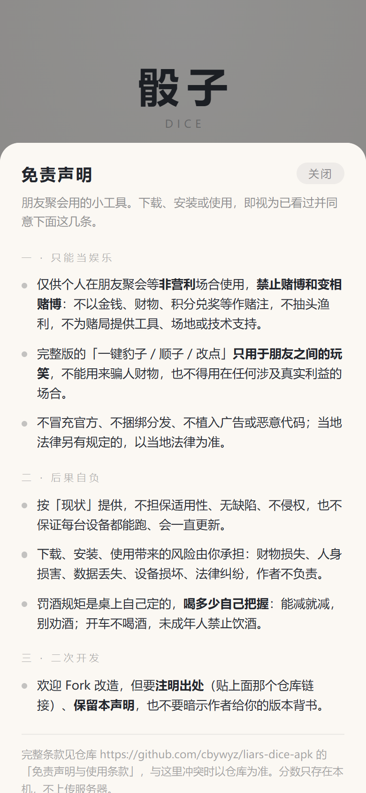
</p>
<p align="center">
  <sub>三条讲完，占四成屏，不挡首页</sub>
</p>

## 改代码 / 发版

界面尺寸全部用 `vw`（1rpx = 100/750vw，和小程序的 rpx 等价），换任何屏幕比例都不变形。

### 2026-11-10 起：只发网页版，APK 不跟着编

网页版加到桌面之后跟 APK 没区别（全屏、无地址栏、断网可玩），更新还是「刷新即最新」，
那每版都编一次几分钟的包没什么意义。所以平时改完直接发网页，APK 停在最后一版等以后再说。

| 想做什么 | 怎么做 |
|---|---|
| 发一版网页（**日常就这个**） | 改完 → push 到 `main`，40 秒左右线上就是新的 |
| 手动重发网页 | Actions → build → Run workflow，**`with_apk` 不要勾** |
| 发新版 APK（以后要发时） | 先按下面把版本号对齐 → Run workflow 时**勾上 `with_apk`** |

`workflow_dispatch` 默认就是「只发网页」，手滑点一下不会把 APK 发出去 ——
要编 APK 必须显式勾 `with_apk`。

### 发 APK 之前要做的两件事

1. **版本号对齐**：`app/build.gradle` 里两个 flavor 的 `versionName` 改成网页版当前的版本号
   （就是 `index.html` 里 `page-ver` 那个），`versionCode` 各 +1。
   网页版会一直往上涨，APK 停在最后一版，不对齐的话 Release 里的包和线上网页号对不上。
   目前网页版 `1.10.24`，APK 停在 `1.10.22`（这两版都只发网页）。
2. **网页副本不用手动管**：`app/src/*/assets/www/` 每次推送时由 `push.py` 自动调
   `sync_www.py` 同步，不会过期。想单独确认就跑一次 `python sync_www.py` 看它打印的文件清单。

> 两套源目录：`liars-dice-h5`（完整版）和 `liars-dice-h5-clean`（纯净版）。
> **纯净版是 `make_clean_h5.py` 从完整版裁出来的**，别直接改它 —— 下次生成就覆盖了。

## 免责声明与使用条款

### 一、用途限制

本项目（含 APK、网页版、全部源码与素材）**仅供个人在朋友聚会等非营利场合娱乐使用**。典型场景是玩骰子喝酒的酒局：喝不了酒的人用它把点数控住，少输几杯、把酒挡掉。

**严禁**将本项目或其衍生版本用于以下任何用途：

- 任何形式的**赌博、变相赌博**，包括但不限于以金钱、财物、虚拟货币、积分兑奖等作为赌注的场合
- **抽头渔利、开设赌场、组织赌博**，或为上述活动提供工具、场地、技术支持
- **诈骗、欺瞒取财**：本项目完整版含「一键豹子 / 顺子 / 改点」等辅助功能，**仅可用于朋友之间的玩笑**，
  不得用于骗取他人财物或在任何涉及真实利益的场合使用
- 冒充官方应用、诱导他人安装、捆绑分发、植入广告或恶意代码
- 任何违反使用者所在地法律法规的用途

若您所在地区对相关玩法的使用有额外限制，请以当地法律为准，并**立即停止使用**。

### 二、责任免除

1. 本项目的代码、安装包与说明文档均按 **AS IS（「现状」）** 提供，不附带任何明示或默示的担保，
   包括但不限于对**适用性、无缺陷、不侵权**的担保。
2. 作者**不保证**本项目在任何设备、任何系统版本上均能正常运行，也不承诺修复缺陷或持续更新。
3. **使用本项目所产生的全部风险与后果，由使用者自行承担。** 在法律允许的最大范围内，
   作者不对因下载、安装、使用或无法使用本项目而导致的任何**直接、间接、偶然、特殊或后果性损失**负责，
   包括但不限于：财物损失、人身损害、名誉损失、数据丢失、设备损坏、法律纠纷、行政处罚。
4. 使用者因违反本条款或当地法律而产生的任何法律责任，**与作者无关**，由使用者独立承担；
   如因此给作者造成损失（包括合理的律师费），使用者应予赔偿。
5. 本项目**未上架任何应用商店**，签名证书随仓库公开，仅供个人侧载。
   任何第三方分发、修改、重新打包的版本均**不代表作者**，作者不对其内容与安全性负责。

### 三、二次开发与转载

欢迎 Fork、学习、改造，但请遵守以下几条：

1. **必须注明出处**，并在显著位置（README、关于页面、应用内说明均可）给出原仓库链接：

   ```
   本项目基于 https://github.com/cbywyz/liars-dice-apk 修改
   ```

2. **必须保留本免责声明**（可整体照搬，也可只保留「仅供个人娱乐、禁止用于赌博等违法用途、
   后果自负」这几条核心内容），不得删除或弱化。
3. **不得暗示原作者为你的衍生版本背书**，不得使用原作者名义发布或推广。
4. 衍生版本若造成不良影响，**由衍生版本的发布者独立承担责任**，与原作者无关。
5. 若你不接受上述任何一条，请**不要使用、复制或修改**本项目的任何代码与素材。

### 四、其他

本项目与任何骰子玩法、桌游、酒令的商标或版权持有方**均无关联**，也未获得其授权或背书。
若权利人认为本项目存在侵权，请通过 Issue 联系，作者将及时处理。

条款摘要同时写在仓库根目录的 [`LICENSE`](LICENSE) 里；摘要与本节内容冲突时，**以本节为准**。

---

**下载、安装或使用本项目，即视为您已阅读、理解并同意上述全部条款。**
