# 更新说明

[← 回首页](../README.md)

> 网页版**改完就是最新**：刷新一下就是新版，不用重装、不用重新加桌面图标。
> 仓库 [Releases](https://github.com/cbywyz/liars-dice-apk/releases) 里的是安卓包，发得比网页版慢。
> 版本号在首页页脚、每个玩法页底栏都能看到。

## v1.24.28 · 2026-11-14

这一版把「休息」补到另外两家、给三家都装上离开计时器，顺手修掉全员离席会把房间卡死的毛病。

  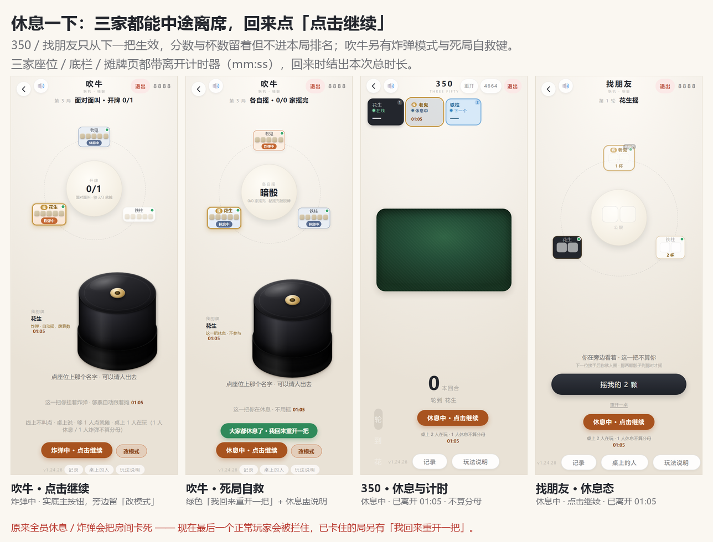

### 联机 350 / 找朋友：也能「休息」了

吹牛先有的那套「人不在、座位留着」补到另外两家，规矩按最合理的来，不需要炸弹：

- **只从下一把生效**：本把照常打完，下一局重开（350）/ 换人（找朋友）才套上去；
  点「继续」同样只从下一把恢复。服务端用 `away`(跨局意愿) / `roundAway`(本把快照) 两层，
  本把的队列、分母、命中、杯数一概不动。
- **分数 / 杯数保留，但不进本局排名**：350 休息的人不排进结算榜（否则 0 分白背一口锅），
  也不占出手序号；找朋友的杯子原样留着，但这一把不会被点到、不算「还没摇」。
- **2 人桌有人休息就停住等他回来**，不洗出只有一个人的局。
- **找朋友轮到休息的人当庄会自动跳过**：前端「准备 / 我来接手」和服务端换人是同一套口径，
  不会点了又被拒。
- 重开 / 踢人投票的分母只数这一把在点按钮的人，不会被休息的座位把整桌锁死。

状态照样要看得见：座位卡整张换底色、状态行写「休息中 / 下把休息 / 下把回来」，
底栏写清「桌上几人在玩 · 几人休息不算分母」，桌上的人写完整一句。

### 三家通用：离开计时器

点下「休息 / 炸弹」那一刻由服务端记起点（权威时钟，不受各台手机时间差影响），
每次广播带一个到此刻的时长；前端用本机时钟接着往下走秒，每秒只改那几个小字、
不重画整页（免得骰子入场动画重播）。座位卡 / 底栏 / 摊牌大表 / 桌上的人都能看到
`mm:ss`，超过一小时自动写成 `h:mm:ss`；回来时结出一句「本次离开 05:23」。

### 吹牛：摊牌页标「豹子」

正豹、全 1、带 1 的万能豹都挂一枚**深紫**的「豹子」牌，顺子仍是金色，一眼分得开。
判定写成公共函数放在裁剪锚点之前，纯净版一样有。

### 吹牛：挂起态按钮与死局修复

- 底栏那句「炸弹中 · 点这里改」太含蓄 —— 换成**实底大按钮「点击继续」**，点一下直接恢复；
  旁边留一颗小的「改模式」，想从休息换成炸弹仍可一步到位（浮层三颗选项都摆出来）。
- **修掉真会卡死的毛病**：全场都休息 / 挂炸弹时，没人能摇、没人能点下一把，
  而「继续」偏要等下一把生效，原来只能重建房间。现在两道保险：
  服务端**拦住最后一个正常玩家离开**（留一个人在桌上才有人能摇），
  已经卡住的旧房间给一颗「我回来重开一把」，直接洗下一把。
- 本把休息的人盅里不再摆五颗空白骰子，改成一句「这一把休息 · 没摇」。

### 验收

新增 `_real/_unit_rest.mjs`（服务端 40 条：跨局生效 / 队列摘除 / 庄家跳过 / 分母 /
计时 / 防死锁 / 自救）、`_real/_probe_rest_ui.py`（两版三家 UI 各 22 条）、
`_real/_e2e_rest.py`（线上真房间 3 场景）。既有公共屏、休息 / 炸弹、改名、踢人、
豹子标注全套回归两版全绿。

---

## v1.24.27 · 2026-11-14

### 联机吹牛：临时离开（休息 / 炸弹）

有人要去接个电话、出去抽根烟，回来还得接着玩。这一版加了两种「人不在、座位留着」的状态，
入口在牌桌底栏「临时离开」，点开再选一次才算数（跟改名 / 请人出去一样防误触）。

**休息**：下一把起占着座位但不参与，不摇、骰子不计、也不投开牌票；回来点「继续参与」恢复。

**炸弹**：下一把起不用自己点。其他正常玩家全摇完时，服务端替他摇一手；够 2/3 票摊牌时
他自动跟着摊。**摇出来的结果有效**（照样进总数、摊在牌桌上），但他既不算摇骰分母、
也不算开牌人数。回来点「继续参与」恢复。

四条规矩（2026-11-14 用户拍板）：

- 开牌仍是**够 2/3 就摊**，炸弹自动跟上，不改成「所有人都点了才摊」。
- 离开期间**不算连顺**：既不清零，也不拿炸弹自动摇出来的牌攒连顺，原值留到回来那一把。
- 2 人桌有人休息就**停在摊牌页**、把话说清楚，等他回来点「继续」再洗；
  挂炸弹不一样 —— 他的骰子还在算，2 人桌照样能玩（1 票就摊）。
- 点「继续」**只从下一把恢复**，当前这把保持不变。

### 状态要看得见

用户追加要求：「处于 休息 炸弹 状态的时候应该要有标识让正常玩家清楚看到」。
所以不是添一行小字：

- 座位卡**整张换底色**（休息冷灰蓝、炸弹暖橙、待生效淡金），名字下面挂一颗实心的
  「休息中 / 炸弹中 / 下把休息 / 下把炸弹 / 下把回来」胶囊；
- 摊牌大表：休息那一行不摆骰子、改写「这一把休息 · 没参与」；炸弹那一行照常摆 5 颗；
- 「桌上的人」弹层写完整一句状态，自己那块「我的牌」旁边也写明本把算不算；
- 叫牌 / 摊牌页的提示行直接说清分母：「桌上 N 人在玩（N 人休息 / N 人炸弹不算分母）」。

第一版底栏那颗入口是浅灰下划线小字，用户实测反馈「有点不明显，但是当状态挂起之后
看起来就比较明显了」—— 现在默认态也做成**加粗的实心描边胶囊**（淡金），
和挂起态（淡橙）同一档明显度，只换颜色区分。

### 服务端怎么落地的

`away`（跨局意愿）和 `roundAway`（这一把生效的快照）分开存，每把洗牌时把前者套到后者：
中途点休息 / 点继续只改 `away`，这一把该谁摇、要几票、几颗骰子一个字都不变。
炸弹**绝不能挂 `sitOut`** —— 总骰数和摊牌统计会跳过它，那就成了「摇了但结果不算」。

分母统一按「本把真在点按钮的人」算。以前 `liarQuorum` 用在线人数，
4 人桌 2 人休息还要 3 票、可桌上只剩 2 只手，会永远摊不开；现在不会了。
炸弹的自动摇卡在「活跃玩家全摇完 → 锁牌」那一刻，**早于**摊牌取数，统计才对得上。

### 验收

服务端状态机用 `_real/_unit_away.mjs` 在 Node 里跑纯函数，33 条（含 4 人桌 2 人休息不死锁、
2 人桌 1 炸弹 1 票就摊、连顺冻结、跨局生效）；布局用 `_real/_probe_away_ui.py` 灌假桌面
量两版各 22 条；真房间用 `_real/_e2e_away.py` 打线上完整版 / 纯净版各 26 条，
覆盖本把照常 → 下一把生效 → 自动摇 → 摊牌 → 点继续 → 再下一把恢复。
既有回归一并跑过：公共屏两版 PASS 34、改名两版 PASS、踢人投票 fail 0、
下一个高亮两版 PASS、「我」牌三家 PASS、交接屏 / 结算卡 / 序号 / 入口页 / 改名探针全过。

## v1.24.26 · 2026-11-14

### 不发新玩法，专修「工具链和验收脚本」

这一版用户看不见新按钮，改的全是会悄悄出错的地方。做完一次全局体检，按「先快赢、再服务端」的顺序收拾。

**一、给 `[hidden]` 加一条全局兜底**

`app.css` 最前面加了 `[hidden] { display: none !important; }`。站里已经因为
「元素自己写了 `display:flex`，把浏览器默认的 `[hidden]` 压掉」踩过四次坑
（`.ng-rank`、`.rn-mask`、`.f3-handoff`、`.me-tag`），七个 CSS 里陆续补了 66 条局部规则
还是防不胜防 —— v1.24.25 那个「交接屏一直挂着上一把排名」就是这么来的。
一条全局规则从源头断掉，旧的局部补丁留着不冲突。
两版实测：所有带 `hidden` 属性的元素（完整版 58 个、纯净版 56 个）`display` 全是 `none`；
`_probe_handoff_rank.py` 验交接屏仍是 `none / 0px`、结算屏仍是 `flex / 57px`。

**二、`board.css` / `board.js` 以前没有版本戳**

`sync_site.py` 给 css/js 挂内容哈希的名单里漏了 `board`，线上两版 `index.html` 实测
`board.css?v=` 和 `board.js?v=` 都是 False。公共屏以后改动时，装到桌面的用户会一直吃旧缓存。
补进名单后两版都带上了 `?v=`。

**三、纯净版的自检以前只扫 3 个文件**

`make_clean_h5.py` 的关键词扫描只看 `app.js` / `index.html` / `app.css`，
`findnet.js` 里留着整套调试面板代码也照样打印「干净」。现在扫全部 18 个文本资源，
另加一条语义断言：调试总闸必须恒 false，不许被改回可激活的形式。
顺带清掉一直跟着纯净版走的 `_dev_*.png` 三张和 `test_dev.py` / `_shot_dev.py`。

**四、服务端：散场、建房、脏数据**

- 房间人走光时，三家 `removePlayer` 现在把 `vote` / `order` / `hand` / `taken` /
  `round` / `log` 一起洗回初始态。以前只清六个字段，而 `pub()` 会把 `vote` 和 `log`
  原样下发 —— 下一桌人进房可能看见上一桌半截的投票卡和消息。
- `/api/new` 建房改成「谁真把房间建出来才算数」：DO 的 `/init` 返回 `fresh`，
  抢不到就换个房号再试。以前两次 fetch 之间可能插进别的请求，两个并发建房会拿到同一个房号，
  后者以为自己开了新桌，其实挤进了别人那一桌。
- 吹牛踢人投票补上 `G.vote = null`（另外两家本来就有），一次只吵一件事。
- 中途加入只会给 350 写出手队列了：条件从 `!== 'find'` 收紧成 `=== 'l350'`，
  吹牛房间不再被塞一份没人下发的 `queue` / `startOrder`。

**五、验收脚本**

全项目 29 处还在点 `#netJoin` 的步骤清干净了（v1.24.25 把 350 房号框改成常驻时删掉了这个按钮，
当时只修了 5 个脚本）。`_real/` 里 9 个、其余散在根目录和 `liars-dice-online/`，
一行多语句的那种只摘片段、不删整行，全部 `ast.parse` 通过。

**验收**：线上完整版 + 纯净版各跑 `test_board.py` **PASS 34**、`_e2e_rename.py` **PASS**、
`_check_next_turn.py` **PASS**；`_e2e_kick_ui.py` / `_e2e_kick_vote.py` 各 **PASS (fail 0)**；
`_probe_handoff_rank.py` / `_probe_seat_ord.py` / `_probe_rename.py` / `_probe_over_card2.py` 全过
（3 人卡 305×221、12 人 305×255 且榜可滚，与上一版一致）。

## v1.24.25 · 2026-11-13

### 联机三家：桌上直接改名、不许重名、座位标了出手序号

这一版全是牌桌本身的事 —— 一局打完那张卡、谁先出手、我叫什么。

**一、一局打完那张卡：文字被切掉半行，大字换成金色**

用户截图里「一局打完 · 分最低的背」那行被卡片上边缘切了半行，副标题左右顶到卡边。
根子是这张卡挤在同一块 `50vw`（375 上 187px）里，却要塞 kicker + 大字 + 副标题 +
榜单 + 按钮五样。

改法不是把字缩小，而是**让卡片按内容长高**：`top:50% / translateY(-50%)` 垂直居中，
`max-height: calc(100% + 18vw)` 封顶，榜单 `flex:1 1 auto; overflow-y:auto` 自己滚，
按钮 `flex:0 0 auto` 钉在底上。人头多的时候榜单可滚（12 人实测 246 > 91），
并且只在**真要滚**时才在底部挂一层渐隐（`is-scroll`），人少时不挂 —— 不然最后一名看着像被抹掉。

大字那一行按用户说的换了颜色：暖金色 `#f2c76e`，带一点点投影，跟牌桌的墨绿底分开。

顺带踩到一个坑：给滚动容器加 `justify-content:center`，内容一溢出就把头几行顶到容器外面，
滚都滚不回来（12 人时第 1~4 名直接消失）。正确做法是让容器自己长高，别居中。

**二、BUG：第一个摇完锁分，弹出的排名还是上一把的**

用户：「轮到下一个玩家是对的，但是下面的分数是上一把的」。

根因只有一行：`.ng-rank` 写的是 `display:flex`，**压过了 `[hidden]` 的 `display:none`**，
所以 `el.rank.hidden = true` 形同虚设 —— 交接屏上那张榜一直挂着，显示的是上一把的数。
补一条 `.ng-rank[hidden] { display: none }` 就结束了。站里 `.rn-mask` / `.me-tag` /
`.f3-handoff` 都踩过同一个坑，凡给元素写了 `display:flex`，就得把 `[hidden]` 这条补上。

**三、重名：进房自动挂后缀，主动改名直接拒**

以前两个人可以顶同一个名字坐一桌，喊「胖虎叫」的时候两个人一起抬头。两处各一套规矩：

- **进房**（`addPlayer`）撞名 → 自动变「胖虎2」。人已经站在门口了，挡回去太粗暴；
- **手动改名**（`renamePlayer`）撞名 → 直接拒，回一句「「胖虎」已经有人用了，换一个」。手在自己那儿，说清楚就行。

比较用 `nameKey()`：去掉所有空白 + 转小写 —— 中文没大小写，但「阿May」和「阿may」
在酒桌上就是同一个人。

**四、桌上点自己那张卡就能改名（双击，防误触）**

以前只有「联机」首页那个输入框能改名，从桌上退出去改完还得重新进房。
现在三家玩法都是点自己那张卡（找朋友是长按，因为点一下是摇骰）：

- **350**：双击玩家条里自己那张 → 弹改名浮层；
- **吹牛**：双击圆环上自己那张座位（连卡上那排小骰子也算）→ 同一个浮层；
- **找朋友**：**长按** 550ms → 同一个浮层，手指一动就作废。

为什么改成双击：用户说「点击就弹出，可能会误触」。牌桌上手指一直在动 —— 递手机、指屏、
碰一下杯沿，单击就弹一个「把他请出去」太容易点错人。现在第一下只回一句「再点一下 · 请人出去」，
600ms 内点同一张才认。吹牛摊牌后那张大表上的名字也走同一套双击。

浮层里当场判重、给红字（改一个字就消失），真正算数的那次在服务器；两个人同时改名时，
服务器会拒，拒了弹吐司。浮层刚弹出来的 320ms 内不认背板点击 —— 手指抬起来浏览器还会
在同一处补一个 click，不挡这一下浮层会自己关掉。

**五、座位卡右上角写上这一轮的出手序号**

用户：「这一把 3 个人玩，由第二个人开始摇，那给他标注 1，下一个标注 2，最后一个标注 3」。

序号不能用 `queue` 算：那是 players 下标，锁一个分就短一截，算不出「已经摇过的我是第几」。
服务端在 `startRound` 时按**玩家 id** 存一份快照 `G.startOrder` 随状态下发；踢人按 id 过滤
（剩下的人序号不跳），中途加入的推到队尾。

角标用 `position:absolute` 钉在右上角，名字行让出 `padding-right: 2.4vw`。卡片只有 82×61，
名字 14 + 间隔 2 + 状态 9 + 间隔 2 + 分数 20 + 上下内边距 14 = 61px 已经用满，加不出一整行。
12 个人时两位数序号盒宽 13px、一位数 12px，实测都不压名字，条子高度前后都是 77 / 210。

**六、350 的入口页改成跟另外两个玩法一样**

用户：「350 这个页面不如他们两个，现在 350 想加入房间还得点一下才会展开输入房号的地方」。
现在三屏同一套排版：标题 + 以谁的身份进房 + 房号输入框（**常驻，不再折叠**）+ 进房 + 开一桌 + 一句说明。

**七、验收**

- 新增 `_real/_probe_rename.py`：350 灌假桌面量浮层（单击不弹、双击弹、重名红字、空名字不关窗、
  点别人弹的是请出去、点背板收起、z-index 压在牌桌浮卡上）。
- 新增 `_real/_e2e_rename.py`：真房间两两配对，三家玩法各验一遍 —— 同名进房变「胖虎2」、
  双击自己改名、全桌跟着变、抢别人的名字被拦；另外**绕开界面单开一条 socket** 发 `rename`，
  确认服务端那道门也真的会拒（本地拦得住不代表服务器拦得住）。
- 完整版 / 纯净版线上各跑一遍全 PASS；`test_board.py` 两版 PASS 34；`_check_me_tag.py` 三家 PASS；
  `_check_next_turn.py` PASS；`_e2e_kick_ui.py`、`_e2e_kick_vote.py` 跟着双击改完重跑，全 PASS。
- 350 入口页重做之后，几个老脚本里「点一下展开房号框」的那一步（`#netJoin`）整个删掉了。

## v1.24.24 · 2026-11-12

### 350 联机：下一个出手的是谁，一眼就能看见 / 结算榜同分不再排反

用户两条：「正在进行本轮游戏的时候，桌面没有很好的提示下一轮轮到哪个玩家，
我觉得让下一个玩家高亮提示」；「我们原先说好的，第一个 500、第二个 500、第三个 500，
那必须是最后一个拿到一样分数的人为最低分」—— 第二条是真排反了。

**一、「下一个」是借用状态灯那一行写的**

那条玩家卡在 375 上只有 **82×61**，名字 / 状态 / 分数三行已经把 61px 用满
（14 + 2 + 9 + 2 + 20 加上下内边距 14），再塞第四行，整排格子会一起变高，
每轮到一个人就把下面的牌桌顶一下。所以下一个出手的那张卡改成：

- 淡蓝底 + 内描边，名字和分数转深蓝；
- 状态灯那一行由「在线」改写成「**下一个**」，绿点照旧留着（他要是掉线了，点还是红的）。

字数和「离线」一样多，条子高度实测前后都是 77px，一格没动。服务端本来就下发
`queue`（本轮出手顺序），`queue[0]` 永远等于当前这一手，所以往后找第一个没锁的
就是下一位 —— 不用额外加字段。

**二、同分谁背：之前的比较方向是反的，正好把最早锁的那个人推上了头一行**

350 抓的是分**最低**的，同分时不看分数看「谁最后拿到这个分数」：三个人都锁在 500，
**第三个锁的**才背。原来的写法是「按锁分顺序正着排」，于是最早锁的排最前 —— 正好相反。

现在单独抽了一个 `rankRows()`（结算大字和榜共用它），同分时**后锁的排前面**；
榜下面的说明也从「同分先锁的在前」改成「同分最后锁上的背」。

**三、验收**

- 新增 `_real/_check_next_turn.py`：真房间 4 人 / 12 人量「只有一张卡标着下一个、
  它不是当前这一手、那行字写的是「下一个」、全场只有它是淡蓝底、那行字没探出卡片、
  条子没被顶高」；真房间凑不出来的形态（只剩一个人、下一位正好是我、交接中、一局打完）
  用 `LDNet.paint` 灌桌面看真样式；结算榜用三组分数直接喂数据（含「四个人全是 500」
  这种最极端的一组），并且同时算出**旧规则会排谁**，确认两种规则在这组数据上
  确实不是同一个答案 —— 免得写出一个怎么改都能过的空测。
- 完整版 / 纯净版线上各跑一遍，全 PASS；顺带回归 `_real/test_board.py` 两版都是 **PASS 34**，
  `_real/_check_me_tag.py` 三家四种组合照旧 PASS。

## v1.24.23 · 2026-11-12

### 「哪个是我」：三家牌桌都在自己那张卡上挂了同一颗金「我」牌

用户：「我发现联机版的几个玩法，在游戏页面自己对应哪个名称显示的不够明显，
可能有人会忘记自己是哪一个了，你看看怎么优化明显一点」。

三家原来的标法根本不是一回事：

- **350**：**一点标记都没有**。那条玩家条上只有「轮到谁」会翻成深色卡 —— 别人轮到时，
  自己那张和别人的长得一模一样，只能顺着念昵称找；
- **找朋友**：名字后面跟一句同色的「· 我」，座位一圈 0.2667vw、55% 透明度的淡金边；
- **吹牛**：名字后面一句「（我）」，卡片本身是暖金底 + 粗金边 + 放大 6%（这家本来就最明显）。

现在统一成一套：**粗实金边（2px）+ 名字转金加粗 + 名字前面一颗实底金「我」牌**。

  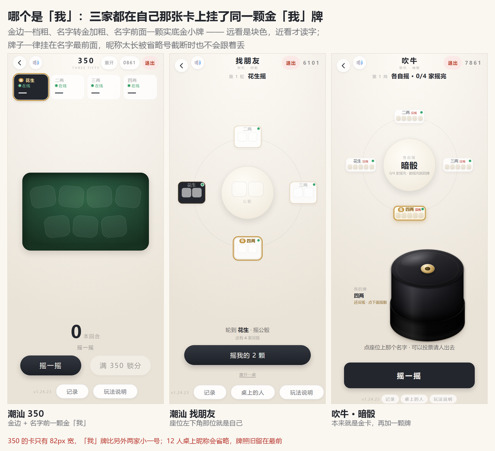

**一、为什么做成「牌子」而不是「文字」**

跟名字同色的三个字或一句话，在米白底上等于没标：一桌十几个人、名字又被省略号截断，
扫一眼根本挑不出来。实底金 + 白字是一块**色块**，远看就跳出来，近看才知道是「我」。

**二、牌子为什么一律挂在名字前面**

三个名字容器（`.p-nm` / `.fd-n` / `.lr-n`）都是 ellipsis 截断的 —— 服务端允许 8 个字的昵称。
挂后面的话昵称一长就被截掉，正好把「我是谁」弄丢。12 人桌 + 8 字昵称实测：
名字只剩 43px（约 4 个字）加省略号，牌子照旧留在最前面。

**三、边用 outline，不用 box-shadow**

350 的卡还要用底色表示「轮到谁 / 掉线 / 已锁」，找朋友的座位要用阴影表示
「被点到 / 待摇 / 下把」—— 那几条规则整条写着 box-shadow，挤进去会被后面那条整个覆盖。

顺带踩到一个只有量 computedStyle 才看得见的坑：**outline 的宽度是向下取整到整像素的**
（border 不取整）。写 `0.5333vw` 算出来 1.999875px，落到屏幕上只有 1px，米色底上还是淡；
给 `0.6667vw`（375 上 2.5px）才真的画出 2px 来。

**四、顺手统一的几处**

- 350 那条 strip 的 `data-key` 里加进了 `s.you`：刚进桌那次「哪张是我」是后到的状态，
  不算进 key 就不会重画，会一直标着别人；
- 名字前面多包一层 `.p-nm`：4 列的卡只有 82px 宽，8 个字放不下，省略交给它、牌子缩不掉；
- 三家「桌上的人」弹层、吹牛摊牌页那两处的「（我）」/「· 我」，也换成同一颗牌子。

**五、验收**

- 新增 `_real/_check_me_tag.py`（真房间，观察者是**最后进房**的那位 —— 他不是房主、
  也不是当前这一手，卡是浅色的，那才是大多数人的样子）：全场只有一张卡带 `.me`、
  牌子在、写的是「我」、金底白字、整颗落在卡里、卡片里的东西没探出卡、金边是 2px 实金。
  350 4 人 / 350 12 人（8 字昵称）/ 找朋友 4 人 / 吹牛 4 人，完整版 + 纯净版全 PASS。
- `_probe_votecard_many.py` 375×667 / 414×736 × 8 人：三家浮卡位置一条没变
  （牌子没把卡片顶高），仍然全部「干净」。
- `test_board.py` 线上两版：公共屏没被这次改动碰到（部署完那几分钟偶发 1 条时序 FAIL，
  每次都换一条断言，重跑即绿）。

## v1.24.22 · 2026-11-12

### 投票卡上直接能点「同意」，三张卡的位置也全部重量过

用户：「这个弹窗卡片没有直接可以同意的按钮吗」「联机吹牛那个卡片在左边偏下，
可能会遮住隐藏开关，要不要挪到左上呢」「检查那卡片对其他玩法的隐藏开关会不会遮挡」。

  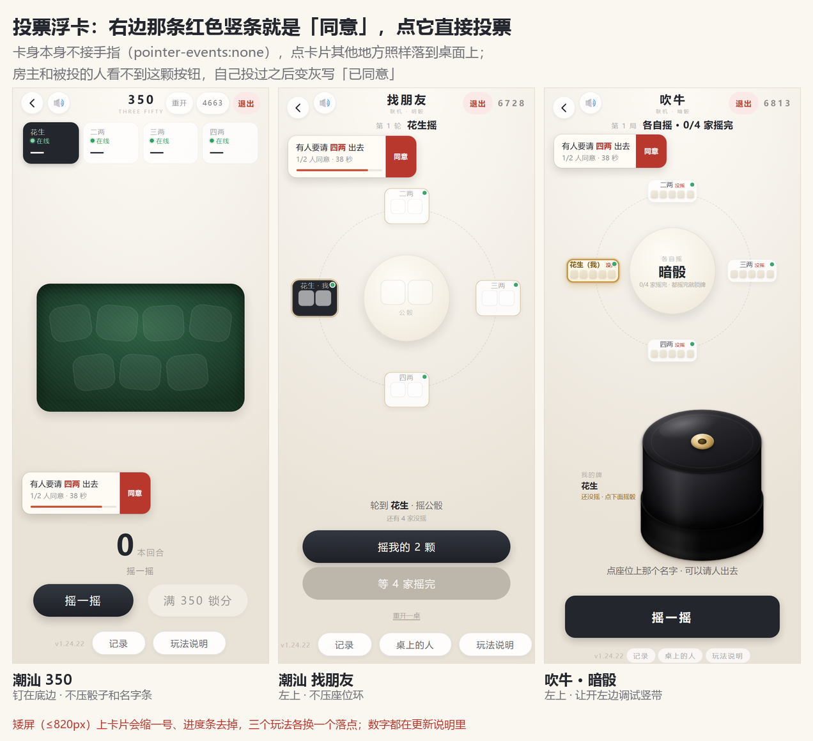

**一、卡片右侧多了一条竖着的「同意」**

- 不用再进「桌上的人」补票，卡片上直接点。
- 卡身仍然是 `pointer-events: none`，**只有这条按钮 `auto`** —— 那句「不能影响桌面操作」
  没破：点卡片其他地方照样落到桌面上（`_e2e_vote_card.py` 里用
  `document.elementFromPoint` 两头都验了）。
- 做成**竖条**而不是底下加一行按钮：卡片的落脚空档本来就窄（矮屏上只有一条 34px 高的缝），
  横着加一行会让卡长高十几像素、又得重新找位置；竖条是把右边缘让出来，高度一点没变。
- 房主、以及被投的那个人**看不到**这颗按钮（房主点谁谁立刻走，不用投票）。
- 自己投过之后按钮留原位变灰写「已同意」，不收起 —— 收掉会让左边文字宽度跳一下。

**二、位置重排，主要是不再压调试热区**

三家各有一条「平时透明、但确实能点」的调试热区，卡片以前都压在它们身上：

- 350：`.hot-zone`，通栏铺在骰盅下方；
- 找朋友：`.fn-hot`，通栏，高 13.07vw，占着「座位和提示行之间那块空白」；
- 吹牛：`.lr-zone`，左边竖着三格（`top:46%`，高 34%）。

吹牛那张原来在 `45.5%`，正好落在竖带（388~675）上 —— 用户一眼看出来了。
现在：**标准屏** 350 仍钉底边 26%、找朋友左上 8.3%、吹牛左上 8%。

**三、把 701~820 这段漏掉的高度补上**

原来矮屏那一档的上界写的是 700，只覆盖了 iPhone SE。实测 701~820 这段是空的：
找朋友 / 吹牛在 780 上压座位 10px / 9px，720 上压 35px（顶座位卡已经到 y=72，头部又占掉 60，
那条带子只剩 12px）。现在上界提到 **820**，这一段统一走「卡片缩一号」（字号各降一档、
去掉进度条 → 39px），并且各找一个确定的位置：

- 350 —— **统一停在分数那一行**（39px 塞进 472~514 正好）。667 上整条竖带最宽的空隙只有
  19px，怎么放都要压，那就挑最不值钱的：只盖住「N 本回合」一个数字，不可点、提示行还在。
  人数多少都一样，不再按人数换档（原来的 `vc-dense` 已删）。
- 找朋友 —— 退到圆环下方那条通栏空白（就是 `.fn-hot` 那条带子）。它不画任何东西、判定走坐标、
  卡片又不接手指，功能上一点没挡；探针里对这一段单独豁免。
- 吹牛 —— 贴**按钮上方**那条通栏空白（杯底到按钮之间，45~51px），并往右让开左边那条
  调试竖带（`.lr-zone` 宽到 25vw），否则 736 / 667 上会压 10~11px。

**四、验收**

- `_probe_votecard_many.py`：3 个玩法 × 5 个高度 × 2~12 人，全部「干净」。
  高度覆盖 375×667 / 720 / 780 / 812 / 820 / 844 与 414×736（8 Plus）。
  新增两个开关：第三个参数写 `rects` 只打矩形不断言，写 `sweep` 每 0.5% 扫一遍空档。
- `_e2e_vote_card.py`（模板走本机、房间打线上）：三家各验「卡片上有同意」「按钮自己接手指」
  「点按钮中心真命中」「点完票够了人被请走、卡片当场收」，并且房主那张确认没有按钮。
- `test_board.py` 线上两版各 PASS 34，公共屏没被这次改动碰到。
- 上面那张图是 `_real/_shot_vote_card_doc.py` 拼的：底图由探针在**真房间**（375×844、4 人）
  实拍整屏，不是摆出来的假 socket，所以座位、骰盅、调试竖带的位置都是真的。

## v1.24.21 · 2026-11-12

### 有人发起踢人投票，全场都看得见

用户：「现在如果有人点击投票之后，全场是没有给其他人任何提示的」。

以前投票只活在「桌上的人」那个弹层里 —— 按钮从「发起投票」变成「同意 1/2」。
不打开它的人，别人发起投票你根本不知道，45 秒作废了才发觉。

现在三个联机玩法（350 / 找朋友 / 吹牛）都有一张浮卡，落在左边的空档里：

- 写清三件事：**要请谁出去**、几票 / 要几票、还剩几秒，底下一条进度条在走。
- **只在投票活着的时候出现**，45 秒到点自己收掉。服务端到点不推消息（它只在有人动手时
  才广播），所以倒计时是客户端按上一次「还剩多少」自己数的，不指望回包。
- 票凑齐、人真被请走 → 卡片当场消失，不会挂在那儿。
- 自己投过的那台，卡上多一句「你已同意」。
- **`pointer-events: none`**：这张卡只通知、不接手指。点它正中间，事件落到桌面
  （盅 / 骰子 / 座位 / 三格热区照常点），投票入口还是「桌上的人」那一层。
- 位置是量着放的，不是目测：350 钉在底边 26%（名字条会随人数换行往下长，钉 top 会飘）；
  找朋友 62%；吹牛 45.5% 并且收窄到 35vw —— 再往上是座位卡、再往下是盅。
  吹牛摊牌屏（`.lr-table.rev`）左列本来就能直接点人请走，卡片自动让开。
- **矮屏（屏高 ≤700px）另有一档**：正常屏的百分比在扁屏上一律不成立，这几条是重新扫出来的
  —— 350 抬到 59%，找朋友 57.2% 并把卡片缩一号（矮屏上整屏没有一处容得下 60px 高的卡），
  吹牛 45.5% 本来就够用。9 人以上 350 的名字条会换三行、把骰盘往下顶，
  这时卡片主动退到分数那一行（`vc-dense`），代价是盖住「N 本回合」那个数字 ——
  盖一个数字，总比盖住一颗骰子强。

验收脚本（都留在 `_real/`）：

- `_e2e_vote_card.py`：三家真房间（4 台浏览器），验「不用开弹层也看得见」「秒数在走」
  「点卡片打不到它」「到点自己收」「人被请走后立刻收」。
- `_probe_votecard_many.py`：2 / 5 / 8 / 12 人满桌逐块矩形求交，看卡片压没压到座位、盅、按钮；
  视口可换（`390×844` 与矮屏 `375×667` 都跑过），`liars-dice-h5-clean` 可作第六个参数一起量。
- `_probe_votecard_overlay.py`：350 交接屏、吹牛摊牌屏这两张「盖在桌上的另一种脸」。
- `_shot_votecard.py`：375×812 / 375×667 各拍一张，人眼复核。

## v1.24.20 · 2026-11-12

### 撤回摇骰动画：回到点一下立刻出结果

v1.24.19 给公骰和 350 加了「先滚 1.5 秒、再一颗一颗停」的过程。用户看过后否掉：
「这不就是简单的点数跳动的画面而已吗，如果是这样，恢复原样吧」。

**为什么它只是「点数在跳」**：我们的骰子是 CSS 画的 2D 贴图（白胚 + 圆点），
所谓滚动只能是每隔 68ms 把点心重画一遍，骰子本身不位移、也不旋转 ——
看着就是点数在闪，不是真正的摇骰子。要做成参考视频里那种翻滚，
得把骰子换成能动的素材（逐帧图 / 3D），不是这一版该顺手塞进来的改动。
按用户「先拿截图确认再动骰子外观」的约定，这次不另起方案，直接回退。

**撤掉的东西**（单机 / 联机各两处，全部还原到 v1.24.18）：

- 单机找朋友 `find.js` / `find.css`：`rollCoreAnim` / `coreFace` / `.rolling` / `.land` 与两段 keyframes。
- 单机 350 `f350.js` / `f350.css`：`rollDiceAnim`、`LAND_FIRST` / `LAND_GAP`、"摇骰中" 让路逻辑。
- 联机找朋友 `findnet.js`：`paintTable()` 里按 `center` 变化触发的滚动、`rollPending`、`paintHint()` 的「摇骰中…」。
- 联机 350 `net.js`：`rollHandAnim`、`data-key` 让路、底栏 / 提示的「摇骰中…」。
  顺手撤掉的还有 `rollOne is not defined` 那个坑（它本身就是动画引入的）。
- 调试功能（`?test=1` 钩子、找朋友五格与面板、吹牛的 `LDDev`）随之一并回到原状，
  与 v1.24.18 完全一致 —— 上一版为动画加的适配不再需要。

`_real/qqclip/` 里的三个探针脚本（`_probe_net350_roll` / `_probe_f350_hooks` /
`_probe_findnet_roll`）保留：它们验的是「动画节奏」，代码回退后跑起来会直接看出没有动画，
以后真要重做摇骰画面时还能拿来量。

## v1.24.19 · 2026-11-12

### 摇骰子有过程了：公骰先滚、再一颗一颗停（**已被 v1.24.20 撤回**）

用户反馈：「找朋友的公骰摇一摇之后桌面直接就展示了结果，完全没有中间骰子被摇晃或者转动的动作动画……
点摇之后出现动画动作，2~4 秒，开始停下第一颗出现点数，然后第二颗再慢慢停下……
另一个玩法 350 也是这个问题，点一下就马上出结果，没有过程，而 350 骰子有点多可以依次停下」。

**四处各自的做法**（点数只在落定那一刻写，滚动中只是随机换脸）：

- **单机找朋友**（`find.js`）：点下去先把公骰点数算好、命中 / 杯数 / 阶段一起定，
  再播 1.5 秒滚动，**1.55s 停第 1 颗、2.35s 停第 2 颗**并揭结果。
- **联机找朋友**（`findnet.js`）：点数只能来自服务器，所以不能「点下去先滚假牌」。
  改成 state 里的 `center` 一变就开滚，滚的是随机面，到点再把这一手真点数依次落下来；
  滚动期间**座位不亮「谁对上了」、杯数停在开滚前那一帧**，提示只写「摇骰中…」。
- **单机 350**（`f350.js`）：7 颗**1.15s 起每 175ms 落一颗**，约 2.4 秒落完；
  1 / 5 的 100 / 50 角标在落定瞬间补上，不用等重绘。
- **联机 350**（`net.js`）：点摇先本地播放摇骰音、震动、抖一下（不等回包，不然慢半拍），
  回包后用真点数播「一起抖 → 一颗一颗停」。

**踩到的两个坑**：

1. 联机 350 的动画里调了 `rollOne()`，但那是 `f350.js` 自己闭包里的函数，
   `net.js` 根本没定义 —— 点摇直接抛 `rollOne is not defined`，骰子一动不动。
   语法检查（`node --check`）查不出这种未定义引用，得真点一下才看得见。
   已补一个只用于「看着在摇」的本地随机函数，不参与结算。
2. 联机找朋友原来靠「`center` 变没变」判断要不要播动画，**连着摇出同一个点数就不播**
   （1/36；调试开「出 11」时是必然），看着像按钮坏了。现在按一下「摇公骰」就先记一笔
   `rollPending`（3 秒作废），点数撞成一样也照滚。

**调试功能同步核对**（用户要求）：

- 350 单机的 `?test=1` 钩子：点数在点下去那一刻就写进 `G.hand`，动画只决定「什么时候画」，
  所以 `__t.state()` 读到的永远是这一把的真点数；动画播到一半调 `__t.setHand()` 会先掐掉动画，
  再按指定点数重画，不会被让路的 `renderDice` 吞掉。
- 联机找朋友的五格 / 调试面板：全是服务端改牌，客户端只负责重画，动画期间照样能按；
  「出 11」连摇现在也有动画了。
- 吹牛的 `LDDev` / 点骰改点 / 三格热区这一版没动，回归仍全绿。

新增探针 `_real/qqclip/_probe_net350_roll.py`（假 socket 验联机 350 的 7 颗落定节奏）、
`_real/qqclip/_probe_f350_hooks.py`（验测试钩子与动画互不干扰），
`_real/qqclip/_probe_findnet_roll.py` 加了「同点数二次摇」这一段。

## v1.24.18 · 2026-11-12

### 单机吹牛：电脑上鼠标也能拖盖子了

用户反馈：「用点开打开网页，单机版的吹牛他的盖子我用鼠标无法上下滑动，
只能点击开盖，而联机版的可以滑动，手机打开网页是全部正常」。

**根因**：单机 `app.js` 的舞台手势只绑了 `touchstart / touchmove / touchend`；
桌面鼠标不会派发 `touch` 事件，所以电脑上整套拖拽逻辑一次都没跑过。
联机 `liarnet.js` 用的是 `pointerdown / pointermove / pointerup`，鼠标天然会触发，
所以同一个浏览器里联机能拖、单机不能拖，手机两端又都正常。

**修法**（只动单机，不动联机）：
- 加 `gPoint(e)`：触摸取 `touches[0]`，鼠标直接取事件对象；
  `onStageStart` / `onStageMove` 改走它，两条路共用同一套 1:1 计算、松手定格和点一下全开 / 全关。
- 舞台补 `mousedown`，`mousemove / mouseup` 挂 `document`，鼠标滑出舞台也不会把手势丢在半路；
  再加 `window blur` 兜底。只认左键，`mousedown` 上 `preventDefault` 防止浏览器开始选字 / 拖图片。
- 触摸结束后浏览器会补一次合成 `mousedown`，不能让它把刚定格的盖子又翻一遍：
  `lastTouchAt` 记时间戳，700ms 内的 `mousedown` 忽略。

**踩到的坑**：`document` 上原本就绑着 `onHoldEnd`（下方空白桌面的 mouseup），
它**无条件**把 `S.grabbing` 清成 `false`。新加的 mouseup 如果等冒泡，`onStageEnd`
开头那句 `if (!S.grabbing) return` 会直接吞掉结算 —— 表现很迷惑：拖得动、位置也对，
但松手后状态不落地（提示一直是「盖着」）、点一下也不开合。
把结算绑到**捕获阶段**，抢在 `onHoldEnd` 前面就好了。回归里专门加了一条
「松手后提示变成半开」的断言，防止只看 `lift` / `transition` 假绿。

新增 `_real/_e2e_mouse_lid.py`：桌面 800 / 1280 两个视口 + 完整版 / 纯净版，
覆盖 50% 定格、半开接着拖、98% 不吸附、点一下全开全关、形状不变形；
另在手机视口验证触摸路径没坏、合成鼠标事件被抑制。
原有闪烁 / 盖子 / 点骰改点 / 调试面板 / 公共屏回归全部仍绿。

## v1.24.17 · 2026-11-12

### 撤回 3D 骰子，恢复原来只显示一面的 2D

上一版把盅里那几颗换成等轴测 3D 贴图，用户实测后直接否掉：
「你现在连骰子的原来样式都改变了，特别难看，还不如原来的只显示一面也就是 2d 呢」。

**整段撤回**：删掉 `app.js` 的 `window.Dice3D`、`renderDice()` 里的 SVG 渲染、
`liarnet.js` 里 `paintDice()` 的 `cup` 分支、`app.css` 末尾那段盅内 3D 样式；
单机 / 联机 / 纯净版 / APK 内嵌四处都回到 `.die` + `.pip` 的 2D 贴图。
v1.24.15 的「开盖不闪」、v1.24.14 的「盖子不变形」等修复全部保留。

参考视频里那种顶面 + 两侧都有点数的立体骰子**不再做** —— 原来的平面骰子就挺好。
以后要动骰子外观，先拿截图给用户确认，别整套替换。

回归：闪烁、盖子、点骰改点、调试面板、两版 `test_board` 全绿；
并确认盅内没有任何 `.d3` / SVG 残留。

## v1.24.16 · 2026-11-12

> [!NOTE]
> 本版已在 **v1.24.17** 整段撤回：用户认为 3D 骰子「特别难看」，
> 已恢复原来只显示一面的 2D 贴图。以下仅作历史记录，配图已移除，
> 文中提到的 `_verify_dice3d.py` 也已改成「无 3D 残留」的反向回归脚本。

### 盅里那几颗骰子换成 3D 立体的（顶面 + 两侧都有点数）

用户看参考视频：「开出来的骰子，好像是有展示骰子两侧的点数，你看看我们为什么没有」。
放大核对：对方是 3D 圆角立方体，顶面 + 左右侧面都看得见点数；我们全站那套
`.die`/`.pip` 是 CSS 2D 贴图，只画正面，侧面只有一条 `box-shadow` 厚度阴影。
不是数据少了，是没做立体渲染。

按用户定的范围：**只给盅里那几颗做**，座位卡小骰子、摊牌大表、公共屏维持原样。
单机是 2~10 颗动态、联机固定 5 颗，两边共用同一张贴图。

**做法**：`app.js` 挂 `window.Dice3D.svg(v)`（`index.html` 里 app.js 先于
liarnet.js 加载），生成一张等轴测 SVG —— 顶面放这一颗**真正的主点数**
（1 / 4 红、其余蓝），左右侧面按骰子规则推两个不同的点数，**纯装饰、不参与判点**；
九宫格点位用仿射 matrix 映射到菱形 / 平行四边形，圆点自然变椭圆。
只给 `#diceLayer` / `#lrMeDice` 里的 `.die` 加 `.d3`，CSS 用 id 选择器限定作用域。
`data-v` 仍是唯一判点依据，点骰改点、装填、豹子 / 顺子识别、摊牌统计全没动。

先试过 CSS 3D（`perspective` + `rotateX` 折三个面）：顶面被投成翘起来的尖角纸片，
换个角度又完全看不到侧面 —— 和盖子后翻那次是同一类坑，否掉。
等轴测 SVG 是纯 2D，不碰 3D 变换，也不和 `dieIn` 入场动画抢 `transform`。

新增回归 `_real/_verify_dice3d.py`：单机 2 / 5 / 10 颗、联机 5 颗的 DOM 作用域，
以及座位卡 / 摊牌大表 / 公共屏**不带** `.d3`，全部断言通过。
闪烁、盖子、点骰改点、调试面板、两版 `test_board` 全绿。

## v1.24.15 · 2026-11-12

### 修掉单机开盖时骰子「闪一下」

用户：「单机版的吹牛开盖的时候骰子会闪一下，而联机版的不会……我猜是刷新」
—— 猜得对，就是骰子的入场动画被**重新播放**了一次。

`.die` 默认 `opacity:0`，靠 `.die.in` 的 `dieIn`（0.46s）淡入。单机
`revealDice()` 以前每次 `setData({revealed:true})` 都无条件
`remove('in')` + `void die.offsetWidth` + `add('in')`，本意是重播入场动画；
但开盖一次会把 `revealed:true` 写好几遍：上滑拖过 28% 时一次、
松手 `settleLid()` 又一次（点一下开盖也会）。于是骰子刚淡入到
`opacity:1`，松手瞬间又被打回 0 重新淡入 —— 就是那一闪。

**联机版不闪**：`dieEl()` 一建出来就带 `.in`，`paintDice()` 用 `data-k`
缓存整排骰子，key 不变就不重建，动画天然只播一次。

**修法**：`revealDice()` 只在「隐藏 → 显示」真的发生切换时才加 `in`；
已经在展示的骰子直接跳过，绝不 remove 再 add。合上再打开仍会正常播一次
入场动画；`renderDice()` 重建出来的节点本来就带 `in`，也不会双播。

新增回归 `_real/_e2e_dice_flash.py`：把 touchmove / touchend 拆成多个
JS 任务（同一个同步块里动画根本没机会开始，量不出重播），用
`animationstart` 计数 + 松手瞬间的 opacity 判定。修复前
**10 次启动 / 松手瞬间 opacity 1.00→0.00**，修复后
**5 次 / 保持 1.00**，点按钮开盖同样是 5 次。

> [!NOTE]
> 和盖子那次是同一类问题：动画 class 别在「值没变化」时被重设。
> 想验证「有没有闪」，把整串触摸事件塞进一个同步块是测不出来的。

## v1.24.14 · 2026-11-12

### 修掉盖子后翻变形：这张 2D 贴图只能平移，不能旋转

用户一句「盖子后翻变形了，你没发现吗」点中了上一版的问题：开到 75% / 90% 时，
盖子被压成**左右带尖角的扁飞碟**，圆顶椭圆拉成菱形，完全不像一只骰盅盖。

**根因**：盖子不是 3D 模型，是 CSS 画的 2D 贴图（圆柱侧壁 + 椭圆顶面 + 圆钮）。
给它套 `perspective() + rotateX()` 之后，透视投影把这块矩形贴图投成梯形，
椭圆边界跟着被拉歪 —— 这是必然会穿帮的，调角度 / 透视距离都救不了：
- `88° / 120vw`：75% 开度压成尖角扁片
- `70° / 200vw`（上一版发的）：75%、90% 仍是尖角飞碟
- 去掉透视、只留正交 `rotateX`：圆顶被压成平顶方盒，圆钮成一条线

**逐帧核对录屏**（13.17 秒 / 36.7fps）：对方从盖严到全开，圆顶、圆钮、左右轮廓
**一丝不变**，就是整只空心钟罩垂直升起；抬起后底部露出一个黑色椭圆内口，
看着才像往后掀开。也就是说「后翻」是观感，不是真的旋转。

**这一版**：单机 `lidStyle()`、联机 `lidApply()` 的 transform 回到纯
`translate3d(0, -45.3333vw × p, 0)`，删掉 `FLIP_DEG` / `LID_FLIP`，
盖子形状从头到尾保持一致。其余全部保留：
- 1:1 跟手、拖动 / 松手 `transition:none`
- 0~100% 任意开度定格（90%、98% 也不会被补到全开）
- 点一下全开 / 全关、半开点骰改点、`forceOn` / `revealed` 联动

  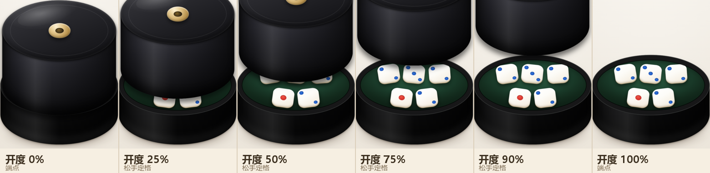

回归 `_real/_e2e_lid_free.py` 加了**防变形断言**：两版 transform 必须只有平移，
出现 `perspective` / `rotate` / `scale` / `skew` 直接 FAIL，防止以后再加回去。
单机 / 联机 × 改点开 / 关四组全绿。

> [!NOTE]
> 真要做明显的倾斜后翻，得先把盖子换成图片序列 / SVG 素材 —— 现有这张 CSS 贴图
> 一旦旋转就会变形，没有参数能绕过去。

## v1.24.13 · 2026-11-12

> [!NOTE]
> 本段的「② 向后翻开」已在 **v1.24.14** 撤回：透视旋转让 CSS 画的 2D 盖子贴图变形。
> 「① 全程定格」与下面那张变形对照图保留作历史记录。

### 盖子「向后翻开」，而且从头到尾都能停

接着上一段录屏又提了两条：「开到一半左右就会直接全开是吧，一半有点少，视频里好像从头到尾都可以随时停」，
以及「它是向后翻开，我们是向上拉升的，我喜欢后翻」。

**① 全程定格**。以前松手只要 `p >= 0.85` 就把位置**补到 1** —— 哪怕只补最后 15%，
看起来仍是「拖到一半盖子自己全开」。现在两版都不补位置：
- 单机 `settleLid()` 照旧把状态记成 `open`、照旧播开盖音和牌型提示，但 `lidStyle` 用的是当前 `p`；
- 联机 `up()` 只在最底 2% 盖严，其余一律 `lidApply(p, false, true)` 定格。

**点一下**仍是全开 / 全关的快捷方式，没动。

**② 向后翻开**。在原来那段线性抬升上叠一个 `rotateX`，透视原点跟着
`transform-origin: 50% 100%` 一起钉在盖沿：顶边越翻越往后、越翻越小，
不再像整块被拎起来。
- `perspective(200vw)`、角度 `70 × p`（单机 `rpx(1500)` / `FLIP_DEG=70`，联机 `LID_FLIP=70`）；
  抬升仍是 `45.3333vw × p`（单机 340rpx），1:1 跟手没变
- 试过 88° / 120vw：开到 75% 盖子会被压成带尖角的扁片；超过 90° 更是翻出背面、
  被 `backface-visibility` 整块藏掉，定格时会突然消失 —— 两组都否掉
- 拖动 / 松手都是 `transition:none`，淡出只在最后 1.5%，中间任意高度盖子都是实心的

  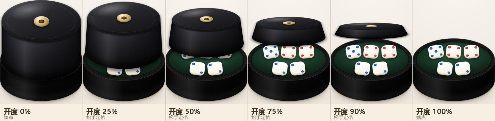

**点骰改点没动**：单机认 `state==='open' || 'ajar'`，联机 `tapEditLive()` 读 `S.lidP >= 0.3`，
`lidApply()` 每次都同步 `lr-tap-live`；`forceOn` / `revealed` 联动原样保留。

回归 `_real/_e2e_lid_free.py` **全绿**（单机 / 联机 × 改点开 / 关四组）：
新增 p=0.90 / 0.98 松手位置定格、`transition:none`、`rotateX = 70 × p`、
点一下仍掀到底、半开连点两下照样改点。纯净版由 `make_clean_h5.py` 同步重生成，两版参数一致。

## v1.24.12 · 2026-11-12

### 骰盅盖子改成「手指走多少、盖子走多少」

用户分享了一段别人家骰盅的录屏：「为什么他的骰盅可以在任意位置停止，但是我们的不行，而且它还很丝滑」。
视频 13.17 秒 / 36.7fps：整只圆顶垂直抬起，手指拖到哪就停在哪，中间没有任何回弹或补动画，
露出的骰子随高度连续变化 —— 典型的**直接操纵**。

我们之前差在四处（单机 `app.js`、联机 `liarnet.js` 都有）：

| | 以前 | 现在 |
|---|---|---|
| 抬升曲线 | `0.72p + 0.28p²`，匀速上滑却先慢后窜 | **线性 1:1**：`lift = LIFT × p` |
| 松手 | 联机一律弹到 `0` 或 `1`；单机 `p>=0.5` 吸到全开、只有下半段能半开 | **停在哪就哪**，`0.02 < p < 0.85` 全部定格 |
| 松手动画 | 两处都补 `0.36s` 缓动，看着像自己又滑一段 | 定格时 `transition:none`，只有按钮 / 点一下 / 新的一把才缓动 |
| 接着拖 | 联机按「按下点算绝对位移」，从半开会先跳回 0 | 记住按下时的开度 `p0`，在原基础上继续 |

**两端仍留一点收尾**：`p >= 0.85` 补完最后 15%（带缓动），`p <= 0.02` 盖严。
这不是吸附，是避免早前反复吐槽过的「拖到顶还差一丝、第一次只能开一点」，
同时给「全开 / 全关」一个干净的终点。**点一下仍然是全开 / 全关的快捷方式**。
另外淡出压到最后 1.5%，中间任何高度盖子都是实心的，不会半透明穿帮。

**点骰改点没被影响**：单机 `onDieTap` 认的是 `state==='open' || 'ajar'`，
所有中间位置仍然归 `ajar`；联机 `tapEditLive()` 读的是当前开度 `S.lidP >= 0.3`，
`lidApply()` 每次都会重算 `lr-tap-live`，盅手势让位用的也是同一个函数。
`forceOn=false`（开过盖就解除装填）与 `revealed` 的联动原样保留。

回归 `_real/_e2e_lid_free.py` **42 条全过**，其中包含：
单机 p=0.35 连点两下改点 `2→3`、联机 p=0.35 / 0.60 都照常报 `lset`、
点骰不会顺手合盖；以及两版「从半开接着拖不跳回 0」。
旧的 `_e2e_lid.py`、`_check_dbg.py` 也全绿。

> 测试踩坑：CDP 的 `Input.dispatchTouchEvent` 在同一页里**第二次**手势只发
> `touchstart/touchend`、`touchmove` 全被吞掉（页面对 touchmove 调了 `preventDefault` 之后）。
> 所以单机那段改成在页面内构造 `TouchEvent` 派发，走的仍是 app.js 的真 handler。

## v1.24.11 · 2026-11-12

### 联机吹牛那颗 🔊 是假的：点了没反应

用户报：「检查一下联机吹牛左上角那个声音图标，我点击后好像也没有关闭声音，是不是失效的」——
**确实失效**，而且原因很低级：`#lrSound` 上挂了**两个** click。

- `snd.js` 的 `paint()` 会给全站每一颗 `.sound-btn` 绑一次点击（`setOn(!on)`）
- 联机吹牛这边 `liarnet.js` 又自己绑了一次（`toggle()`）

同一下点进去，开关翻两回，**正负抵消** —— 状态原地不动、图标也还是 🔊，看着就像按钮是假的。
350 单机、找朋友那几颗没有这毛病，正是因为它们没有自己再绑一遍。

**改法**：把 `liarnet.js` 里那段 click 删掉，只留一句注释警告后来人别再绑；
图标不用各自维护 —— `setOn()` 末尾本来就会 `paint()` 一遍，五颗 🔊 一起变。

实测（真浏览器、两版线上）：

| | 点第 1 下 | 点第 2 下 |
|---|---|---|
| 修复前 | `isOn` 仍为 `true`、图标还是 🔊 | 一样，永远不动 |
| 修复后 | `false` / 🔇 / `ld_sound=0` | `true` / 🔊 / `ld_sound=1` |

关掉之后给 `cue()` 打探针：振荡器创建 **0 次**（修复前照响不误）；打开再触发是 3 次，对得上「豹子三连音」。
在 350 里点那颗，吹牛这颗的图标也跟着变 —— 全站仍然只有一份开关。

## v1.24.10 · 2026-11-12

### 装填点退回原来的绿，只让它自己呼吸

v1.24.9 把被装填那张卡的在线点改成深金之后，用户回了一句：

> 「现在这样不错 而且颜色会呼吸，但是颜色为什么不用绿色呢，不然别人瞄你一眼手机，
> 怎么是金色的，如果是一样的绿色呼吸就比较不明显」

**这话是对的**：这个标记的全部意义是「只有塞牌的人看得出来」，一旦颜色变了，
同桌斜眼瞄一下你的手机就能发现「他那张卡上那颗点怎么是金的」—— 反而暴露。

**改法**：色号退回和普通在线点完全一致的绿 `#3aa76d`（连白边、位置、尺寸都不动，
`.lr-seat.arm::after` 现在只挂一个动画，别的属性一律继承）。呼吸照旧 2.6 秒一个来回，
但下限从 0.5 收到 **0.62**，只呼吸透明度：

| 帧 | 普通在线 | 被装填 |
|---|---|---|
| 0% / 100% | 不透明 | 完全不透明（一模一样） |
| 50% | — | 透明度 0.62（淡一点，旁人以为是正常反光） |

旁观者看到的永远是一颗绿色在线点，只有你自己知道它在轻轻明暗。
不加外圈光晕、不做缩放 —— 都是「又造了个新东西」，一样会被看出来。

顺带补一个边界：被装填的人中途掉线时，那颗点要报的是「人不在了」，
所以 `.lr-seat.off.arm::after` 仍然是红 `#c2493f`，呼吸停掉，红色优先。

  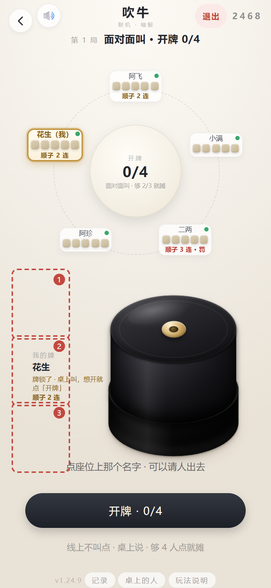

  图底部四种状态：普通在线 → 被装填·呼吸最亮 → 被装填·呼吸最淡 → 掉线（红优先）；
  前两张肉眼分不出来，这就是它要的效果（这张图顺带把面板入口和三格位置也带上了）

## v1.24.9 · 2026-11-12

### 装填点：不另点了，让那颗在线绿点变色

> ⚠️ 这一版的**深金点只活了几小时**，v1.24.10 已经改回原来的绿（色号不变，只呼吸）。
> 下面这节留作记录，当前行为以 v1.24.10 为准。

用户看完 v1.24.8 那颗小金点后回：

> 「这个小金点，不行 显眼了之前还变了位置，我觉得直接在原来那个绿色圆点那里直接标记被装填的
> 玩家即可，例如被装填的玩家 那个绿点 加个描边或者 圆点颜色变得更深或者更浅」

**根因**：座位卡右上角那颗绿点是 350 / 找朋友 / 吹牛三家共用的在线状态点（绿 = 在线 / 红 = 离线，
写在 `app.css` 的 `.lr-seat::after`）。v1.24.8 另点的小金点用的是**同一个伪元素**，
后写的规则把绿点整个顶掉了 —— 位置挪到卡片外角（`top/right: -0.7vw`）、尺寸也放大到 1.8vw，
所以看起来「变了位置」而且扎眼。

**改法**：不新开点。位置 / 大小 / 白边全部沿用原来那颗，只改两样：

| 项 | 普通卡 | 被装填的卡 |
|---|---|---|
| 颜色 | 绿 `#3aa76d` | **深金 `#8a5f18`** |
| 光晕 | 一圈白边 | 白边 + 一圈 0.7vw 的淡金 |
| 动画 | 无 | 2.6 秒呼吸一次，**只呼吸透明度** |

只呼吸透明度、不缩放 —— 缩放会让那颗点看着在「跳」，用户上一版已经嫌它显眼。
`dbg.hit` 仍然只回给发起者，别人屏幕上那颗点还是绿的；被装填的人摇出这一手时回执被收掉，
颜色当场复原。

### 另外两处

- **记录里也缩成「罚」**：第 3 连那条从「某某 连了 3 把顺子 · 罚酒」改成「某某 连了 3 把顺子 · 罚」，
  跟牌面和摊牌页的叫法统一（`liarCountStreak`）；
- **底部大按钮「摇 · 5 颗」→「摇一摇」**：盅里本来就只有 5 颗，颗数不必写在按钮上；
  `f350.js` 的玩法说明、`docs/play-liar.md` 的指引同步改口。

**测试**：`test/rules-liar.mjs` **PASS 238**；`_real/_e2e_other_arm.py` 线上真房间 **PASS**
（装填点落在被挑中那张卡上 / 对方屏幕上没有 / 摇完复原）；`_real/_check_streak.py` **PASS**；
`_real/_e2e_dbg_liar.py` **PASS**；公共屏两版 **PASS 34**；
纯净版 `lr-seat.arm / lrArmPulse` grep 0（`app.css` 那颗绿点照旧保留）。

## v1.24.8 · 2026-11-12

### 装填别人之后，牌桌上点一颗小金点

用户：「我们随机装填他人的时候，在调试功能面板可以看到给谁装填了，但是在桌面我们毫无感知，
有没有比较隐秘的提醒方式能让我们知道装填给了谁，因为人多是随机装填的」。

面板那句「已装填给 冬瓜 · 豹子 · 这一把生效」只有开着面板才看得见，一关面板、人一多，
谁被塞了牌就全靠记。现在被挑中那张**座位卡右上角点一颗小金点**（1.8vw，2.4 秒呼吸一次）：

| 问题 | 做法 |
|---|---|
| 认哪个人 | 回执加 `pid` —— 名字会重名，只有 id 认得准 |
| 谁能看见 | 只有塞牌的人：`liarPub` 只把 `dbg.hit` 回给发起者，别人屏幕上连 `.arm` 这个类名都没有 |
| 什么时候消失 | 被挑中的人**摇出这一手的那一刻** —— `dealLiarDice` 之后 `liarDropArmHit` 把回执收掉 |
| 排到下一把的 | 活过洗牌，等他在新一把里摇出来才收 |
| 他没摇 / 人走了 | 洗牌时作废，点不会挂着不走 |

被挑中的人自己记一笔 `armBy`（谁塞的），他摇骰时就是靠这个找到塞牌人的 `hit`。
面板里「装填别人」那行说明也补了「桌上标个小金点」。

**测试**：`test/rules-liar.mjs` 新增两节 12 条（回执带 pid / 吃到就收 / 自己装填不写 armBy /
排下一把的回执活过洗牌 / 人走了作废），**PASS 238**；
`_real/_e2e_other_arm.py` 线上真房间加断言：A 点完 → A 的桌上有一颗点、正好在「二两」卡上、
B 自己屏幕上没有、B 摇完之后 A 那颗点消失，**PASS**；公共屏两版 **PASS 34**；
`_real/_check_streak.py` **PASS**；纯净版 grep `装填别人之后 / lr-seat.arm / lrArmPulse / dbg.hit` 全 0。

## v1.24.7 · 2026-11-12

### 摊牌页：逐点统计撤掉，自己的卡描金放大

用户截图报了两件事：

> 「这里的全场总共 15 个骰子没错，但是下方统计的时候没有剔除顺子，因为顺子是不算点数的
> 1×4 2×2 3×3 4×2 5×2 6×2，这里应该剔除顺子后为多少，或者我觉得只显示多少颗骰子即可就行了，
> 因为还有豹子会算 6 或者 10 个，直接不显示，让别人自己看下方即可」

> 「下方 顺子4连·罚酒 改为顺子4连·罚」「高亮自己不够明显」

**① 那行逐点统计本来就是错数**：顺子不计点数，豹子算 6 个（带 1 算 10 个），
`1×4 2×2 3×3 …` 怎么加都对不上桌上这手牌。所以整行删掉（`#lrRevS`），
摊牌页只剩「**全场一共 N 颗**」—— 用户要的就是这个：「直接不显示，让别人自己看下方即可」。

**② 公共屏同一处跟着改**：原来大屏也列 `1 × 4 · 2 × 2 …`，现在改成报
「**N 家有顺子 · 顺子不计点数**」（没有顺子就写「没有顺子 · 点数自己数」）——
摊开那一刻桌上最该数的就是几手顺子，逐点那串数字反而误导。

**③ 连顺文案**：三处显示（座位卡 / 摊牌行 / 我的牌）从「顺子 N 连 · 罚酒」改成「顺子 N 连 · 罚」，
`_real/_check_streak.py` 的断言一起改。

**④ 自己那张卡**：原来只有 `inset 0 0 0 0.27vw rgba(181,137,63,.55)` 一圈淡金，
一桌十几张白卡里扫不出来。现在：

| 层 | 原来 | 现在 |
|---|---|---|
| 边 | 0.27vw 半透明金 | **0.5vw 实金 `#c2943f`** |
| 外圈 | 无 | `0 0 0 0.4vw` 淡金晕 + 暖色投影 |
| 底 | 白色 78% | 米白→浅金渐变 |
| 名字 | 常规深灰 | **金褐 `#8a5f18` 加粗** |
| 大小 | 19.4vw | **×1.06**（`transform` 必须连 base 的 translate 一起写，否则定位会歪） |

摊牌页里自己那一行也加了 `.lr-rv.me`：整行刷 12% 淡金、名字转金 —— 一列五六行，
光靠名字后面「（我）」两个字找不到自己。

**测试**：`_real/_check_streak.py` **PASS**（含新文案「顺子 3 连 · 罚」）；
`test_board.py` 完整版 / 纯净版 **PASS 34**；`_e2e_dbg_liar.py` **PASS**；
纯净版 `lrRevS` grep 0、`v1.24.7` 12 处。

## v1.24.6 · 2026-11-11

### 他人随机好牌（简称「他好」）

用户：「再增加一个功能，他人随机好牌 怎么做呢 举例 33315 固定三个点数 + 一个 1 万能牌
+ 一个其他点数，然后这个功能简称就叫他好 也可以在隐藏按钮自定义」。

面板「装填别人」多了第三颗：**他人随机好牌**。形态就按用户给的样例：

| 组成 | 取法 |
|---|---|
| 三张同点 | `2~6` 里随机（不取 1，`1 1 1 1 5` 更像被安排） |
| 一张 1 | 固定一张，1 是万能牌 |
| 一张杂牌 | `2~6` 里除掉那三个的点数（不能同点 = 四个就成豹子；不能是 1 = 两张万能形态又变了） |

出的是 `3 3 3 1 5` / `5 5 5 1 2` 这种，最后打散顺序。按吹牛规矩是「三个 3 带万能」，
够硬；摊开看着像随手一摇，不像豹子那么扎眼 —— 这一档的用处就在这儿。

- 服务端 `liarRandGood()`，走的是同一条 `liarArmOther`：没摇这一把生效，摇过排下一把；
- 回执写「已装填给 二两 · 好牌 · 下一把生效」；
- 三格自定义跟着多一颗 chip（`DBG_ACTS` 加一项即可，面板顺序 = 数组顺序），
  现在是六颗：顺子 / 豹子 / 改点 / 他顺 / 他豹 / **他好**；
- 三种给人装填的震动分开：顺子 22ms、好牌 32ms、豹子 45ms。

**测试**：`test/rules-liar.mjs` 加了一节 —— 九条形态断言 + 连抽 40 次全对，**PASS 226**；
`_real/_e2e_other_arm.py` 线上真房间加第四局：A 点「他人随机好牌」→ 下一局 B 出 `[5,1,2,5,5]`，
**PASS**；纯净版 grep `lrOtherGood / randomGood / ogood / 他人随机好牌` 全 0。

## v1.24.5 · 2026-11-11

### 装填别人：对方已经摇过就排到下一把

用户实测（2 人局）：「我把其中一个按钮设置为他顺或者他豹之后，我点击了开关，
下一把其他玩家并没有出现顺子或者豹子」→ 补一句「我是在这一把进行时点击的」。

根因在 `liarArmOther` 的候选池：原来写的是「在线 + **还没摇** + 不是自己」。
可正常打牌的顺序是「你先摇 → 你看自己的牌 → 你才去点面板」，等手能伸到面板上时，
对方早摇完了 —— 候选池空，服务端回一句「其他人都摇过了」，客户端连字都不弹。
2 人局必然复现（只有一个人可选）。而且就算装上了，`liarNextRound` 洗牌时
`p.arm` 也会被清掉，所以「下一把」永远等不到。

用户确认的规则，**分两个口袋**：

| 对方状态 | 写哪 | 什么时候出点 |
|---|---|---|
| 这一把还没摇 | `t.arm` | 他下一次摇骰就出这手（这一把生效） |
| 这一把已经摇过 | `t.armNext` | `liarNextRound` 洗牌时落到 `arm`，**下一把**生效 |

- 两边都只用一次：`dealLiarDice` 出完即清，`armNext → arm` 落地也立刻清空；
- 候选去掉「还没摇」这一条，只排除掉线 / 坐出局 / 自己；桌上没人回「桌上没有别人」；
- `me.hit.next` 跟着回执下发，面板写「已装填给 二两 · 顺子 · 下一把生效」；
- 客户端 `otherArm()` 不再要求 `phase === 'roll'`，叫点 / 摊牌阶段点了也认（排下一把）。

### 网页版：新页面配旧脚本

同一晚用户先报「面板多了 1 2 3 的选择，但点击无效，三格也全哑」，刷新一下就好了。
是 `sw.js` 的网络优先兜底：`caches.match` 是**全 origin 搜**的，部署刚完、新 HTML 已经从网上
下来了，而 `liarnet.js` 慢过 1.5 秒被兜底接住时，拿到的是**上一版**那份 ——
新页面写 `data-z`、旧脚本认 `data-k`，三格全哑；旧脚本也没有 `zcfg` 那套，三行只剩 1 2 3 三个数字。
现在兜底只在本版缓存（`CACHE`，名字里带构建号）里找，新页面永远配同版脚本。

**测试**：`test/rules-liar.mjs` 补了「对方已摇过 → 排下一把 → 洗牌落地 → 下一把摇出来就是这手」
共 11 条，外加掉线 / 坐出局 / lobby 三条边界，**PASS 216**。

## v1.24.4 · 2026-11-11

### 装填别人：让别人的下一手「运气好」

用户：「他人随机顺子打开后，下一把其他玩家随机挑一个必定摇出顺子，而不影响其他玩家，
只影响被挑中的玩家」「他人随机豹子……随机万能豹子」。

面板里多了一组「装填别人」：

| 按钮 | 做什么 |
|---|---|
| **他人随机顺子** | 随机挑一位还没摇的在线玩家，给他装一手带 1 的顺子 |
| **他人随机豹子** | 同上，装万能豹（2~4 颗真点数 + 剩下的 1） |

服务端 `liarArmOther`：候选 = 在线 + 没摇 + 不是自己，把 `p.arm` 写在那个人名下，
等他自己摇的时候由 `dealLiarDice` 出点 —— 所以**只改被挑中的那一个**，
发起者和其他人的牌都不动。

回执只发给发起者：`liarPub` 的 `dbg.hit = { name, act, at }`，
面板状态条第二行写「已装填给 二两 · 顺子」，8 秒后自己收掉；
被挑中的人那边一个字都不弹，他只是觉得这一把运气好。

### 三格不再写死：1 2 3 各绑什么，面板里自己排

用户：「开关 1 2 3 可在面板中自定义，可给已有功能增加排序」。

- `DBG_ACTS` 是唯一的功能清单（`st / lion / tap / ost / olion`），**数组顺序就是面板顺序**；
- `dbg.z = ['st','tap','lion']` 存三格各自的绑定，落在 `localStorage` 的 `ld_liar_dbg` 里，
  刷新、退出重进都还在；
- 面板里三行五颗 chip，点一颗就把这一格换掉，「骰盅左边三格」那句说明同步改口；
- 三格触发改成读 `data-z`（0/1/2）→ `dbg.z[i]` → `runAct()`，不再按写死的 `data-k` 分支。

### 顺带

- 面板比一屏长了，「完成」改成 `position: sticky` 钉在底部；
- `tellDbg()` 改成「总闸开着就报 on」—— 以前只认 tap / zone 两个开关，
  只点面板上那颗「随机顺子」会被服务端回「调试功能没开」；
- 纯净版裁剪脚本跟着改：`el` 映射那段和残留关键字清单都补了新节点 / 新函数，
  `lrOther / lrZCfg / zchip / zcfg / larmOther / DBG_ACTS / otherArm / paintZoneCfg / runAct`
  一个都不许剩（实际 grep 全为 0）。

**测试**：`test/rules-liar.mjs` 新增 22 条（只装一个人 / 被装的人摇出来就是那手 /
没被挑中的照常随机 / 万能豹形态 / 三道边界），**PASS 203**；
`_real/_e2e_other_arm.py` 线上真房间两台手机：A 点「他人随机顺子」→ B 出 `[1,5,2,4,6]`，
新一局点「他人随机豹子」→ B 出 `[3,3,3,1,1]`，**PASS**；
`_real/_e2e_dbg_liar.py` 补了面板两块、`larmOther` 协议、三格换绑后真的改走新功能、
刷新后配置还在，**PASS**。

## v1.24.3 · 2026-11-11

### 单机就叫单机，不叫单人

用户：「我们是单机版，单机就可以完成，非单人，而且确实游戏内也写了单人，实际单机哈」。

玩法一个字没动，全是叫法：

| 位置 | 以前 | 现在 |
|---|---|---|
| 首页模式卡 | 单人模式 | **单机模式** |
| 选玩法页标题 | 单人 / SOLO | **单机 / OFFLINE** |
| 联机卡副标题 | 各看各的手机 · 现在先支持潮汕 350 | 各看各的手机 · **吹牛 / 350 / 找朋友** |
| 联机页「吹牛 · 暗骰」卡 | 每人 5 颗只有自己看得见 · 叫点 / 斋 / 劈 | 每人 5 颗只有自己看得见 · **摇完就锁** |

最后一行是顺手修的：叫点在 v1.21.0 就整块删了，卡片上还留着这三个字。
`f350.js` 里那几行注释（「单人页」「单人模式」）一起改口。

### README 重排：六个玩法摆在一处

用户：「仓库首页说明中的玩法我没看到新增联机吹牛，下面有看到更新，你最好对首页重新排版哈，有点乱了」。

- 玩法拆成「单机 · 一台手机轮着玩」和「联机 · 各看各的手机」两张表，
  **六个玩法全在里面**（以前只有四行：漏了联机吹牛、单机找朋友）；
- 联机三个玩法共用的「本局记录 / 桌上的人 / 重开一桌 / 退出这一桌」单独一张小表；
- 公共屏、罚酒规矩、用在哪各归其位，不再夹在更新记录中间；
- 更新记录只留最近三版（v1.24.3 / v1.24.2 / v1.24.1），v1.21 及以前全部交给这份 changelog；
- 图从三十一张减到十八张，每张都还在讲一件具体的事。

`play-net.md`、`play-find.md` 同步：联机玩法写成三个，找朋友开头补一句单机版怎么玩。

## v1.24.2 · 2026-11-11

### 吹牛的「桌上的人」补上踢人按钮

用户：「350 还是找朋友那里的记录 / 桌上的人 那里是有踢人的按钮，而联机吹牛没有，你更新一下」。

以前吹牛的规矩是「在线的人只有房主能请」，所以普通玩家打开「桌上的人」，右边一个按钮都没有；
350 和找朋友一直是房主直接踢、其他人发起投票。现在三家统一：

- **掉线的人**：谁点都直接请出去（他反正按不了）；
- **房主**：点在线的人一下就请走，不用别人同意；
- **其他人**：点一下是**发起投票**，在线的三分之二同意才请得出去（分母不算被踢的那位），
  45 秒没人接着点就作废；自己投过再点一下是撤回。
- 人员页按钮会跟着状态变：「发起投票」→「同意 1/2」→「已投 1/2」；
  底栏提示也分开写「可以请人出去」/「可以投票请人出去」。

服务端 `kickPlayerLiar` 改成和 `kickPlayerFind` 同一条线，`G.kick` 复用同一套投票结构，
新增 `{t:'unvotekick'}`；`liarPub` 里本来就下发 `kick`，前端直接复用。

### 说明文档补上吹牛联机的截图

README 的吹牛一节新增「调试功能」和「桌上的人」两排图：面板、三格位置（图上画了
1/2/3 三个虚线框，App 里是隐形的）、普通玩家视角的人员页、投票确认层。
`play-liar.md` 的「请人出去」整节按新规则重写。

回归：`rules-liar` **PASS 181**（新增「非房主发起投票 / 凑够 2/3 / 房主直踢 / 撤回」）；
`_check_sheet.py` 新增非房主视角（按钮、底栏提示、已投 / 同意 / 撤回三种状态）**PASS**；
新增 `_e2e_kick_vote.py`：四台手机真房间，B 发起、C 同意，把 D 请出去。

## v1.24.1 · 2026-11-11

### 随机顺子不再只发连顺；顺子只有一个叫法

用户：「我怎么还是发现，我通过调试得到的顺子，怎么都是 12345 23456，
怎么没有其他的万能顺啊」——查下来，随机档之前留了 22% 概率「偶尔来一条连顺」，
连着点几下就撞上几次，加上下面两颗固定档本来就是连顺，看起来就像随机档根本没生效。

- **随机档（面板「随机顺子」+ 三格上格）现在固定从 `1~6` 里删 2/3/4/5**，
  每次都留 1：只可能出 `13456` / `12456` / `12356` / `12346`，再打散顺序。
  **一次连顺都不出**；想要 `12345` / `23456` 就点那两颗固定档。
- 单机版 `randomStraight()` 同一个改法，两版一致。
- 顺手让「随机顺子」真的随机：8 次连点至少出 2 种断档形态（回归脚本钉死）。

### 顺子只写「顺子」

用户：「标记顺子只标记顺子就好，万能顺也叫顺子」。`13456` 这类带 1 断一截的，
摊牌页以前贴「万能顺」，现在和连顺一样只贴金底「顺子」；状态条也统一写「顺子 · 1 3 4 5 6」。
`isWildStraight()` 整个删掉，界面不再出现「万能顺」这三个字。

### 自己也能看见自己连了几把

用户：「连续顺子的人，在桌面和摊牌页面都看不到自己连了几次了，只有其他玩家看得见」。

连顺本来是按整桌数据画的，服务端对所有人都发同一个 `streak`；问题在**位置**——
圆环上自己那张卡在对面，眼睛最先落的却是低处「我的牌」那一块，那儿一直没写。

- 「我的牌」那三行里补一行：2 连起「顺子 2 连」，3 连起红字「顺子 3 连 · 罚酒」；
- 圆环上自己那张座位卡描一圈淡金，一桌十几个人也能先认出「我在哪儿」。

回归：`_check_streak.py` 新增「自己那格有字 / 占位 / 没被盅挡住」「我的牌那块也写」、
摊牌页自己那行可见性，全部 PASS；`_e2e_dbg_liar.py` 改成 8 次随机顺子必须全都带 1、
一条连顺都不许出。

## v1.24.0 · 2026-11-11

### 连续顺子记在座位上，3 连标「罚酒」

用户：「在桌面例如桌子的用户位置，或者摊牌的时候，标记用户有没有连续顺子，
我们这里的规矩，**连续 3 次顺子要罚酒，间断则不算**」。

这条只能由服务端记 —— 摇完之前谁也看不到别人的牌，客户端自己算不了。
所以 `liarSettle()` 每摊一次牌就数一遍：这一把 5 颗点数互不重复（含带 1 的万能顺）
就 `streak + 1`，**不是顺子直接清零**（不是减一：断一把就从头连）。

牌面上两处都写：

- **座位卡**最下面那行 —— 以前空着（叫点拆掉之后没话可说），现在从 2 连起写
  「顺子 2 连」；到 3 连转红，写「顺子 3 连 · 罚酒」；
- **摊牌页**名字下面同一列写一行，跟「掉线」错开，不占骰子那一行的宽度。

到第 3 连时记录里自动写一条「某某 连了 3 把顺子 · 罚酒」，翻「记录」能看到；
第 4、5 连不再重复刷，但牌面上会继续往上数。开新一桌、半路进来的人、以及
这一把没摇的人，都从 0 起算。

协议只加了一个只读字段：`liarPub().seats[].streak`（服务端算，客户端只画）。
服务端 `liarIsStraight / liarCountStreak` 也导出给单测用。

回归：`test/rules-liar.mjs` 新增连顺一节（顺子判定 / 2 连 / 3 连罚酒 / 断一把清零 /
同一局重数不重复累加 / 第 4 连不刷记录 / 新桌与新人从 0），**PASS 176**；
新增 `_real/_check_streak.py`（座位卡与摊牌页的文字、颜色、不溢出）**PASS**；
新增 `_real/_e2e_streak.py`（线上真房间连打 5 局，验 2 连 / 3 连罚酒 / 断一把 / 重新连）
**PASS**。`rules.mjs` 145 / `rules-find.mjs` 259 不受影响。

## v1.23.1 · 2026-11-11

### 随机顺子终于出「万能顺」了

用户：「**13456 也是顺子，1 是万能，只要没重复点数就是顺子，不能我调试之后出来的都是连顺啊，万能顺没给我整**」。

查下来是三处互相打架：单机 `faceOf()` / `quickState()` 一直写的是「5 个数互不重复就是顺子
（`12345` / `13456` 都算）」，可 `randomStraight()` 早前被改成只挑 `12345` / `23456` 再洗牌；
联机照搬了生成器，还把 `isStraight()` 写死成「必须连成一条」—— 于是调试装出来的永远是两条连顺，
`13456` 这种带 1 断一截的万能顺一次都出不来，摊牌页也不认。

现在按用户定义统一：

- **顺子 = 5 颗点数互不重复**。`12345` / `23456` 是连顺，`13456` / `12456` / `12356` / `12346`
  是带 1 的**万能顺**（1 是万能牌，顶掉断掉的那一截），都算；有重复点数的不算。
- **随机顺子**：从 `1~6` 里随机删一个点数再洗牌。删到 2/3/4/5 就是万能顺；
  连顺偶尔出一条、但**绝不连着出两次**，连点几下不会再全是五个连续数字。
  单机、联机、面板「随机顺子」和三格上格全用这一套。
- **两颗固定档仍只发升序** `12345` / `23456` —— 那是主动指定叫哪条顺子，形态不变。
- **认得出来**：状态条写「万能顺 · 1 3 4 5 6」，摊牌页贴金底「万能顺」，
  「随机顺子」那颗 chip 对打散过的任意一条顺子都亮，固定两颗只认升序。

服务端不用改：它只存 5 颗点数、不判牌。改的是 `liars-dice-h5/liarnet.js`
（`isStraight` / 新增 `isWildStraight` / `straightKey` / `armName` / `paintChips` / `randomStraight`）
和单机 `app.js` 的 `randomStraight()`。

回归：`_e2e_dbg_liar.py` 加了「8 次随机顺子至少 4 次是万能顺」「13456 状态条 / chip / 摊牌标签」
等断言，本地 **PASS (fail 0)**；`_check_dbg.py`、`_e2e_lid.py`、`_check_quit_ui.py`、
`_check_sheet.py` 全 PASS；服务端三套单测 **145 / 259 / 157**；13 张吹牛截图重拍。

## v1.23.0 · 2026-11-11

### 三个联机玩法，都能自己退出这一桌了

用户：「所有联机版的都没有退出按钮，都没办法自主退出游戏」。

这话没错，而且比看上去更实在：**以前只有左上角那个「←」**，点它只是关掉连接、
座位还留在服务端，回来凭房号还能续上（「上一桌还没打完」那张卡就是为这个做的）。
想真的走 —— 把座位让出来、桌上的人接着玩 —— 没有任何办法，只能等房主或全桌投票
把自己请出去。踢人的提示里甚至还写着「踢自己？点左上角返回就行」，可那个箭头并没退桌。

现在 **350 / 找朋友 / 吹牛** 的大厅和牌桌右上角都有一颗写着「退出」的按钮，
点一下弹确认，确认才真走：

- 服务端新增一条 `quit` 协议，三家共用。走的是跟「被请出去」完全相同的摘人流程 ——
  座位重排、轮次修正、票数当场重数，日志写「**某某 退出了这一桌**」。
  退出者那条连接此后不再代表桌上的任何人，不会被误标成掉线。
- 本地把房号和座位 token 一起清掉，回选玩法页时不会再弹「上一桌还没打完」。
- **「←」原样保留为「暂时离开」**：座位留着，掉线、接电话、去洗手间都还靠它续上。
  两件事摆在同一行、长得不一样，确认层里也把区别写清楚了。

### 在线状态三家统一，吹牛补上「记录」和「桌上的人」

用户：「有的有现在在线状态，有的没有」「看看吹牛对比其他还少了什么，记录？人员？」

以前只有 350 那排座位卡常显「绿点 · 在线 / 红点 · 离线」；找朋友、吹牛的圆环座位卡
只在掉线时压暗或挂个「掉线」，**在线是「没有标记」**，得靠反推。现在两张圆环座位卡
都补了一颗常显的小状态点（绿 = 在线，红 = 离线，带白圈，深色卡片上也看得清）。

吹牛的服务端一直下发 `log`，前端却没画 —— 350 有「记录」，找朋友有「记录 / 桌上的人」，
吹牛页脚只有「玩法说明」。现在补齐成跟找朋友一样的**一个弹层两页**：

- **本局记录**：谁开的局、谁摇完了、谁点了开牌、谁退出了这一桌，越往下越新；
- **桌上的人**：一行一家，写清「摇了 / 没摇 · 在线 / 离线」，标房主，
  能请人出去的点一下直接接原来的踢人确认层。

找朋友「桌上的人」里也把「在线」写成字了（以前只有掉线才加「· 掉线」）。
**吹牛这边没有「重开」「跳过」是有意的**：这一版逐局自动洗牌、摇完即锁、票按在线人数算，
没有轮到谁那一手，用不上。公共屏（摆桌上）三家一直都支持。

> 单测 145 / 259 / 157（三个玩法各加一组主动退出）；新增静态验收 `_check_quit_ui.py`
> （5 颗按钮、顶栏不挤、确认层两条路）、`_check_sheet.py`（在线点、记录、人员页）；
> 线上真房间 `_e2e_quit.py` 验「算了 / 真退出 / ← 暂时离开 / 回原位」全过。

## v1.22.0 · 2026-11-11

### 摊牌页也点得动人名 · 桌上只剩一个人时，一票就够

用户随手截了一张摊牌页过来：

> 「如果在这个页面玩家退出了，直接卡死无法继续啊，这个页面无法踢人」

那张截图里牌已经摊开了、一行一家，可座位卡全收了起来 —— 名字还在，点不动。
对面那位的头像早就灰了，剩下的人互相看着，谁也走不到下一步。

三处一起补：

  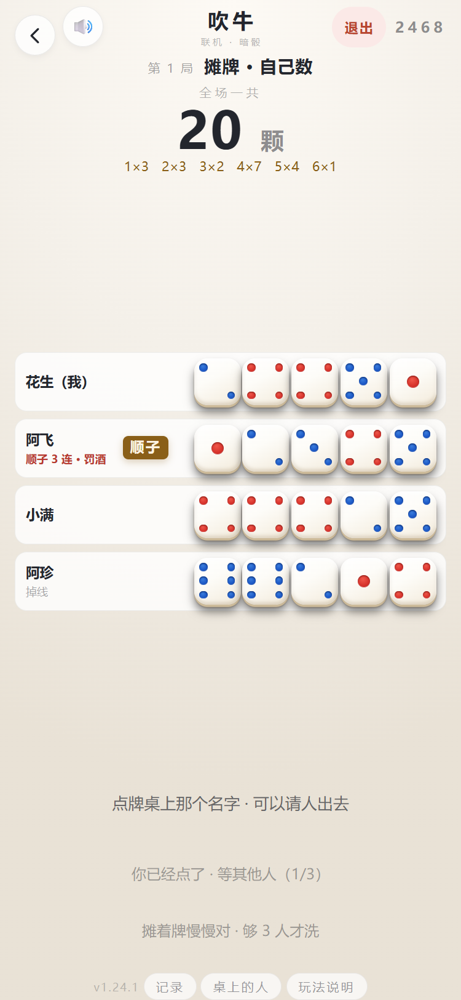
  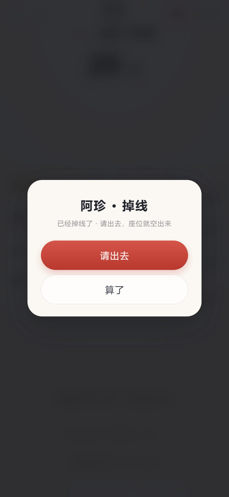
  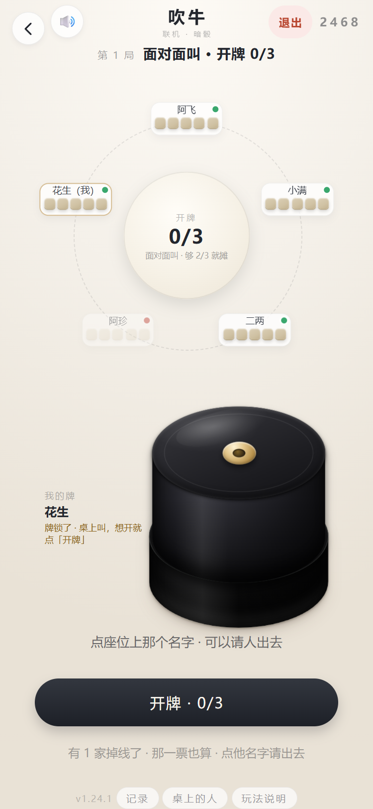
  

  摊牌页的掉线标记 → 点名字就弹确认 → 请出去之后两张票的票数当场重算

**一、摊牌页的踢人入口。** 以前只有「面对面叫」那一页能点名字，摊牌页是死的。现在两页都行 ——
而且只认**名字**那两个字，不认整行：摊着牌的时候手指在屏幕上找自己的点数，随手一按就弹
「请出房间」太吓人。

**二、只剩一个人，一票就够。** 这不是打补丁，是一条本来就该有的规矩：分母一直按**在线人数**
算（2/3），两个人里走了一个，剩下的那位就是全桌，他点的就该算数。以前门槛写死「最少 2 票」，
于是最后一个人怎么点都差一票，屏幕上那个 1/2 永远不动。

**三、有人掉线的那一刻，票数当场重数。** 我先点了开牌（1/2），对面接个电话再没回来 ——
分母已经变成 1、那一票其实够了，可没有人去重数，屏幕就那么停着。现在掉线、被请出去、退房，
三条路都会重数：该摊的当场摊开，该洗的当场洗牌。

| 场景 | 之前 | 现在 |
| --- | --- | --- |
| 摊牌页有人走了 | 点不动、也踢不掉，只能整桌退出去重开 | 名字还在，点它 → 请出去 |
| 两个人玩、走了一个 | 门槛 2 票，剩下的人永远差一票 | **1 票**，点一下就摊 |
| 我点过开牌之后对面掉线 | 停在 1/2 | 掉线那一刻自动摊开 |
| 摊着牌、别人都走了 | 停在 0/2 洗不了牌 | 一个人点「下一把」就洗 |

### 面板改名叫「调试功能」，联机版也有同一套了

> 「把吹牛骰子单机版那套功能联机版也要一样，入口一样是按住上方文字……我们这个隐藏面板的名
> 以后也叫调试功能，单机版原来叫点数设置，也改成调试功能，以后不管加什么这些都叫调试功能。」

  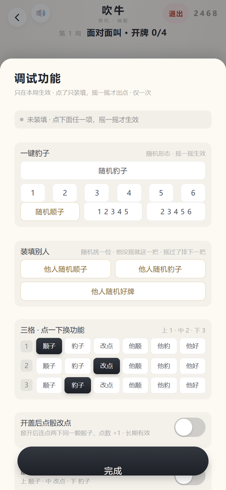
  

  联机版：长按顶上那行字弹面板；骰盅左边一条竖带，竖着切三份（上 顺子 · 中 点骰改点 · 下 豹子）

第一个人说完这句，第二句紧跟着就来了：

> 「怎么调试功能没把单机的整个拿过来？」

对 —— 第一版只搬了三个开关。现在**面板整张跟单机一模一样**：装填状态条、一键豹子（随机 / 1~6）、
顺子（随机 / 1 2 3 4 5 / 2 3 4 5 6）、三个开关。状态条会写「已装填 · 豹子 · 66666 · 摇一摇生效，仅一次」——
点了到底有没有效，不用再猜。

**三格竖着切在盅左边。** 联机的盅挪到了右边、下面紧挨着「摇 · 5 颗」那颗大按钮，横着切一定压在按钮上，
所以竖着切在盅左边那条空当（位置是用户自己在截图上圈出来的，照着量）：

| 位置 | 作用 | 震动 |
| --- | --- | --- |
| 上 1/3 | 装填**随机顺子** | 一下短 |
| 中 1/3 | **点骰改点**开关 | 开＝两下 / 关＝一下长 |
| 下 1/3 | 装填**随机豹子** | 一下长 |

摇不了的场合（牌锁了、已经摇过）给一下很轻的 12ms —— 用来分开「点了没反应」和「点了没生效」。

**当场修掉三个实测报上来的毛病：**

- **「点骰改点开启后没法改点，无效果」** —— 盅里那层骰子整层 `pointer-events:none`；
  就算让它接手指，盅那套掀盖手势一 `setPointerCapture`，`click` 就被派给盅，骰子永远收不到。
  现在开盖改点开着时才让骰子接手指，盅手势让开落在骰子上的那根手指，监听改成 `pointerdown`。
  顺带：点骰子不会再顺手把盖子合上了。
- **「三格的 2、3 点了没震动」** —— 原来在容器上按 `clientY` 算落在哪一格，手机上点下面两格
  根本没进 handler。现在三块 `<i data-k>` 各自接 `pointerdown`，落哪块算哪块。
  另外三格**摊牌页整块收起来**：那一屏左列是名字，点它请人出去，别让三格挡在中间。
- **「一键豹子不要正豹，要随机豹；刚试了一次 11111 太明显」** —— 联机第一版的
  「随机豹子」只是把点数随机了，形态仍是五颗一样（还会摇到 `11111`）。现在照单机那套改成
  **万能豹**：点数 2~6 随机、2~4 颗真点数、其余填 1 再打散（`1 1 6 6 6`）。
  1 是非斋局的万能牌，强度不变，摊出来却是一手普通牌。三格下格也跟着换；
  状态条和 chip 点亮都能认出这种形态。1~6 指定档保留（那是主动要叫几点才用的）。
  顺手查了「随机顺子也看下哈」：联机第一版发的是升序 `12345` / `23456`，五个连续数字排一溜
  同样扎眼，也照单机改成先挑一条再打散（`3 1 5 2 4`）；三格上格一并跟上。
- **「摇了之后退出、再进来，盖子打不开」** —— 这条是上一条修完带出来的：开关存在手机里，
  退出重进会自动带回来，于是骰子层一直「让着」手指；而改点又要求盖子先掀开 —— 两边都不接，
  点盅正中间那一块成了死区。重进时盖子本来就是合上的，就再也掀不开了。
  现在「此刻真的能改点」只有一个判断（`tapEditLive`：盖子已掀开 + 已锁牌 + 总闸和开关都开着），
  盅让位、骰子接手指、CSS 放开指针三处共用它；其余任何时候点盅都是照常掀盖。

**门禁只有一道：首页页脚那个版本号，连点 7 下。** 总闸关着的时候，单机长按标题、联机长按顶栏，
都毫无反应，连计时都不起。这条这次专门写了脚本，两边各验一遍。

联机的点数在服务端摇的，所以「装填」和「改点」都得走协议：`larm` 只装一次、摇完立刻清掉；
`lset` 只改自己那一份、每次 +1，摊开之后再改就是对账了，服务端直接拒。

**纯净版（`/clean/`）里这一整套是剪掉的** —— HTML、CSS、协议调用点一起剪，不是藏起来。

> 单测 147 条（新增「掉线重数」「调试功能」「装填只回给自己」三组），
> 线上端到端五条（重连 / 踢人 / 只剩一人 / 调试功能 23 条 / 盖子 30 条）全绿，
> 14 张版式图重拍。盖子那条专测「开关开/关 × 第一次进/退出重进 × 盅上四个位置」，
> 外加锁牌掀盖后连点骰子仍报 `lset`、且不会顺手合盖。

## v1.21.0 · 2026-11-11

### 联机吹牛再减一刀：「开始」没了，叫点也没了

上一版给联机吹牛加了一道「按开始锁牌」，当时觉得那道锁很关键。用了一下午就发现它是个多余的门槛：

> 「摇完了也无法摇第二次，为什么不摇完直接就自动点开始呢？这样省事。」

对。**一个人一辈子只能摇一次**，摇完就是认账 —— 那还按那一下干嘛？于是这一步整个删掉：

  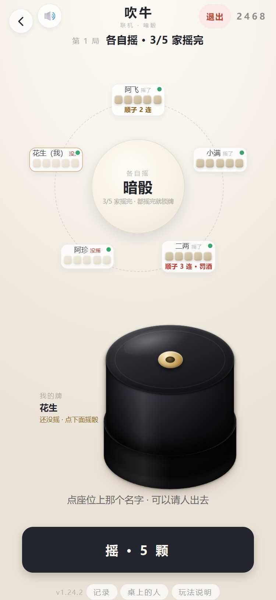
  
  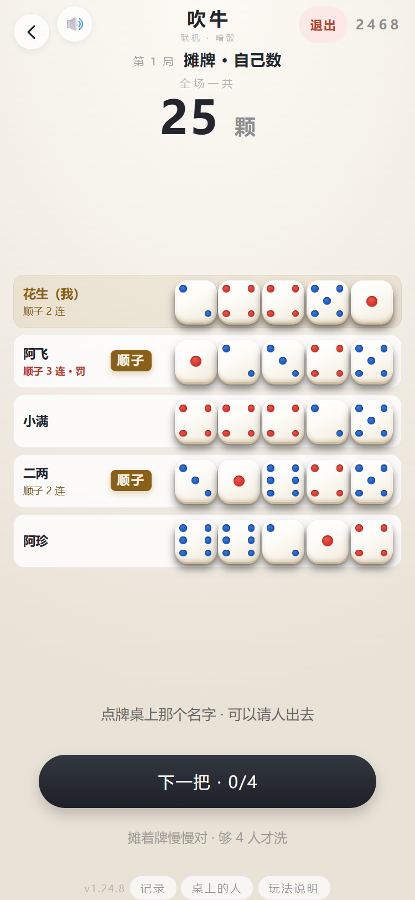
  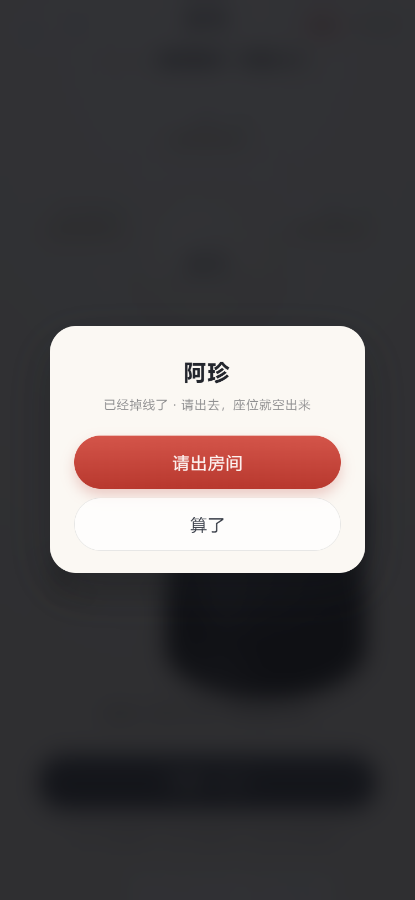

  摇（摇完自己就锁）→ 面对面叫 → 开牌 2/3 → 摊牌 → 下一把 2/3，外加「点名字请人出去」

| 变化 | 之前 | 现在 |
| --- | --- | --- |
| **「开始」按钮** | 每家按一下，全员按了才锁 | **删了**。在线的都摇完，牌当场锁 |
| **叫点面板** | 手机上点「几个几 / 斋」，还要守「只往上走」 | **整块删了**。线上一个字都不记，桌上说 |
| **「开！」** | 谁都能开，开了就摊 | 换成**「开牌」这张 2/3 的票**，够了才摊 |
| **摊牌顶栏** | 报「7 个 4 · 够数 · 二两 输」 | 只报**「25 颗」**和**「1×3 2×5 3×2 4×8 5×4 6×3」**，不判输赢 |

**为什么把叫点也删了**：程序记不住你们嘴上的顺序。谁先叫、隔着座位接话、喊了几轮 ——
记错一次全桌都要重来，还得为「手机上点错了」再吵一轮。而它本来只服务一件事：
开牌的时候算不算数。既然现在**开牌本身也只剩一张票**（谁不信谁点，2/3 就摊），
那叫点就彻底没有存在的理由了。

**新加的：点名字请人出去。** 桌上总有人接个电话就再没回来，座位一直占着，别人还得等他那一手。
现在点座位上那个名字会弹一句确认：

- **已经掉线的人，谁点都能请** —— 他反正按不了，留着只是占位；
- **还在线的人，只有房主能请** —— 防的不是手滑，是桌上吵起来。

没有投票、没有倒计时。人一走座位马上重排，两张票（开牌 / 下一把）的票数也跟着重新算 ——
有时候人一走，当场就够了。

**新加的：顺子标出来。** 五颗正好连成 1-2-3-4-5 或 2-3-4-5-6，名字和骰子中间那块空白会贴一个
金底的「顺子」。理由很实际：顺子是最强的一手，可它长得**最像什么都没有**（五颗全不一样），
满桌人低头数点子的时候最容易漏的就是它。豹子不标 —— 五颗一样，没人会看错。

**顺手挪了个位置**：骰盅从左边挪到**右边**（文字块挪到左边）。
单手拿手机，拇指的自然落点就在右下角，掀盖是这一页做得最多的动作，不该放在最左边。

**修：升级前开的旧桌不再是一片空白。** 上线当天就撞上了 —— 上一把还开着的人回来，
看到的是一桌没有按钮的牌，问「摇一摇丢了？那怎么摇，这样好像无法开始」。房间里的局面还是
旧协议留下的（`phase` 是个新版不认识的名字），新版没有哪一步对得上，底栏就空着。
现在这种桌子会明说：

  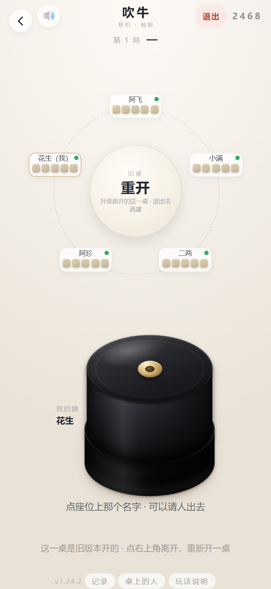

一句话：**升级之后先把旧房间退掉再建**，新开的房间一定是新协议，进去就有「摇 · 5 颗」。

**留下的还是那些**：摇完就锁、2/3 只算在线的人、摊牌只展示不判、摊着不自动洗、掉线凭房号回原位。
四张票的分母（在线人数 × 2/3）全场只有一套算法，3 人 2 票、5 人 4 票、9 人 6 票。

> 单测跟着重写成「摇完即锁 / 开牌票 / 摊牌只摊不判 / 换局 / 踢人」五组（78 条全绿），
> 线上端到端 41 条全绿，含「第二局照样锁得上」那个真 bug 的回归。

## v1.20.0 · 2026-11-11

### 联机吹牛砍到只剩一件事：线上只负责给骰子

一桌人坐在一起，其实拿单机版就能打 —— **唯一的麻烦是看不见别人的点数**，核对的时候得挨个
把手机递过去。那联机版就该只补这一件事，别再管别的。

所以这一版把「吹牛 · 联机」整个拆了重做：

> **发骰子 → 按「开始」锁牌 → 面对面叫 → 谁不信谁点「开！」→ 全桌摊开核对 → 2/3 点「下一把」**

  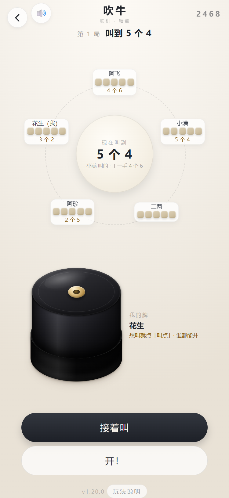
  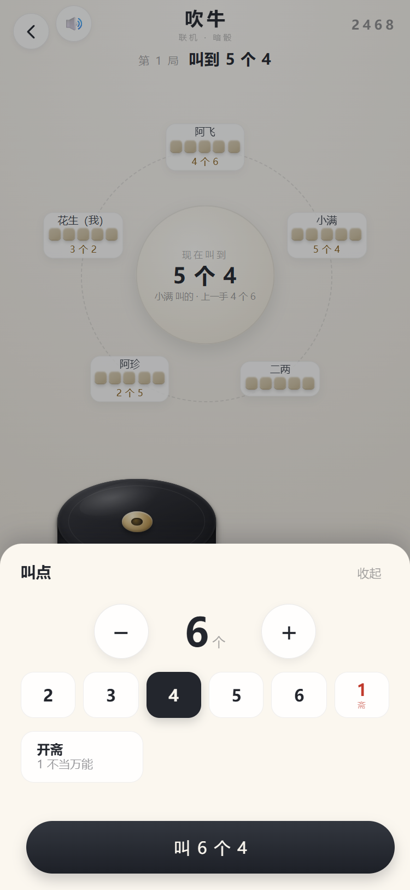

  摇完按「开始」→ 全员都按了才开叫 → 一开就摊，够票才洗（叫点这一整套在 v1.21.0 全删了）

**新的一步：「开始」。** 摇完点「开始」，这一把就**锁住** —— 不能再摇，也改不了。
缺了这道锁，一局永远开不了头：总有人说「等我再摇一下」，而你没法知道他是真没摇完还是在等点数。
**全员都按了才进叫点**，桌上每个人名字后面挂着「摇了」/「开始」，谁还欠一手一眼看得出。

**删掉的东西**（都是故意的，别再搬回来）：

| 删了 | 为什么 |
| --- | --- |
| 起叫门槛、最少几个才能叫 | 第一手 1 个 2 也该叫得出来。程序不知道你们刚才是怎么讲的 |
| 「轮到谁」、转向、点人 | 你们嘴上是隔着座位接话的，程序跟着记就行，不该替你们排顺序 |
| 抢开翻倍、认半杯、劈 | 开了就是一摊，一杯。别的环节全是给程序看的，桌上根本不走这一套 |
| 对赌倒计时、自动摊牌 | 摊着不自己往下走 —— 有人还在低头对牌，屏幕不能被换掉 |
| 摊牌报杯数 | 只写「谁输」。喝多少是桌上自己的事 |

**留下的**：叫点只往上走（因为它决定「开」的时候算不算数）、斋、进斋退一位、破斋翻倍。
这几条不是玩法偏好，是「够不够数」的算法本身。

**摊牌是一整屏的表**：一行一家、5 颗骰子放大到 10vw（375 的屏上 37.5px 一颗），输家那行描红；
顶上两句 —— 「全场一共 7 个 4」和「5 个 4 · 够数 · 二两 输」。够数就是开的人赌错了，
不够就是叫的人吹爆了。9 个人也不挤，骰子自己降到 7vw。

  
  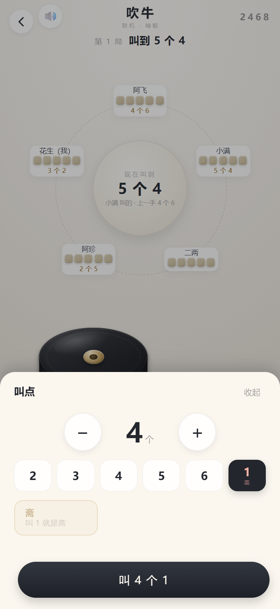
  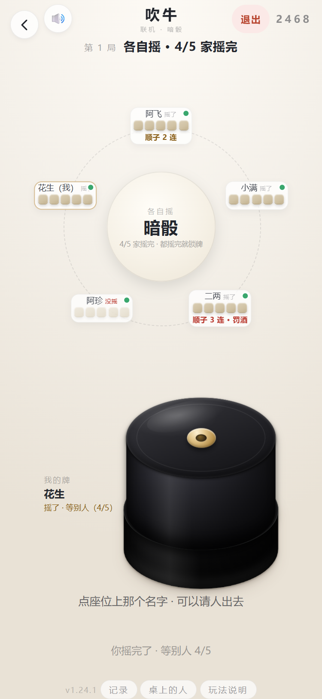

  叫点面板跟着减：没有门槛条、没有「转」、没有「点人」，只剩几个 · 几点 · 斋

**顺手修掉一个会卡死整桌的 bug**：换下一把的时候没清「已开始」这个标记，
于是第二局一进来全员都是「已开始」，那套「全员到齐才开叫」的判定永远不会再触发 ——
整桌就停在新的一把里，谁点都没反应。现在换局会把每一家的「摇了 / 开始」一起清掉，
端到端里专门留了一段验它（第二局照样开得起来）。

**骰盅还是单机那只**：整只盅全 vw 单位，套进来缩到 40vw，配方一字没改 ——
点开、点合、跟手拖、摇的时候整只晃、换局自动合盖，都跟单机一样。

## v1.18.0 · 2026-11-11

### 摆桌上一块屏：房号、轮到谁、各家几杯，全在大屏上

联机两个玩法都是「各看各的手机」。真坐到一张桌子前，这就多出些零碎事：
**谁该摇了得喊一声**、房号要挨个念、谁几杯了得挨个数、刚才谁喝的那杯是为什么 ——
每次换人都得来一遍，有人低头回条消息就全错过。

这一版加一块**公共屏**：找台旧手机、pad、副屏摆在桌子中间，输一次房号就不用管了。
房号、轮到谁、各家几杯、刚发生什么，全摆在大屏上；**摇骰、看自己的牌还在各自手机上**，
谁也看不到谁的。

入口在「联机」→ 玩法页最下面那条金色的 **摆桌上 · 公共屏** ——
它不算第三种玩法，所以没跟上面两张玩法卡抢同一份份量，是一条细带子。

  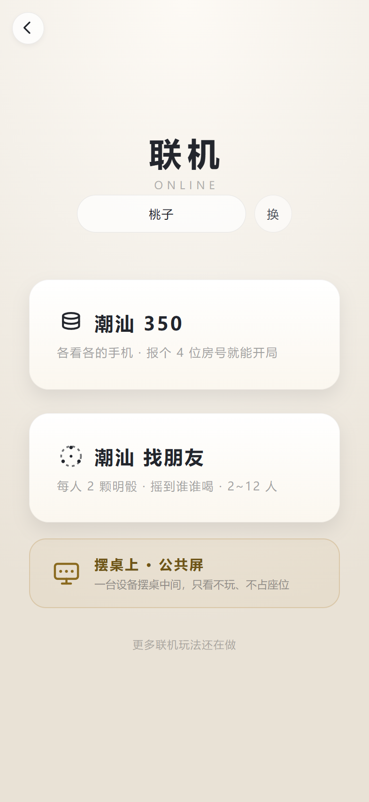
  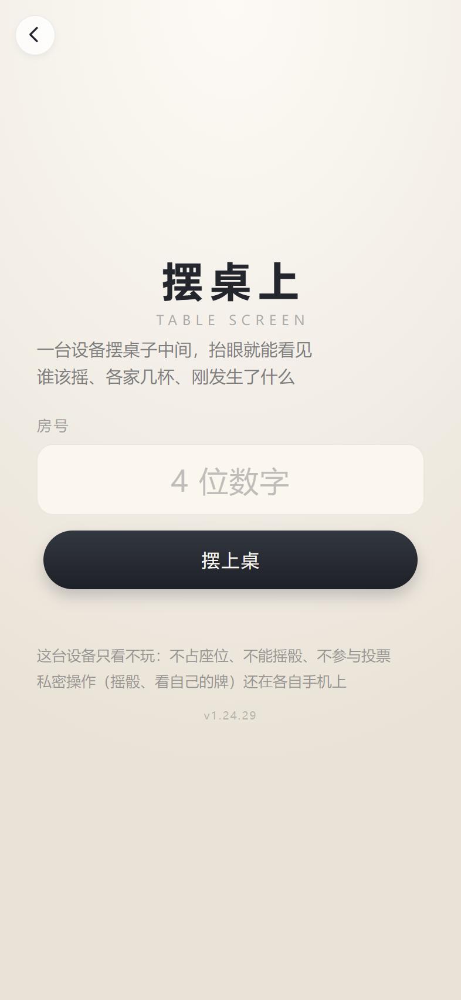
  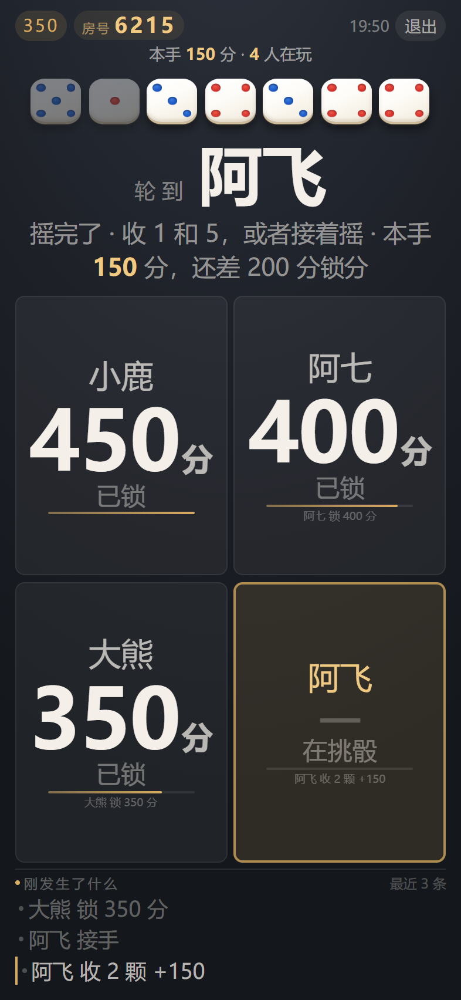

  入口 → 输一次房号 → 350 打到一半：桌上摊着这一手的骰子（收下的压暗），三家的分已经锁了，底下是最新三条

| 大屏上有什么 | 说明 |
| --- | --- |
| **房号** | 顶上一直是这桌的 4 位房号，谁晚到抬眼就能看见，不用再问一遍 |
| **轮到谁** | 名字摆到最大那个字号 —— 隔一张桌子也看得清，不用凑过去看别人的手机 |
| **各家几杯** | 350 摆每个人锁下来的分数（读作「400 分」）；找朋友摆每个人喝了几杯（读作「2 杯」）—— **数字后面带单位**，不用猜这个数是什么 |
| **各家点数** | 找朋友本来就是明骰，一人两颗全摊在桌上，大屏照摆；还没摇的人画成两个空位，一眼看出他还欠一手 |
| **刚发生什么** | 底下最近三条：谁锁了多少、公骰点到谁、谁喝了一杯 |
| **不熄屏** | 摆在桌上那块屏没人碰它，一分钟就黑下去等于白摆 —— 申请了 Wake Lock，亮着 |

  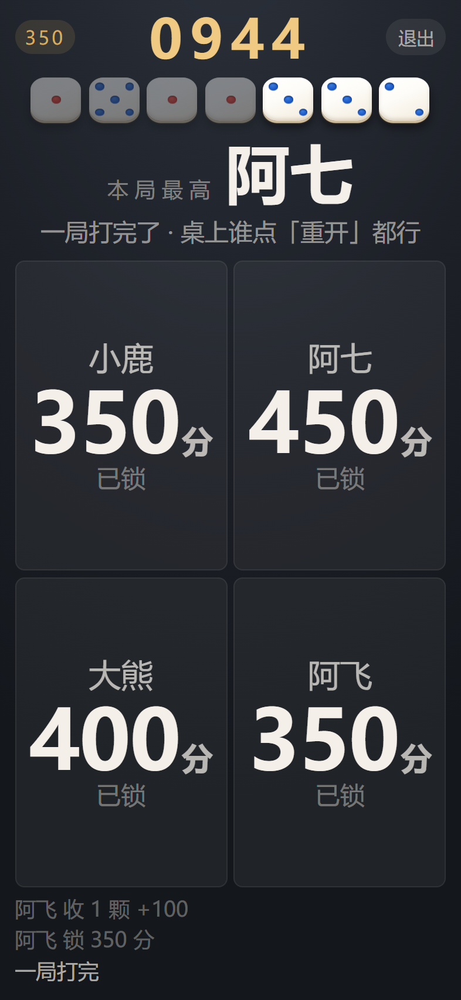
  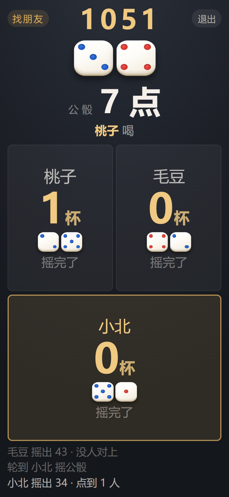

  左：350 一局打完，直接写「本局最高」是谁 · 右：找朋友，公骰点到谁谁喝，各家那两颗也照摆

几个刻意的地方：

- **它只看不玩，连一个能点的东西都没有**。不是把按钮藏起来 —— 这台设备进房时根本
  没有座位：桌上还是 4 个人，它不在名单里。
- **不占座位，也不进投票的分母**。4 个人重开要 3 票；看板要是算进去就变成 4 票，
  而那一票永远点不出来 —— 那一桌就再也重开不了了。这是整个功能唯一不能让的一步。
- **卡片上的数字后面带单位**（「400 分」「2 杯」）。第一版是裸数字，
  第一眼看上去像名次、像编号 —— 有人对着大屏研究了一局才明白那是杯子数。
- **找朋友把各家的两颗也摆出来**。明骰玩法，桌上一人两颗本来都摊着，
  大屏没理由空着 —— 私密的是「摇」这个动作，不是点数。350 那边反过来：
  只有当前这一手的骰子值得看，锁完就只剩分数。
- **骰子不另画一套**。第一版自己画了个「九宫格里点亮几格」的骰子，米白配深灰点 ——
  摆在牌桌旁边像另一个 App。现在直接复用牌桌那颗：白胚、蓝点、一点和四点红、
  底下那层侧面厚度，连落地动画都是同一个；大屏只负责「多大、摆哪儿」。
- **卡片底下那行小字跟顶上是同一件事**。原本轮到谁就一律写「正在摇」——
  可他摇都摇完了、顶上写着「摇完了 · 收 1 和 5」，卡片上还写「正在摇」，
  一屏两句话打架，看的人会以为自己漏了一步。现在按手上的动作写：
  该他摇 / 在挑骰 / 豹子 / 爆了 / 收下了。
- **房号输错会退回来告诉你**，不会留一块黑屏让人对着等；打一半断网自己重连，
  屏上角标闪一下「重连中」。
- **纯净版一样有**。这是面对面打牌的一部分，不是完整版才给的功能。

## v1.16.0 · 2026-11-11

### 牌桌上多了「本局记录」和「桌上的人」

联机这两个玩法（350 / 找朋友）以前有个毛病：**桌上发生过什么，只能当场看见**。

「3 号被公骰撞到了」是一句 1.5 秒就消失的提示，「你这一杯怎么来的」没人说得清；
低头回条消息，抬头已经换人了。房间里有人走了、有人乱点，房主手里也只有
「重开一桌」这一把大锤 —— 一按，全桌人的杯子跟着清零。

这一版补上两样，外加把「重开」改成投票。

  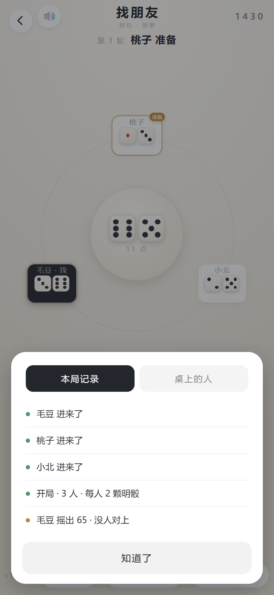
  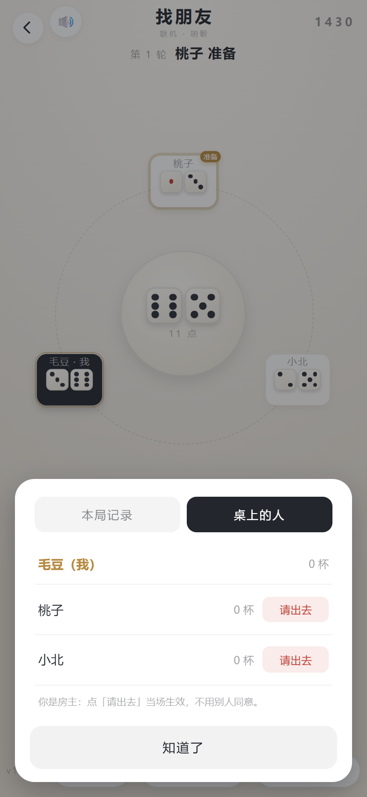
  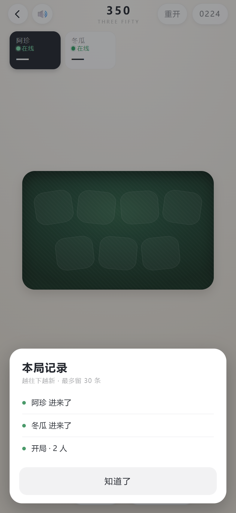

  左：本局记录（找朋友）· 中：桌上的人 · 右：本局记录（350）—— 页脚点开，收起来接着打

| 新的 | 说明 |
| --- | --- |
| **本局记录** | 页脚「记录」摊开整局：谁进房、开局、各家摇出几点、公骰撞到谁、谁喝了一杯、换到谁、重开。**最多留 30 条**，越往下越新，打开就停在最新那条 |
| **桌上的人** | 名字 + 这几局喝了几杯 + 掉线标记。谁走了、谁一直不动，一眼看得出 |
| **房主请人出去** | 点「请出去」**当场生效**，不用别人同意（人是他招来的） |
| **其他人发起投票** | 点「发起投票」：在线的**三分之二同意**才请得出去；45 秒没人接着点就自动作废；再点一次是撤回 |
| **重开一桌改成投票** | 以前房主手滑一下就把一桌人的杯子全清了。现在同样要三分之二点头；投过之后按钮上写着「重开 1/2 · 撤回 · 45s」，别人也看得见有人在张罗 |
| **被请出去的人** | 回到填房号那一屏，房号下面写着「你被请出了这一桌」—— 不是莫名其妙断线 |

  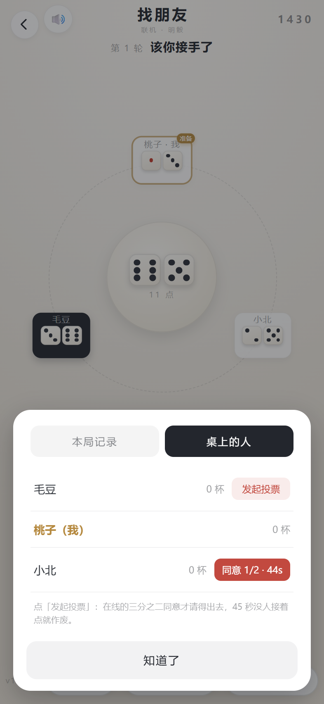
  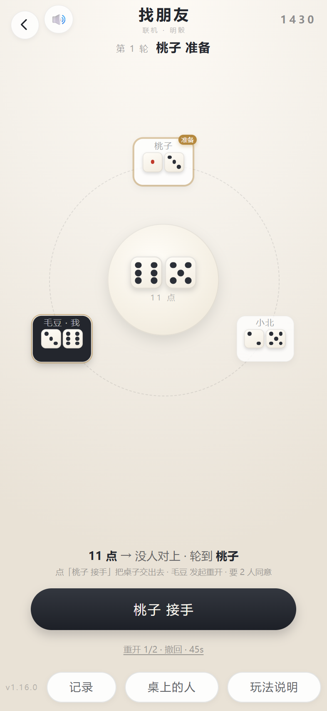

  投票中的样子：踢人那条变成红色的票数按钮，重开这颗缩在「接手」下面一行

几个刻意的地方：

- **记录是服务端记的，不是手机记的**：谁在第几轮喝了几杯、公骰点数多少，
  以服务器那份为准；换手机、断线重连回来，记录还在
- **只记这一局**：不写「上周三谁赢了多少」那种账本 —— 一桌人喝酒，不需要被存档
- **分母只数在线的人**：掉线那位本来就听不见，把他算进分母等于把整桌锁死
- **踢人的分母再减一**：被踢的那位不算，不然等于给了他一张否决票
- 纯净版**一样有**这三样（它们是牌桌上的公开功能，不是隐藏开关）

## v1.15.9 · 2026-11-11

### 每个玩法页都能关声音了

以前只有**吹牛**和**联机 350**的顶栏有那颗 🔊，350 单机、找朋友单机、
联机找朋友这三个页面怎么都关不掉声音 —— 一桌人坐下来，想静音得先退回吹牛页。

现在五个玩法页的顶栏**同一位置**都有一颗：进页面点一下关，再点一下开。

  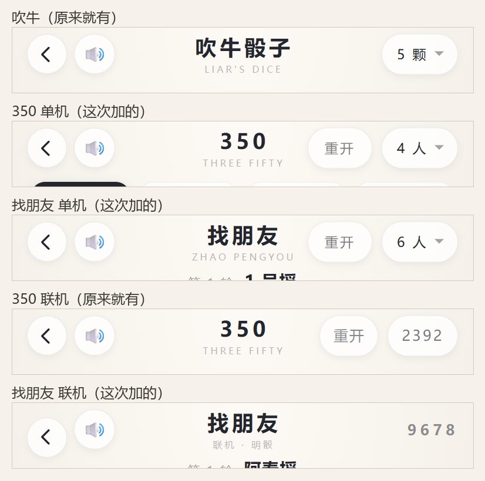

  返回箭头右边那颗就是 —— 五个页面位置完全一样，图标一亮一暗就是开关状态

  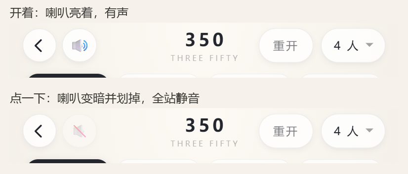

  同一页对比：上面是开着（有声），点一下就是下面这样 —— 喇叭变暗、划掉，全站静音

- **一个开关管全站**：在哪一页关的，换到别的玩法还是关着的，刷新也记得
- 关掉之后**真的一声都不出**：摇骰的沙沙声、换人、豹子、爆点、开盖、结算，全部静音
- 只关声音，**震动照旧**（想连震动一起关，那是系统设置里的事）

## v1.15.8 · 2026-11-10

这一版加了一个新玩法，顺手把隐藏功能那套的按钮位置修对了。

### ① 新增「联机 · 潮汕 找朋友」

各看各的手机，报个 4 位房号就能开局。**明骰点名**：全桌的骰子都摊在桌上，公骰点到谁，谁喝。
2~12 人，每人 2 颗，中间 2 颗公骰。

  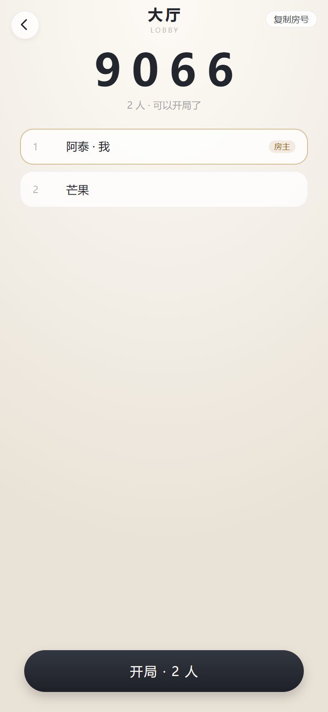
  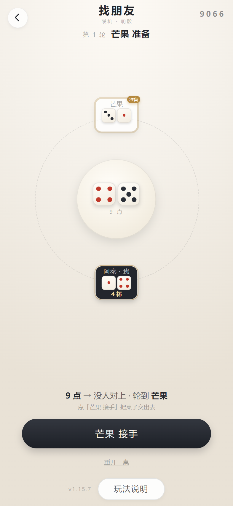
  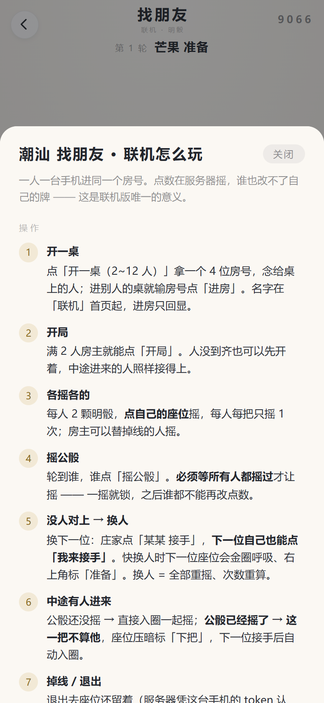

  报房号坐下 → 公骰点到谁谁喝，杯数挂在各自名下 → 规则就在牌桌上，边玩边看

- **一模一样 2 杯**、只是和值相同 1 杯、豹子碰豹子 1 杯，按最高那档算，不叠加
- 摇出 **1+1** 的庄家，可以再指一个人罚 1 杯
- 一直摇到「谁都没对上」才换下一家；换人时全桌重摇，每人**只能摇一次**
- 完整玩法 → [联机 · 潮汕 找朋友](play-find.md)

### ② 找朋友也有了「调试功能」（完整版才有）

跟单机吹牛一样藏起来：**首页页脚连点 7 下**开总闸，再**长按牌桌标题 1.2 秒**开面板。
面板六行 —— 总闸 + 五项，牌桌上还有五格隐形快捷键。

  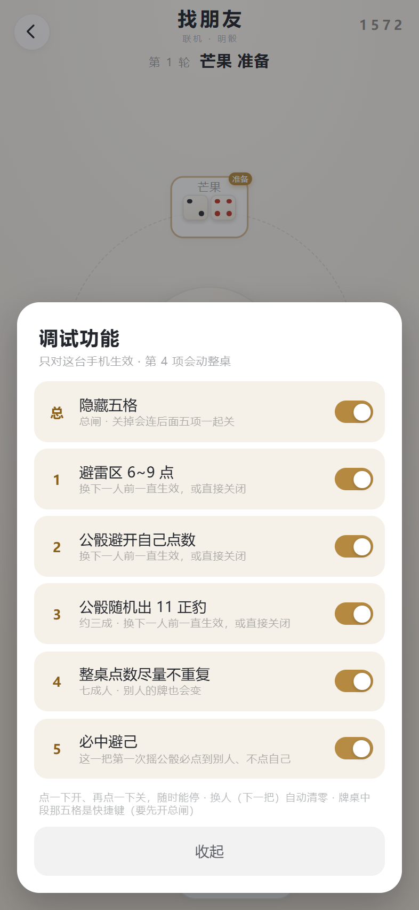
  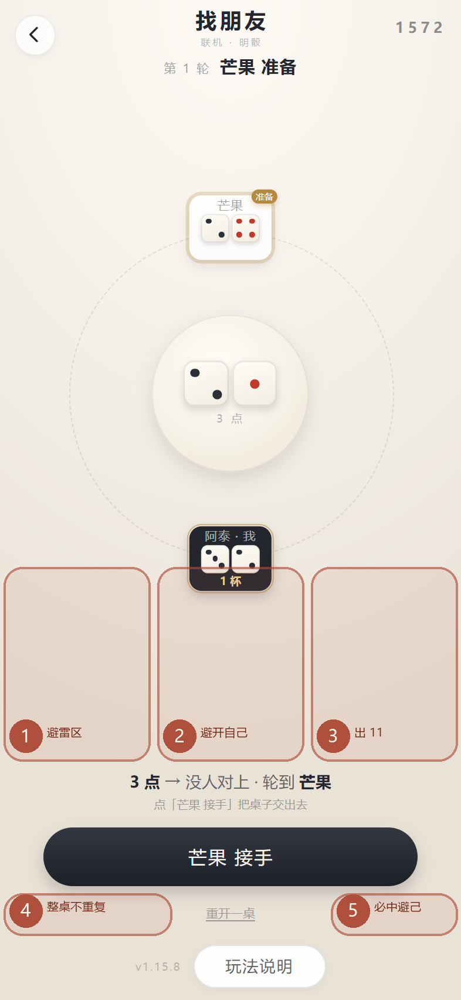

  左：长按标题弹出的面板　　右：五格在哪（框是画给你看的，App 里是隐形的）

| # | 开关 | 一句话 |
|---|---|---|
| 1 | 避雷区 6~9 点 | 自己那两颗避开 34 / 45 这些最容易被撞的档 |
| 2 | 公骰避开自己点数 | 摇公骰绕开自己，尽量撞别人 |
| 3 | 公骰随机出 11 正豹 | 约三成直接 1+1，附带再罚一个人 1 杯 |
| 4 | 整桌点数尽量不重复 | 七成人拿到不重复的组合，**会动到别人的牌** |
| 5 | 必中避己 | 这一把**第一次**摇公骰，必定点到别人、绝不点自己 |

点一下开、再点一下关，随时能停；**换下一人自动清零**。
怎么开、五项各是什么、有什么副作用 → [隐藏设置](hidden.md)
（纯净版没有这一套，代码整段都不存在）。

### ③ 修：隐形按钮会压在「接手」上

上一版把牌桌五格改大之后，下排那两格（4 整桌不重复 / 5 必中避己）算的是
「留白带下方 69px」—— 而底栏那几颗按钮是钉在屏幕底边的，结果两格正好搭在
「接手 / 摇我的 2 颗」这颗大按钮的两个下角上：**总闸开着的时候点按钮，
会顺手把 4 或 5 翻掉**。

现在下排改成**按屏幕底边算**（离底 52~94px 那一条），不管按钮叫什么、
按钮在哪儿，它都落在按钮和「玩法说明」之间那条空当里；
另外还加了一道保险：落点在真按钮上的那一下，隐形格一律让路。

## 更早的版本

| 版本 | 改了什么 |
|---|---|
| **v1.15.8** | 新增「联机 · 潮汕 找朋友」（明骰点名、一模一样双倍）；找朋友也有调试功能暗门；修下排两格压在「接手」按钮上 |
| **v1.15.7** | 牌桌五格改成两层（上排三格铺到圆环下方、下排两格落在页脚两角）；关总闸会把五项一起关 —— 修掉「明明关了还老出正豹」 |
| **v1.15.6** | 补第五项「必中避己」；面板编号从 1 起，跟牌桌五格对齐；两项注释改成「换下一人前一直生效」 |
| **v1.15.5** | 加第四格「整桌点数尽量不重复」，并且五项都能随时点开、随时关掉 |
| **v1.15.4** | 找朋友联机加「调试功能」暗门：首页连点 7 下 + 长按标题，牌桌三格快捷键（避雷区 / 避开自己 / 出 11） |
| **v1.15.3** | 「玩法说明」入口搬进牌桌（原来在拿房号那一屏）；350 牌桌上点开的是**联机**那份规则，不再是单机文案 |
| **v1.15.1** | 找朋友每人每把从摇 2 次改成**只摇 1 次** |
| **v1.15.0** | 联机加「潮汕 350」：每人 5 颗、满 350 收手，房号进房、掉线回位、踢人 / 重开投票 |

更早的记录看仓库的 [commit 历史](https://github.com/cbywyz/liars-dice-apk/commits/main)。
