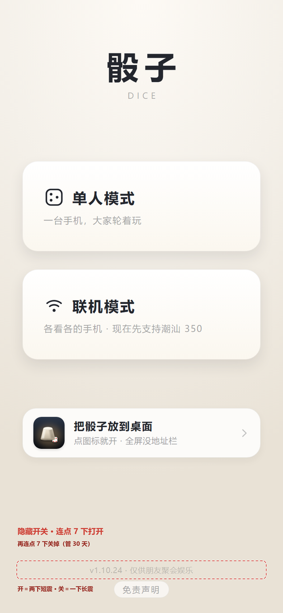
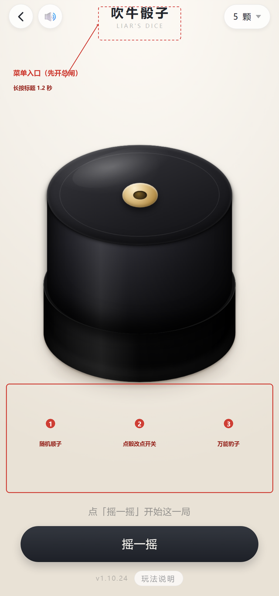
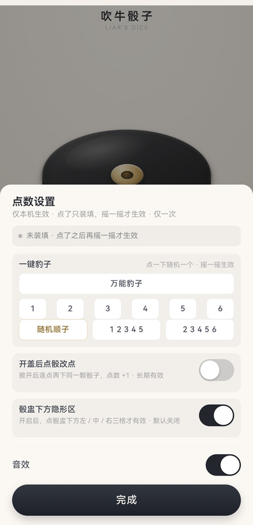
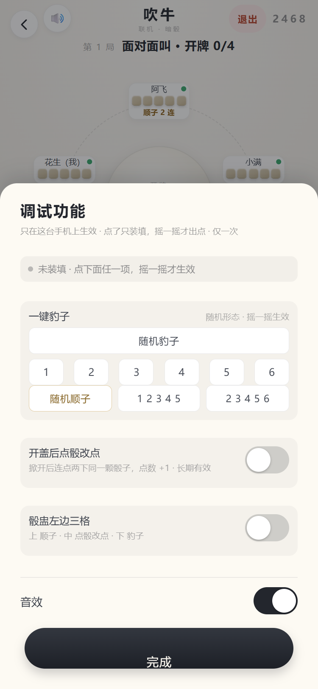
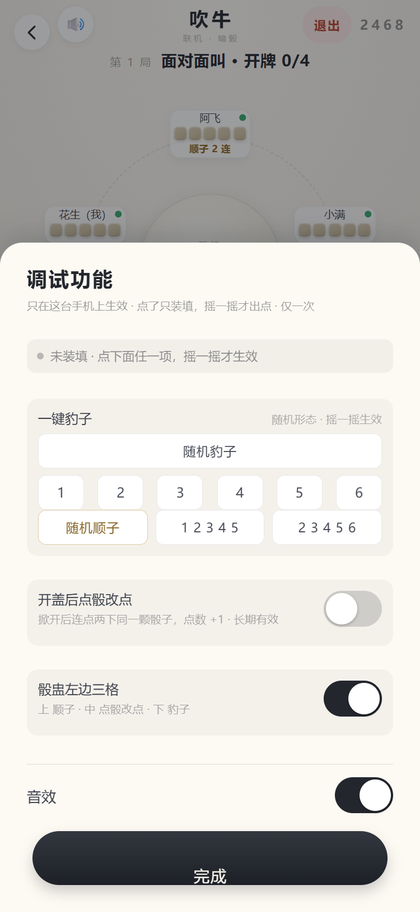
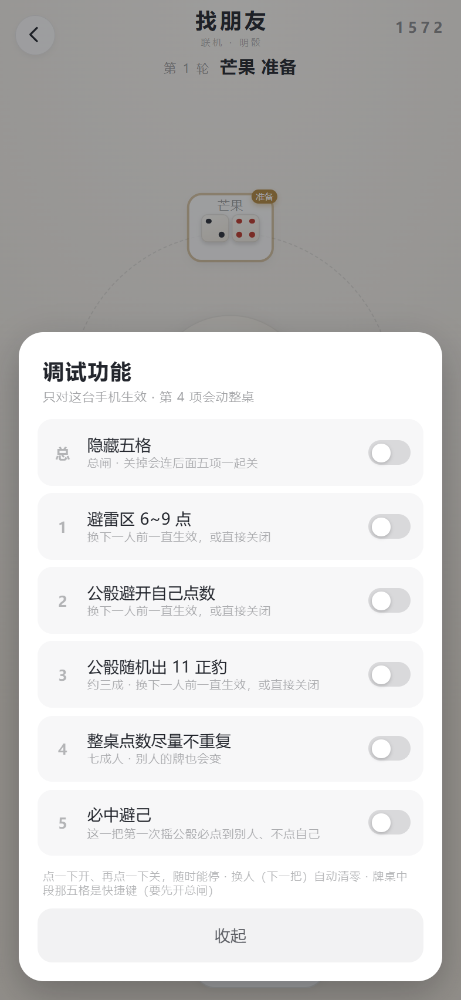
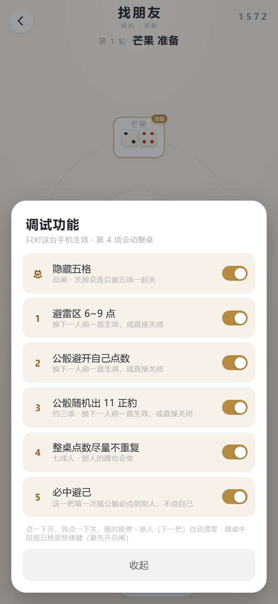
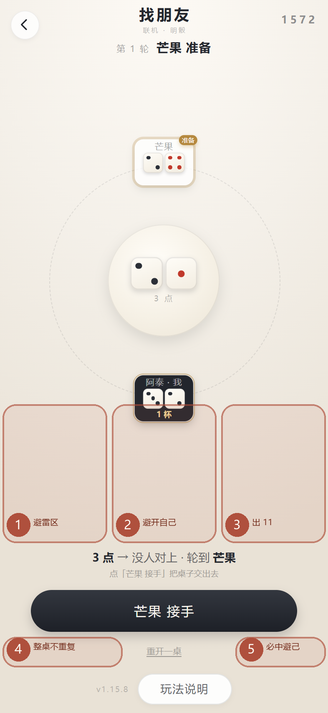

# 隐藏设置（完整版才有）

[← 回首页](../README.md)

## 隐藏设置（完整版才有）

> ⚠️ 这一节的功能是给**酒局上挡酒**用的（见开头「用在哪」），**只能在朋友之间的玩笑里用**。拿它去骗钱、设局、做赌具，都是违法的，后果自负 —— 见[完整免责条款](terms.md)。

**这些入口默认全是关着的，界面上一点提示都没有。** 所以分两步：先开总闸，再谈入口。

### 第一步：开总闸 —— 首页页脚连点 7 下

  

  落点就是首页最底下那行版本号 —— 字小、灰色、贴在屏幕最底下，谁也不会去点它

| 项目 | 怎么算 |
|---|---|
| 点哪里 | 首页页脚 **「v… · 仅供朋友聚会娱乐」** 那一行（版本号那行，灰色贴底） |
| 点几下 | **连点 7 下**打开；**再连点 7 下**关掉（同一个动作，不用记第二个手势） |
| 间隔 | 两下之间**不超过 0.9 秒**，停久一点就从头数 |

开和关**不弹任何字**，只有握着手机的人该知道：

| 动作 | 颜色 | 震动 |
|---|---|---|
| 打开 | 那行闪 **0.7 秒绿色** | 两下短震 |
| 关掉 | 那行闪 **0.7 秒红色** | 一下长震 |
- 开着**管 30 天**，每真用到一次就续一次期 —— 天天用就一直有效，借出去放一个月自己就失效了
- **关着的时候，下面所有入口一点反应都没有**：不震、不弹、连计时器都不起，跟一块普通标题没区别
- 一个开关管全部：以后别的玩法要是也做暗门，入口第一句都先判这个开关，开了全桌生效

**为什么不用密码**：这是纯前端，密码就写在 js 里，翻一下源码就知道了 —— 挡得住手滑，挡不住「学了去」；
而且**输密码这个动作最招眼**，旁边人一眼就知道这儿有东西。连点一行灰字，看着就像在乱点。

### 第二步：两个入口

激活之后，**长按顶部标题「吹牛骰子」1.2 秒**打开调试功能面板：一键豹子（1–6）、随机顺子（含万能顺）/ 12345 / 23456、
开盖后点骰改点、骰盅下方三格隐形区的总闸、音效。

  
  

  左：激活之后才有用的两个「看不见的入口」　　右：长按标题后弹出的面板

**两个入口在界面上都没有任何提示**，第一次用建议对着上图找：

| 入口 | 在哪 | 怎么用 |
|---|---|---|
| 设置面板 | 顶部标题「吹牛骰子」 | **激活之后**长按 **1.2 秒**（按一下只是标题，没反应） |
| 三格隐形区 | 骰盅下方那块空白桌面 | 左 1/3 = 随机顺子（含万能顺），中 1/3 = 点骰改点开关，右 1/3 = 随机万能豹子；单击就生效 |

- **一键豹子 / 顺子**：点了只「装填」，**不会当场改当前这把** —— 摇一摇才出这个点数；
  只要还没开盖，摇多少次都是它；开盖之后装填解除，下一把恢复真随机
- **豹子认定：1 是万能牌** —— 去掉所有 1 之后剩下的全相同即算豹子，所以 `11333`(3的豹子) / `14444`(4) / `11122`(2) / `11111`(1) 都算
- **顺子认定：5 颗点数互不重复就算** —— `12345` / `23456` 是连顺，`13456` / `12456` / `12356` / `12346` 是带 1 的**万能顺**（1 顶掉中间断掉的那一截），都算顺子；有重复点数的不算
- **完全不弹字**：点了就是静默装填，只有握着手机的人感到一下轻震
- **三格隐形区（还要在面板里单独打开这块的总闸，默认关闭）**：

  | 位置 | 作用 |
  |---|---|
  | 左 1/3 | 装填**随机顺子**（连顺 / 带 1 的万能顺都可能） |
  | 中 1/3 | **点骰改点**开关（开＝两下轻震，关＝一下） |
  | 右 1/3 | 装填**随机万能豹子** |

  单击就生效，不用按住；从这块地方往上拖，照旧是掀盖手势。
  三种手感互不混淆：装填＝一下短震、开关打开＝两下、开关关闭＝一下长震。
- **开盖后点骰改点**：长期开关。打开后掀开盖子，连点两下同一颗骰子，点数 +1（6 之后回 1）

## 联机 · 吹牛：调试功能（跟单机同一套）

> 2026-11-11 加的。规矩跟单机一个字不差：**同一个总闸、同一张面板、同一套震动暗号**。
> 一样只在完整版里 —— 纯净版这套代码整段不存在。

### 两道门

| 步骤 | 怎么做 |
|---|---|
| 1. 开总闸 | 首页页脚那行「v… · 仅供朋友聚会娱乐」**连点 7 下** |
| 2. 进牌桌 | 吹牛 · 联机 → 开房或报房号 → 开局 |
| 3. 开面板 | **长按牌桌顶上那两行字**（「第 N 局」「各自摇 · 0/4 家摇完」）**1.2 秒** |

  
  

  左：面板（跟单机那张一模一样）　　右：三格的位置 —— 盅左边那条竖空当

面板上就是单机那一整套：**装填状态条 + 一键豹子（随机 / 1~6）+ 顺子（随机 / 1 2 3 4 5 / 2 3 4 5 6）
+ 三个开关**（开盖后点骰改点 / 骰盅左边三格 / 音效）。
状态条会写清楚「已装填 · 豹子 · 11666 · 摇一摇生效，仅一次」—— 点了到底有没有效，不用猜。

**「随机豹子」装的是万能豹，不是正豹。** 1 在吹牛里是万能牌（非斋局），所以 `1 1 6 6 6`
跟 `6 6 6 6 6` 是同一手满点的豹子，但摊开时看着就是一手普通牌 —— 五个一模一样、
尤其 `11111`，一眼就看得出被装过。真点数取 2~6、颗数 2~4，其余填 1 再打散：
既不会凑成 `11111`，也不会退化成五个一样；三格的下格装的也是这个。
下面 1~6 那排是**指定点数的正豹**，跟单机一致，想自己定叫几点才用它。

**「随机顺子」装的是真·随机顺，不是两条连顺换着来。** 顺子的规矩是「5 颗点数互不重复」，
1 是万能牌，所以 `13456`、`12456` 这种**带 1 又断一截**的「万能顺」也是顺子 ——
用户原话：「13456 也是顺子，1 是万能，只要没重复点数就是顺子，不能我调试之后出来的都是连顺」。
现在从 `1~6` 里随机删一个点数，删到 2/3/4/5 就得到一条万能顺，再洗牌（`3 1 6 4 5`）：
既不是五个连续数字排一溜，也不会每把都是同一副牌。连顺偶尔也出一条、但绝不连着出两次；
下面两颗固定档仍然只发排好的 `12345` / `23456`。状态条会写「万能顺 · 1 3 4 5 6」，
摊牌页的名字和骰子中间会贴一枚金底「万能顺」。单机版同一个做法，两版一致。

### 三格：竖着切在盅左边

联机的盅在右边，下面紧挨着「摇 · 5 颗」那颗大按钮，横着切一定会压在按钮上 ——
所以三格是**竖着切在盅左边那条空当**（用户自己在截图上圈的位置）：

| 位置 | 作用 | 震动 |
|---|---|---|
| 上 1/3 | 装填**随机顺子（含带 1 的万能顺，打散顺序）** | 一下短（22ms） |
| 中 1/3 | **点骰改点**开关（开＝两下 / 关＝一下长） | 两下短 / 一下长 |
| 下 1/3 | 装填**随机豹子（万能豹，带 1）** | 一下长（45ms） |

摇不了的场合（牌已经锁了、或者自己已经摇过）给一下很轻的 12ms ——
用来分开「点了没反应」和「点了没生效」这两件事。

**摊牌页整块收起来**：那一屏左列就是名字，点它是请人出去，三格不能杵在那儿挡路；
何况牌都摊开了，也没有装填可言。

### 点数在服务端，所以走协议

| 动作 | 发什么 | 服务端怎么处理 |
|---|---|---|
| 装填（豹子 / 顺子 / 三格上下） | `{t:'larm', dice:[…]}` | 只装一次，下一次摇骰按它出点，**出完立刻清掉** |
| 改点（面板第一项 / 三格中间） | `{t:'lset', i:0..4}` | 自己第 i 颗 +1（6 之后回 1），只在「牌锁了、还没摊」这段认 |

还有一道门：先报一条 `{t:'ldbg', on:true}`，不然上面两条一律拒 —— 防的是有人不装面板、
手搓一条消息就把点数按上来。**只动自己那一份**：别人的骰子、别人的画面一个像素都不动；
摊开那一刻全桌才看见，所以「装填 → 摇 → 摊」这条链上别连着用同一手。

### 两个坑，都是实测出来的

- **「点骰改点开启后没法改点」**（用户 2026-11-11 报）。两个原因叠在一起：
  盅里那层 `.lr-cup-dice` 整层 `pointer-events:none`；就算让它接手指，盅那套掀盖手势
  一 `setPointerCapture`，`click` 就被派给盅，骰子永远收不到。
  现在：开盖改点开着时才让骰子接手指，盅手势让开落在骰子上的那根手指，监听改成 `pointerdown`。
- **「三格的 2、3 点了没反应」**（同一天报）。原来是在容器上按 `clientY` 算落在哪一格，
  手机上点下面两格根本没进 handler。现在三块 `<i data-k>` 各自接 `pointerdown`，落哪块算哪块。

## 联机 · 找朋友：调试功能（五项）

> 一样是给**酒局上挡酒**用的，一样只管朋友之间的玩笑 —— 见[完整免责条款](terms.md)。
> **只有完整版有**：纯净版里这套代码整段不存在，连总闸都开不出来。

### 还是两道门：先开总闸，再长按标题

| 步骤 | 怎么做 |
|---|---|
| 1. 开总闸 | 首页页脚那一行「v… · 仅供朋友聚会娱乐」**连点 7 下**（再连点 7 下关掉） |
| 2. 进牌桌 | 联机 → 找朋友 → 开房或者报房号进房 → 开局 |
| 3. 开面板 | **长按顶部标题「找朋友」1.2 秒**，面板从底下升起来 |

  
  

  左：刚打开，全是关的　　右：六项全开（总闸 + 五项）

面板一共六行：**最上面一行是总闸，下面 1~5 跟牌桌那五格一一对应**。
总闸关掉 = 后面五项一起关，不会留一个功能在暗处生效。

### 五项各是什么

| # | 名称 | 作用 | 什么时候失效 |
|---|---|---|---|
| 1 | **避雷区 6~9 点** | 自己摇的两颗，和值避开 6 / 7 / 8 / 9 —— 也就是 34、45 这些最容易被公骰撞上的档 | 换下一人 |
| 2 | **公骰避开自己点数** | 摇公骰时绕开自己那两颗，尽量撞到别人身上 | 换下一人 |
| 3 | **公骰随机出 11 正豹** | 约三成概率直接出 1+1，附带再指一个人罚 1 杯 | 换下一人 |
| 4 | **整桌点数尽量不重复** | 重新发牌时让**七成人**拿到不重复的点数组合；**这一项会动到别人的牌**，是五项里唯一影响全桌的 | 换下一人 |
| 5 | **必中避己** | 这一把**第一次**摇公骰，一定点到别人、绝不点自己 | 换下一人；这把摇过一次之后也不再强制 |

**为什么第 5 项只管「第一次」**：如果每一摇都必定有人中，这一把就永远走不到「谁都没对上」，
整桌会卡死在同一个人手上 —— 必中要的是「这一把不会白摇」，不是「一直摇下去」。

### 牌桌五格在哪

  

  框是画给你看的，App 里什么都没有 —— 这五片区域本身是隐形的

| 格 | 位置 | 对应 |
|---|---|---|
| **1 / 2 / 3** | 圆环下方那一整片，横向三等分，**往上一直铺到座位卡下沿** | 避雷区 / 避开自己 / 出 11 |
| **4** | 屏幕最底下一条的**左下角** | 整桌不重复 |
| **5** | 屏幕最底下一条的**右下角** | 必中避己 |

- **不用对准**：上排那片比看得见的那条留白大得多，手指偏上 120px 也算数
- **一格都不碰按钮**：下排只在「重开一桌 / 玩法说明」两侧的空当里，
  点「接手」「摇我的 2 颗」不会顺手把开关翻掉（这条是量了坐标才改对的，见下）
- **点一下开、再点一下关**：想停随时停，不用等这一把结束
- **换下一人自动清零**：不然每把都一样，同桌两圈就看出来了

### 两个坑，都是实测出来的

- **关总闸要把五项一起关**。上一版只让五格失灵、功能还在服务端暗处生效 ——
  表现就是「明明关了还老出正豹」。现在关总闸会把五项一起清零，并且同步给服务器。
- **下排两格原来压在「接手」按钮上**。底栏那几颗按钮钉在屏幕底边（y 705~755），
  而隐形带会跟着内容上下动；按「带子下方 +69px」算，两格正好搭在按钮的两个下角，
  总闸开着时点按钮会顺手翻掉 4 / 5。现在下排**改成按屏幕底边算**（离底 52~94px 那一条），
  换谁来摇、按钮叫什么，这条空当都不动。

### 开了以后点数会变，这是必然的

| 开关 | 变化 |
|---|---|
| 1 避雷区 | 自己出**对子**的机会 16.7% → 24.7%（6~9 被整段挖掉了，剩下的档更集中） |
| 2 / 5 | 公骰**点到人**的概率 38.7% → 100%，出 11 的机会 2.9% → 7.3% |
| 3 出 11 | 出 11 的机会 2.9% → 36.6% |

20 万次模拟的实测值。所以这几项**别一直开着**：一桌人打两圈，谁老是被点到、谁老是摇出 11，看得出来。
