# 玩法 B · 350

[← 回首页](../README.md)

不要盖子，明骰直接摇。1 点算 100、5 点算 50，满 350 才能收手，封顶 700。

## 玩法 B · 350

**不要盖子，明骰直接摇。** 开局先选人数（**4~12 人**），然后轮流来。

| 规则 | 说明 |
| --- | --- |
| 骰子 | 固定 **7 颗** |
| 计分 | **1 点 = 100 分，5 点 = 50 分**；2 / 3 / 4 / 6 不计分 |
| 一轮怎么走 | 摇完**自己点**要拿走的 1 和 5 —— 点过的才算拿走，没点的留在桌上继续摇，**拿走的不会补**。**7 颗全收光这一回合就结束**：没骰子可摇，直接锁分换下一位 |
| 爆掉 | 一把里**一个 1 也没有、一个 5 也没有**（且不是豹子）→ 本回合分清零，**等你按「清零重摇」**才拿回 7 颗继续。不换人，也不自动清屏。**摇的人喝 1 杯；但如果这一把是 7 颗全摇，要喝双倍 2 杯** |
| 收手 | **满 350 分才能锁**，锁了就轮到下一位 |
| 换人 | 锁完**不立刻**轮到下一家摇：桌面盖住、写着「轮到 X 号」，**他自己点「我来了」**才开摇 —— 手机在桌上传来传去也不会误点 |
| 封顶 | **700 分**，到顶自动锁，不用手动点 |
| 豹子 | 7 颗**清一色**（点数全一样，**1~6 都算**）→ 记 1 次豹子，**骰子停在桌上给选择**。**1 或 5 的豹子**两个出口：①「**收下 N 分**」= 这一把的 1 和 5 全算分（7 颗最少 350、最多 700），收完直接锁分换下一位；②「**清零重摇**」= 分数归零、拿回 7 颗，还是他摇。**2 / 3 / 4 / 6 的豹子一分不收**（这几个点数本来就不计分），只剩「**接着摇**」：分数原样留着、拿回 7 颗继续。**摇的人不喝，台上其他人每人 2 杯** |
| 胜负 | 比锁定的最终分数，高者胜；**同分时先收手的排前面**，**分数最低的喝 2 杯** |

  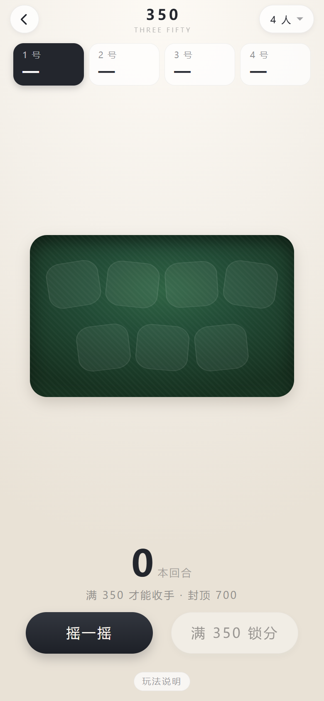
  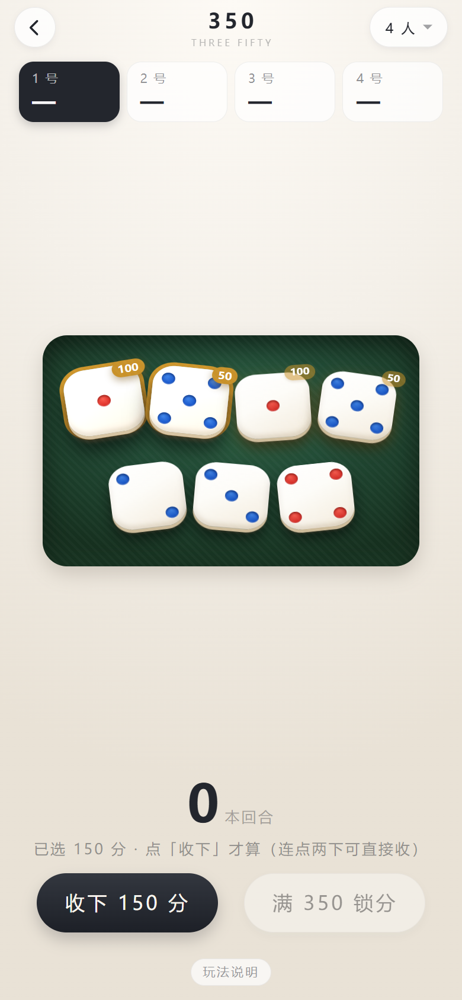
  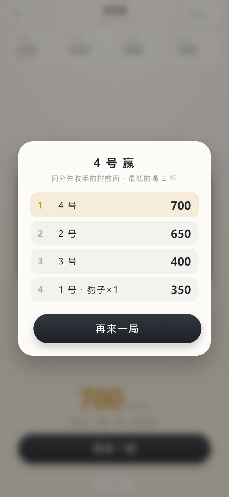

  开局 7 颗空位 → 点要拿走的 1 和 5（不点就不拿）→ 四人结算排名

### 输赢 · 喝多少

350 在桌上本来就是罚酒的玩法。App 只算分，杯数照老规矩来：

| 什么时候 | 谁喝 | 喝多少 |
| --- | --- | --- |
| **爆掉** —— 一把里一个 1 一个 5 都没有（且不是豹子） | 摇的人自己，躲不掉 | **1 杯** |
| **7 颗全摇还爆掉** —— 这一把桌上满 7 颗、一个都没收 | 摇的人自己 | **双倍 · 2 杯** |
| **豹子** —— 7 颗清一色，1~6 都算 | 台上其他所有人 | 每人 **2 杯** |
| **整局打完** —— 分数最低的那个 | 最后一名 | **2 杯** |

爆掉那条的「双倍」是冲着**满手一把就空**去的：7 颗全摇、一个 1 一个 5 都没出，等于这一把白摇，
桌上通常当加倍罚。已经收走几颗、剩 5 颗 6 颗再爆，就只算一杯。

**豹子一条线，六种点数都算。** 以前只认 1 和 5 的清一色（`1111111` / `5555555`），
理由是不想让人白捡；后来发现反了 —— 2/3/4/6 这几个点数**收不走**，只可能出现在「一把摇出 7 颗」
那一下，概率比 1/5 的豹子还低（`6/6⁷ = 1/46656`，四万七千把一回），以前却掉进「爆掉」里白喝一杯。
现在它按豹子算：自己不喝，一桌人端杯，只是**一分不收**（这几个点数本来就不计分），
所以弹窗里没有「收下」，只有一个「**不收了 · 接着摇**」—— 分留着，拿回 7 颗继续。

豹子这一条的关键是**摇的人不喝**：一桌人端杯，他自己只拿牌。

至于**要不要这一把的分**，App 把选择权交回桌上：1 和 5 的豹子，认账就「收下 N 分」锁分走人
（全桌喝照旧），不认就「清零重摇」继续搏 —— 这一手的分数在 350~700 之间，收不收都不亏，看谁敢赌下一把。

**摇出豹子会直接弹一个选择框**，点了才继续（1/5 的豹子两条路，2/3/4/6 的只有「接着摇」）：

  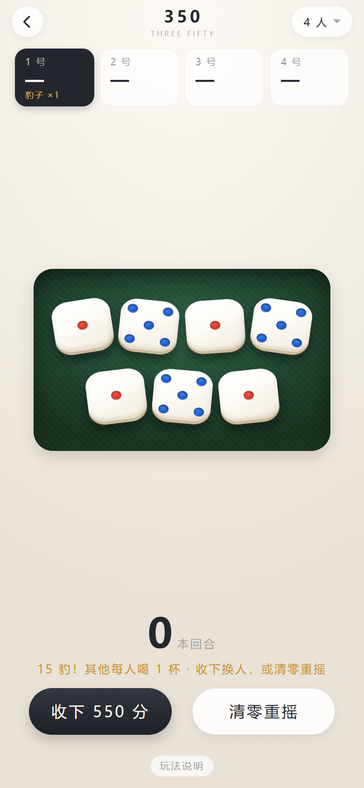

  弹窗里写着这一把值多少分、是什么豹子，<b>还把这一手 7 颗摆出来</b>（桌面被挡住了，不用歪头从缝里看）—— 点空白处关不掉，必须选一个

以前只在底栏换两个按钮，摇完盯着桌上数骰子的人根本不会往下看，回过神来就以为「摇出豹子没得选」。
弹窗里把这一把的分数放大到整个卡最大的一行，隔着桌子也看得见；底栏那两个同名按钮还在，
两边走的是同一份代码，不会出现「底栏收下 550、弹窗收下别的数」这种两张皮。

**两种来路，一个出口**：① 一把摇出 7 颗清一色（六种点数都算）；② 这一回合一颗颗把 7 颗**全收下来**。
后者只可能是 1 和 5 —— 7 颗往往分两三次摇完，收满第 7 颗的那一刻以前会直接把回合翻篇
（分数进本回合、骰子变回 7 个空位），豹子判定压根没跑，所以总有人反馈「我明明收齐了一手 1，
为什么不弹」。现在两种都先弹选择框，点「收下」才锁分换人；整轮收齐的那种会在副标题里多标一句
「整轮 7 颗收齐」。混着 1 和 5 的七颗（比如 `1115555`）**不算豹子** —— 一回合收满必然是这形状，
要是也算，桌桌都在喝；它只是普通的一手大牌，照常点着收分。

所以打到中后段会有人专门去**拼豹子** —— 反正手气不好、分也追不上，干脆搏一把全桌陪你喝。
这也是 350 比闷头算分好玩的地方：桌上多了一个「要不要赌一把」的选择。

**豹子和爆掉都不自动翻篇**：摇出来那一刻骰子就停在桌上，等玩家自己选，
谁看够了谁按 —— 一桌人得先看清是哪种豹子、该几个人端杯，再继续。

杯数是**默认值**，开局前按自己的量说好，能加能减；喝不了酒的喝水、喝饮料一样算数。
App 不记谁喝了多少，也记不了 —— 桌上说好的规矩比 App 重要。

### 人数开局后还能改

  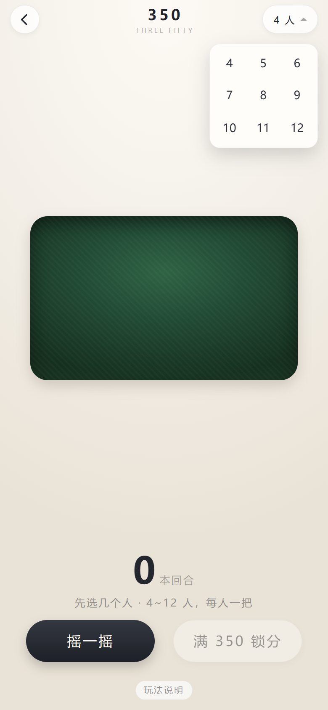
  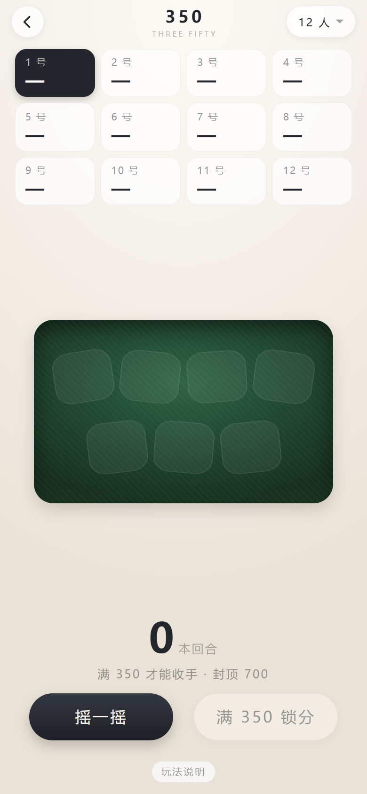

  右上角两个按钮：「重开」（点两下才清分）和「N 人」（原地展开 4~12）→ 12 人排成 3 行，一屏全看得见

顶栏右上角那个「**N 人**」就是入口。**点一下就在按钮下面原地展开 4~12 共 9 档，选哪个当场生效**，
不用再找一个「开始」按钮确认：

- 换了人数 → **重开一局**，分数全部清零、回到 1 号，提示「已改成 N 人 · 重新开局」
- 人数没变 → 只收起下拉，**局不动**（点开看一眼不至于把分丢了）
- 点面板外面的空白处也能收起，收起不等于改人数
- 人数记在本地，下次打开还是上次选的；第一次进来下拉会自动摊开，先选人再摇

**一桌最多 12 个人，一屏全看得见**：顶部的记分条是**一排 4 个、多了往下折行**的栅格，
12 人正好 3 行（1–4 / 5–8 / 9–12），不用左右划去找几号。人少的时候就是一行 4 个，
卡片宽度不变，换人数不会让布局跳来跳去。

### 爆掉了不会自动清屏

  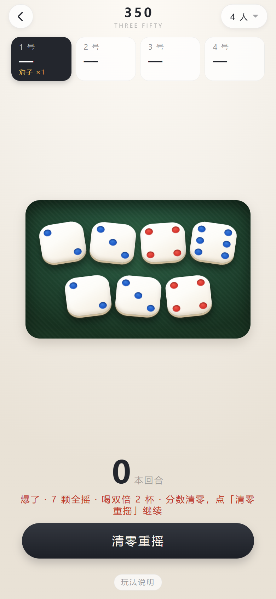

摇出来**一个 1 和一个 5 都没有**的时候，本回合的分数清零 —— 但桌上的 7 颗骰子**不会自己消失**。
提示也把话说全了，还分了档：「**爆了 · 喝 1 杯 · 分数清零**」；如果是 **7 颗全摇**爆的，
直接写「**爆了 · 7 颗全摇 · 喝双倍 2 杯**」。省得新上桌的人还要问一句「这个要不要喝、喝几杯」。

以前这里是 1.6 秒后自动拿回 7 颗，看着利索，实际一桌人经常还没看清点数就没了，
只能听别人说「你去拿 7 颗」。现在改成：结果停在桌上，按钮只剩一个「**清零重摇**」，
**谁看够了谁按**，没按之前画面一直不动。按了才拿回 7 颗、还是同一个人继续摇。

顺带解释一下为什么爆掉时旁边那个「锁分」按钮也一起收起来了：本回合分数已经是 0，
锁无可锁，留个灰按钮在旁边只会让人以为还能点。

### 豹子也停在桌上，收不收你说了算

  

豹子以前是**替玩家做决定**的：要么瞬间翻篇（骰子变回 7 个空位、分数归零，一桌人还没数清就没了），
要么一律清零 —— 明明摇出全桌最大的一手，分却不算数。

现在豹子跟爆掉一样**停在桌上**，1 和 5 的豹子多给一个选择：

- **收下 N 分**：这一把的 1 和 5 全算分，7 颗最少 350、最多 700（到顶按 700 封），
  收完直接锁分、换下一位。**喝酒照旧** —— 豹子该谁喝还是谁喝，跟收不收分无关
- **清零重摇**：分数归零、拿回 7 颗，**还是同一个人摇**，接着搏

2 / 3 / 4 / 6 的豹子一分不收，弹窗里主按钮直接是「**不收了 · 接着摇**」：
分数原样留着、拿回 7 颗、人也不换 —— 它换不来分，但全桌照样端杯。

  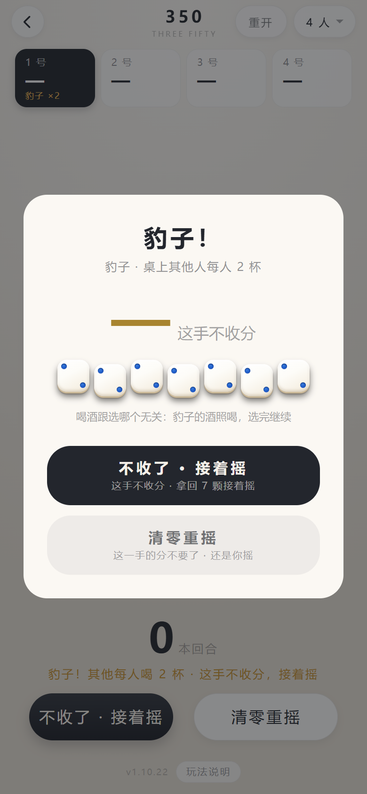

  七个 2 也是豹子：不涨分、不换人，但一桌人得端杯 —— 以前这一手掉进「爆掉」，还得自己喝一杯

按哪个由桌上定：分够了想稳一手就收，落后想翻盘就清。App 只把两条路摆在按钮上。

- 一个都不按就退出 App，回来还是这一步：骰子、提示、豹子标记、两个按钮都在
- 提示用金字写明「**豹子！其他每人喝 2 杯**」，玩家卡上同时记下「豹子 ×1」
- 这一步不改任何判定 —— 记豹子、清零、喝几杯，都和以前一样，只是把「收不收」和「看多久」还给玩家

### 「不点就不拿」是什么意思

这是 350 最不一样的地方，也是先想清楚才写得对的一条：

计分的骰子（1 和 5）**不会自动收走**。摇完它们只是亮一下、角上标个分数，**你点哪颗才算拿走哪颗**。

为什么要这样？因为拿走一颗就少一颗骰子，桌上**不会补**。7 颗变 6 颗，下一把摇出 100 分的机会就少一份。
所以有时候**宁可不要那 50 分**，把 5 留在桌上凑数量、继续搏 1 点。拿不拿，自己权衡。

点错了再点一次就取消（**要隔开一下**，见下条）。按钮上的分数实时跟着变（「收下 150 分」），
一颗没选时按钮是灰的、点不动 —— 这样不会出现「手滑点了收分、分被拿走还没反应过来」。

**连点两下同一颗 = 直接收下**，省掉「点骰子再用另一只手按钮」的两步。收的是当前选中的全部骰子，
所以想只收一颗就别先点别的。两次点击超过 320 毫秒就是两次独立点击，第二次照常是取消选中。

**收了一颗，还能接着收**：双击拿走一颗 1 之后，桌上剩下的 5 照样亮着、照样能点、能双击 ——
这一把摇出来的 1 和 5 可以一颗一颗收干净，不用为了收第二颗再摇一次（摇一次点数就全变了）。
一颗都没选的时候，主按钮自己变成「**摇剩下 N 颗**」，不想收了直接摇；点了骰子又变回「收下 N 分」。

> 这条是 2026-11-09 修的一个手感问题。以前收完一颗，相位立刻切到「等他摇」，
> 剩下的骰子看着还带着金边和 50 的角标，其实已经点不动了 —— 双击的习惯一上来就会撞上，
> 白白丢掉已经摇出来的点数。

**7 颗全收光，这一回合就到头了**：桌上没骰子可摇，所以收满第 7 颗的时候直接**替你锁分、换下一位**
（收满 7 颗最少也是 7 个 5 = 350 分，本来就够锁）。锁完提示一行「某某 · 7 颗全收完，锁 450 分」。

> 这是 2026-11-10 修的一个漏洞（用户截图撞见）：以前收光 7 颗会「拿回 7 颗接着摇」——
> 骰子都收进兜里了，又从哪儿摸出 7 颗？等于凭空补一袋，收光再摇、摇光再收，分数能一路往上刷。
> 真实玩法里 7 颗收完这一把就结束，没有补骰子这回事。

三种状态在视觉上是分开的：**能计分的**有暖光和半透明分数角标，**已经点了的**加实心金边、
整体抬起并提亮，**还没摇的**只是一个淡色空位。

摇骰子有声音（复用吹牛那颗 `shake.mp3`），不用看着屏幕也知道摇了。

### 收下的骰子摆在桌子和分数之间

  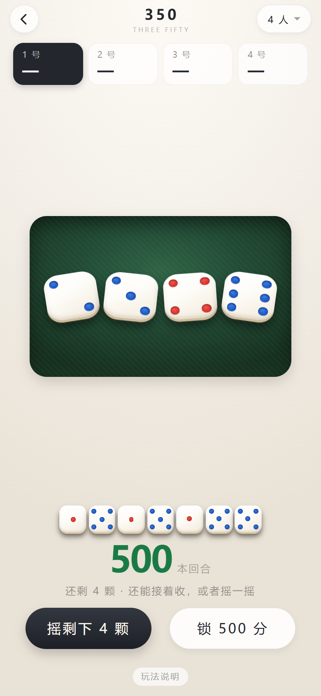

收分的时候那些 1 和 5 从桌上消失，只剩下一个往上跳的数字。一回合打完，
谁也说不清这五百分是摇了几把、收了几个 1 几个 5 凑出来的。

现在每收一颗，**桌面和分数之间那块空当里就多一颗骰子**，按收的先后从左往右排开：

- **和桌上的骰子一样大**（都是 16vw 上下，393 宽的屏上约 63px）：那颗 1 是从桌上拿走的，
  落到这里还是原来那么大，一眼就能对上号
- 摆不下就按可用高度自动算：先试「排成一行」，再试「均分两行」，两种都算一遍取骰子更大的那个，
  所以 7 颗时是一行 4 颗 + 一行 3 颗，14 颗时也能塞进来，**不会压到桌上，也不会压到分数**
- 屏幕特别矮（比如 375×667 的老机型）会整体缩一点，但最少也有 6vw，看不清就失去了意义
- 只管本回合：换人、爆掉、豹子、重开，都跟着分数一起清掉
- 新收的那颗有个轻轻落下的小动画，一眼看出刚才是哪一颗进的分

分数和骰子是两张对得上的账：下面那行数字就是上面这排骰子加出来的，
点「收下 150 分」的时候，分数涨 150，上面也正好多出对应的骰子。

### 换人的时候，桌子先盖一下

  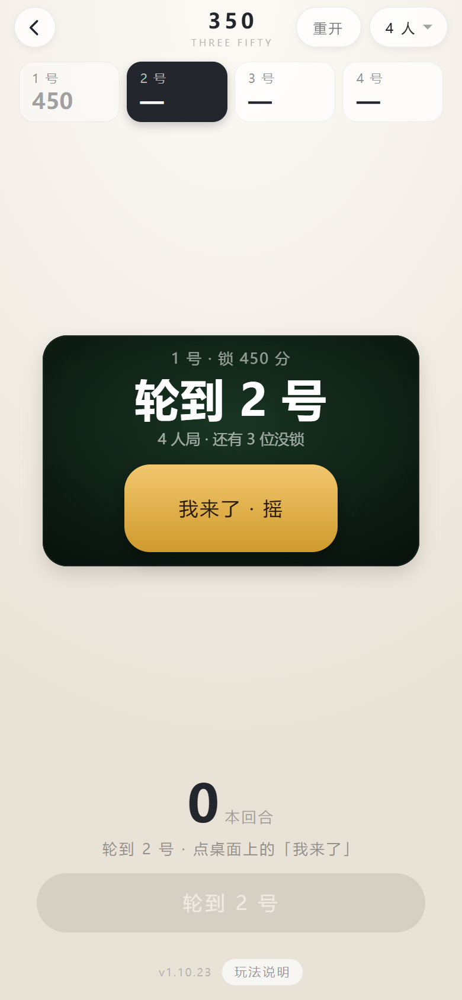

以前锁完分，底栏**立刻**就是「摇一摇」，下一家的名字只在记分条上换个高亮 ——
可手机这时候还在桌上传递：上一位手还没挪开、下一位已经伸手过来，
随便碰一下就把这一回合的 7 颗摇了。骰子白摇是小事，人以为是自己的回合就开摇，
**顺序一乱，后面全跟着乱**。

现在换人是单独一步：桌面盖住，大字写着「**轮到 2 号**」，上面一行小字交代
「1 号 · 锁 450 分」，底栏那颗「摇一摇」换成灰的「轮到 2 号」点不动。
他自己点一下金色的「**我来了 · 摇**」，桌子才揭开、底栏才换回「摇一摇」。

- 盖层只在**换人**时出现。开局第一把不盖：刚选完人数，手机就在先手那个人手上
- **爆掉、清零重摇不盖**：那还是同一个人在摇，没有交接
- 最后一位锁完直接出排名，不再多一次点击
- 交接这一步也存着：这时候退出 App，回来还是「等他接手」，不会白送一个可以摇的回合

> 2026-11-10 用户提的：「换人的时候是不是需要有一个交接画面呢，
> 不然如果有人不小心又点了下一家的摇一摇，这不坏了顺序」。

### 打一半退出去了，回来接着打

  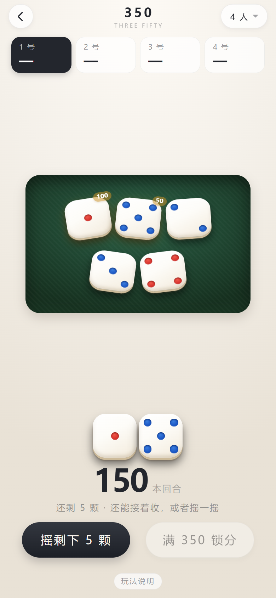

以前这里有个坑：玩到一半退出 App，再进来是「**本回合 200 分 + 桌上 7 个骰子**」——
分数还在，骰子却是新摆的，看着像重新开了一局，也不知道这 200 分算不算数；
想干脆重开一局，翻遍页面又找不到按钮。

现在**手牌、已经收下的那排骰子、本回合分数一起存着**，退出前什么样，回来还是什么样：

- 没来得及收的 1 和 5 照样带着角标、照样点得动，接着收就行
- 主按钮跟着上一次的状态走：刚才收过就是「摇剩下 N 颗」，还没收过就是「点骰子收分」
- 旧版本留下的「只有分数、没有骰子」的存档会被认出来，本回合那个分数直接清掉。
  宁可重摇，也不让一个孤零零的数字挂在那儿让人猜
- 真想推倒重来：点右上角的「**重开**」—— 点第一下只把按钮换成「确定重开？」，**3 秒内再点一下**才真清分
  （分数抹掉不可逆，手指在顶栏滑一下不该把一桌人的分清零）
