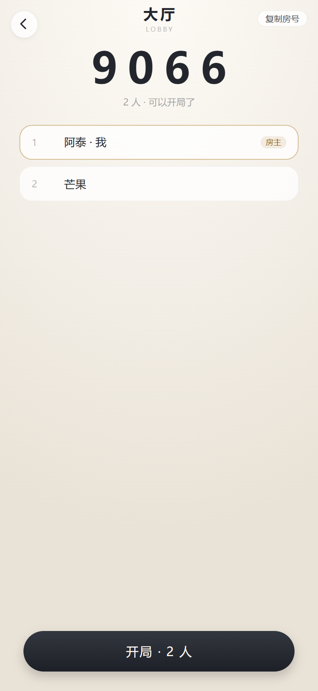
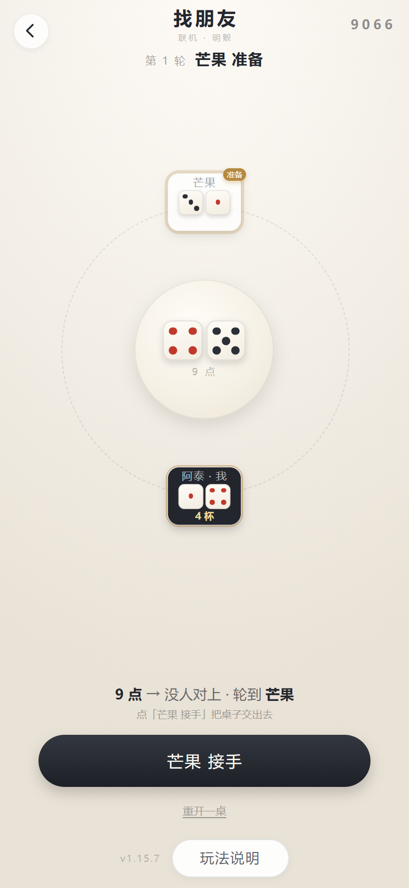
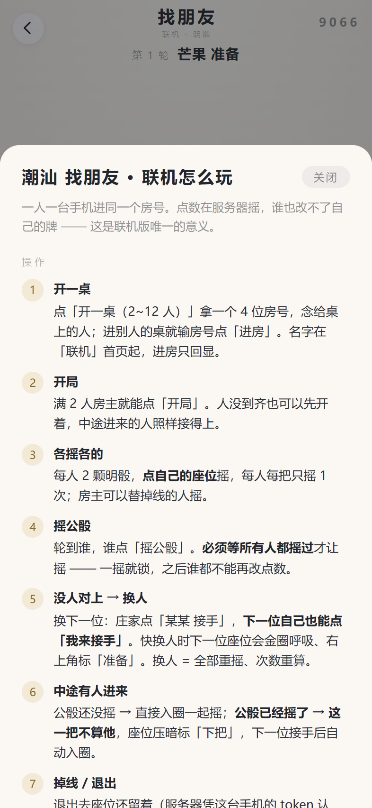

# 联机 · 潮汕 找朋友

[← 回首页](../README.md)

各看各的手机，报个 4 位房号就能开局。**明骰点名**：全桌的骰子都摊在桌上，公骰点到谁，谁喝。

  
  
  

  开房报房号 → 一圈人各自 2 颗明骰，中间是公骰 → 规则就在牌桌上，边玩边看

## 怎么打

**2~12 人**，每人 **2 颗**，全部明着摊开，没有盖子。中间那 2 颗叫**公骰**，由当前这一家摇。

一轮是这样走的：

1. 开局（以及每次换人）全桌**重摇一遍**，每人**只能摇一次**；
2. 轮到谁，他摇中间那两颗公骰；
3. 公骰**对上谁**，谁就喝（对上几档见下表），**这一家继续摇**；
4. 一直摇到「谁都没对上」，才轮到下一家 —— 从 1 号到 N 号算一轮。

**摇公骰的人自己也算。** 公骰点到自己一样喝，没有「庄家免死」这回事。

## 对上几杯

按**最高那一档**算，不叠加：

| 情况 | 例子 | 喝 |
|---|---|---|
| **一模一样** | 中间 3+4，他 3+4 或 4+3 | **2 杯** |
| **只是和值相同** | 中间 3+4=7，他 2+5 或 1+6（也是 7） | 1 杯 |
| **豹子碰豹子** | 中间 5+5，他 2+2 / 6+6（不看点数） | 1 杯 |

一模一样优先：它本来就和值相同，但按双倍算。

**11 正豹有个额外的**：摇出 1+1 的时候，庄家可以再指一个人罚 **1 杯**。
这一杯跟命中无关，是白送的；命中照记，该双倍的双倍。

**一局下来谁喝了几杯，牌桌上每个人都挂着数字**，不用自己记。

## 和「潮汕 350」有什么不一样

| | 潮汕 350 | 潮汕 找朋友 |
|---|---|---|
| 骰子 | 桌上 5~7 颗，明骰 | 每人 2 颗，全摊开，另加中间 2 颗公骰 |
| 目标 | 拿 1 点和 5 点攒分，满 350 收手 | 没有分，只有「谁被点到」 |
| 一轮 | 一人一次，拿完就交接 | 一直摇到没人对上才换人 |
| 输赢 | 最低的喝 2 杯、爆掉喝 1 杯 | 被点到就喝，一模一样双倍 |
| 人数 | 2~12 | 2~12 |

## 联机怎么开

**一个人点「开房」**，屏幕上给一个 **4 位房号**，念给桌上的人；别人点「进房」把号码敲进去就坐下了。
人在大厅里能改名字（顶上的输入框，旁边「换」随机给一个）。人到齐，房主点「开局 · N 人」。

**不用连同一个 WiFi，也不用指定谁当主机。** 两台手机隔着城也能打。
点数是服务端摇的：本地先猜一个再被服务器改，就会出现「我这儿显示点到 2 号，他那儿说没有」——
这种架最伤和气，所以宁可等那一下。

**掉线 / 退出去再进来**：房间和座位都留着，凭房号 + 本机存的座位记号**回到原位**，
大厅里还会挂一张「接着上一桌」的卡，点一下回去，不用重新报房号。

**有人掉线时，房主可以替他摇**（摇自己的 2 颗、代摇公骰都行），
不然整桌会停在「等他摇」上 —— 这比少一个人更难受。

**换人、重开、请人出去**：

| 动作 | 谁能按 |
|---|---|
| **换下一人** | 当前摇公骰的这一家（摇到没人对上之后才出现） |
| **重开一桌** | 谁都能发起，但要**在线人数三分之二点头**（4 个人时 3 票、3 个人时 2 票）；45 秒没人接着点就作废。投过再点一下是撤回 |
| **请人出去** | 房主点名字**当场生效**；其他人点只是发起投票，要**除他本人以外、在线人数的三分之二**同意 |

**页脚的「记录」和「桌上的人」**：这几局发生过什么，服务端一直记着
（谁进房、开局、各家摇出几点、公骰撞到谁、谁喝了一杯、换到谁、重开），
点开摊着慢慢翻，最多留 30 条。低头回个消息不会错过整局 ——
以前这里只有一句 1.5 秒就消失的提示。
「桌上的人」那一页同时是踢人的入口：名字、杯数、掉线标记都在一行里。

被请出去的人会回到填房号那一屏，房号下面写着「你被请出了这一桌」，
拿同一个房号还能再进（除非房主又请一次）。

## 一个开局前的提醒

**每人每把只能摇一次**，不是想摇几次摇几次。
摇多次就能挑好牌，而 6~9 点（3+4、4+5 这类）是最容易被人撞上的档 —— 一次定生死最干净。
