# 玩法 A · 吹牛骰子

[← 回首页](../README.md)

一台手机、一个骰盅、5 颗骰子（2~10 可调）。**摇一摇 → 盖子合着 → 掀盖看点数 → 锁定**。

> 一桌人各拿一台手机打，翻到下面 [联机 · 吹牛](#联机--吹牛线上只负责发骰子) ——
> 线上只发骰子、锁这一把、摊牌给全桌核对，叫点还是面对面讲。

## 玩法 A · 吹牛骰子（默认）

| 操作 | 效果 |
| --- | --- |
| 摇一摇 | 骰盅抖动 1.6s + 音效（只有这一步出声），点数此时生成，盖子保持合着 |
| 开盖 | 盖子形状不变地**整块垂直抬起**，露出骰子 |
| 上滑骰盅 | **单机 / 联机都是 1:1 跟手**，从头到尾都能停（90%、98% 也不会被补到全开），可以半开当挡板；点一下仍是全开 / 全关的快捷方式 |
| 合上 | 盖子盖回去，点数不丢，可反复开合 |
| 锁定 | 本局定板：不能再摇，盅口亮金边 + 金色「已锁定」；盖子仍可开合 |
| 解锁 / 再来一局 | 解锁继续，或开新局（上一把点数还留着，点「开盖」能翻出来） |

骰子配色按传统：**1 点、4 点是红点**，其余蓝点，1 点单独放大。

底栏有「玩法说明」和「换玩法」两个入口：前者是这一份规则的口头版，后者退回玩法选择页。

### 骰子数量 2~10 颗

  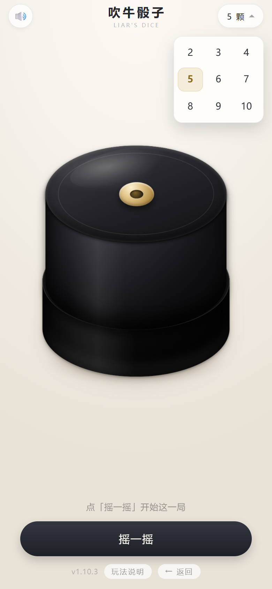

点顶部右侧的「5 颗」，**按钮下面原地展开 2~10 共 9 档**（3×3 排好，不用再弹一整屏的框）。
选完立刻生效，骰子按新数量重新摆位；已经摇过的那把会清掉，提示「已改成 N 颗 · 点『摇一摇』开始」。
数量记在本地，下次打开还是上次选的。

每个数量的骰子边长和间距是**单独算的**，不是把一套尺寸等比缩放：
2 颗摆成一行，7~8 颗摆成 4+4，9~10 颗摆成 5+5。骰子带 9° 倾斜，算可用面积时按旋转后的包围盒扣，
所以角不会戳出桌面，10 颗也不会挤成一坨。

---

## 联机 · 吹牛：线上只负责发骰子

一桌人各拿一台手机，面对面坐着打。上面那一套已经够用了 —— 唯一的问题是**谁也看不见谁的点数**，
核对的时候得挨个把手机递过去看一遍。

联机版就补这一件事：**发骰子、把这一把锁住、把所有人的点数摊开给全桌核对**。
叫点这件事整个交回桌上 —— 手机上一个字都不记。

## 一局怎么走

  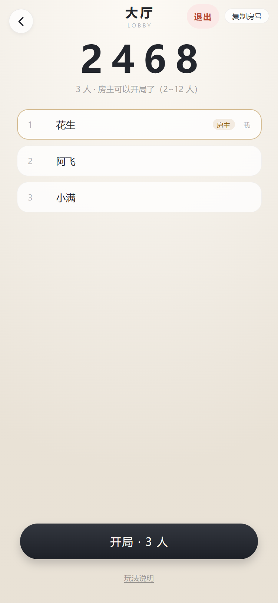
  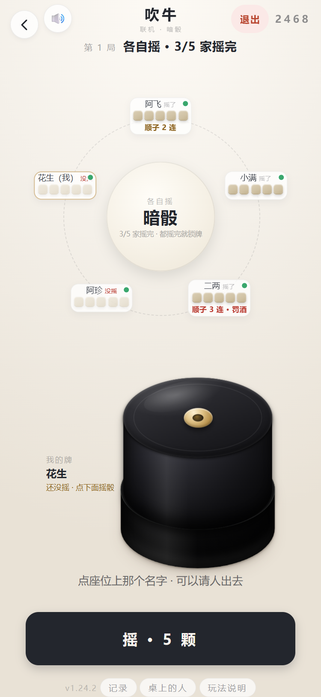
  
  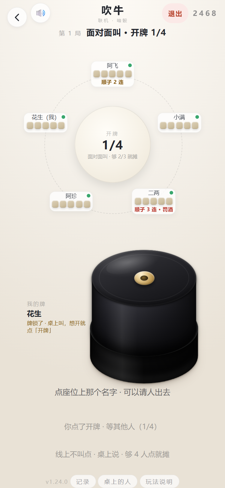

  报房号等人 → 各自摇 → 都摇完牌自己就锁 → 面对面叫 → 谁想开谁点「开牌」

| 步 | 谁按 | 发生了什么 |
| --- | --- | --- |
| **摇一摇** | 每家自己 | 5 颗暗骰落进盅里，**只有自己看得见**；盅盖能开能合，跟单机一样（按钮 2026-11-12 从「摇 · 5 颗」改叫「摇一摇」）|
| **（自动）锁牌** | — | **在线的都摇完，牌自己就锁**，直接跳到「面对面叫」 |
| **面对面叫** | 桌上 | 放下手机。几个几、谁跟谁、谁不信 —— 嘴上说，手机上不记 |
| **开牌** | 谁都行 | 一张票。**够 2/3 的人点了就摊**（3 人 2 票、5 人 4 票、9 人 6 票；**在线只剩一个人时 1 票就够**） |
| **摊牌** | — | 一行一家 5 颗大骰子，顶上只报「全场一共几颗」，逐点各几个不再列（顺子不计点、豹子算 6/10，列出来一定对不上）|
| **下一把** | 全桌 | 也是 2/3，也是「只剩一个人 1 票」。有人还要低头对牌，票不够就一直摊着 |

> 两张票的分母都是**在线人数**。有人掉线那一刻会当场重数 —— 我先点了开牌、对面再接个电话走掉，
> 那张 1/2 会自己变成摊牌，不会停在半路上等人来点。

### 「开始」这个按钮为什么没了

一版一版减下来的。先是「所有人都得按开始」，卡在有人一直没按；改成 2/3 按了就走，
又变成「那没按的那两家算什么」。再往下问一句就通了：

> 一个人一辈子只能摇一次，**摇完就是认账**。那还按一下干嘛？

所以现在**没有「开始」这一步**。最后一家摇完，牌当场锁住，顶栏从「各自摇」跳到「面对面叫」。
名字后面只剩两种小字：**「摇了」压淡一档**（他已经没事了），**「没摇」标红**（全桌等的就是他）。
掉线的人不进这个分母，一个人的手机没电不会把整桌卡住。

### 升级前开的旧桌：退出去重开一桌

  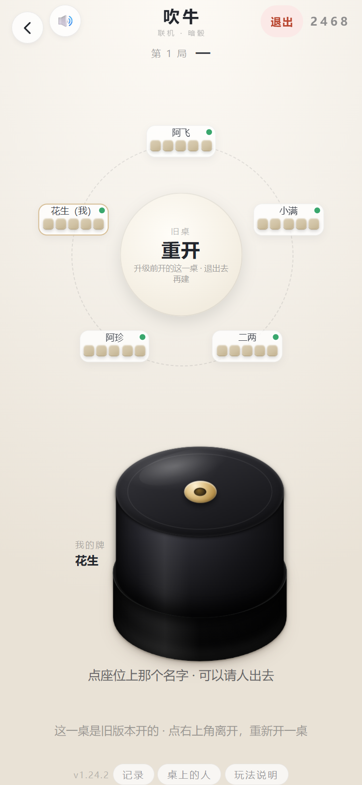

升级当天最容易撞的一件事：**上一把还开着的人，进来看到的是一桌没有按钮的牌**。
房间里的局面还是旧协议留下的（`phase` 是一个新版不认识的名字），新版没有哪一步能对上它，
底栏以前就直接空着 —— 看着就像是「摇骰和按钮一起被删了」。

现在这一桌会明说：圆盘写「旧桌 / 重开」，底栏一行字告诉你**点右上角离开、重新开一桌**。
新开的房间一定是新协议，进去就有「摇一摇」。

> 一句话记：**升级之后，先把旧房间退掉再建。** 桌上一半人在旧桌、一半人在新桌，是连不到一起的。

## 摊牌

  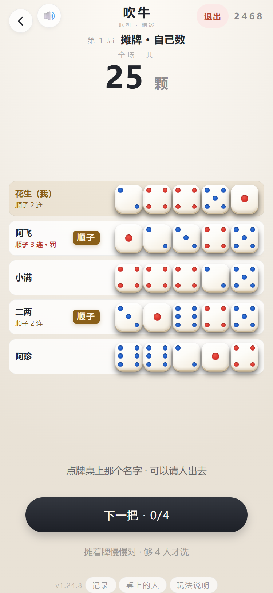
  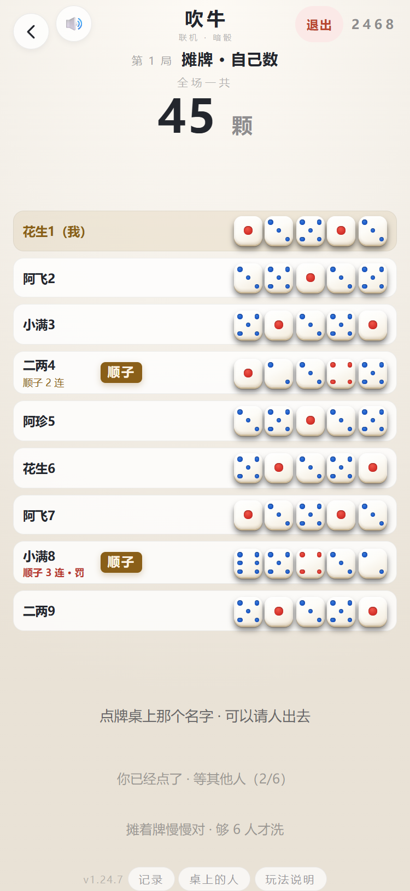

  左：5 个人 · 右：9 个人也不挤（骰子自己变小，一行一家不换行）

整屏一张表：**一行一家**，5 颗骰子放到 10vw（375 的屏上就是 37.5px 一颗）。顶上只有两个数：

- **全场一共 25 颗** —— 说好要数的那个点，到底有几个，抬头看这一行；
- **1×3 2×5 3×2 4×8 5×4 6×3** —— 1 到 6 各几个，摆在这儿，谁都不用自己数。

**不判输赢。** 够不够数、谁喝、喝几杯，App 一个字都不说 —— 它连你们叫到几个几都不知道。

### 顺子会标出来

五颗骰子**点数互不重复**的时候，名字和骰子中间那块空白会贴一枚金底「顺子」。
`12345` / `23456` 是连顺，`13456` / `12456` 这种带 1 又断一截的也算（1 是万能牌，
正好顶掉那个缺口）—— **两种都只写「顺子」两个字**，不用多一个名字去记。有重复点数的不标。

为什么要标：顺子是牌面里最强的一手，可它长得**最像什么都没有** —— 五颗全不一样，
一眼扫过去跟一手烂牌没区别。满桌人低头数点子的时候，最容易漏的就是它。
豹子（五颗一样）反而不标，那种牌没人会看错。

标的是**牌面**，不是判定：App 仍然不说够不够、谁输，只是帮你把眼睛省下来。

### 连续顺子会记着

桌上还有一条规矩：**连着 3 把顺子要罚，中间断一把就不算**。App 把这件事记在牌面上：

- **座位卡**最下面那行，从 2 连起写「顺子 2 连」；到 3 连变红，写「顺子 3 连 · 罚」；
- **摊牌页**名字下面同一位置也写一行，谁连着几把一眼扫完；
- **自己那块「我的牌」也写一遍** —— 圆环上自己那张卡在对面，低头就能看见自己连了几把
  （用户 2026-11-11 反馈「只有其他玩家看得见」之后补的），自己那张卡整张描金、底色变暖、名字也转金，还比别人大一号 —— 一桌十几张白卡里一眼认得出；
- 中间有一把不是顺子，当场**清零**，下一把顺子从 1 重新连（不是减一）。

为什么放在座位上：等下一把摇完之前，谁也看不到别人的牌，但「他上一把、上上把都是顺子」
是全桌一起看见过的 —— 写在座位上，不用谁去记。App 只负责数，罚不罚、罚几杯，桌上说了算。

## 请人出去

  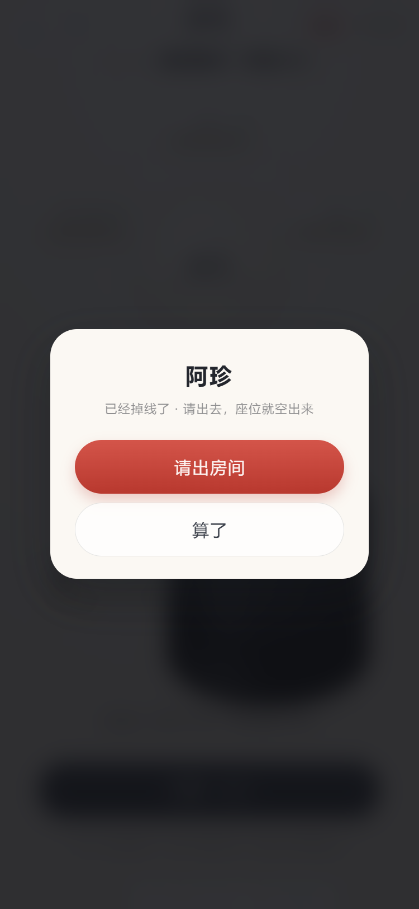
  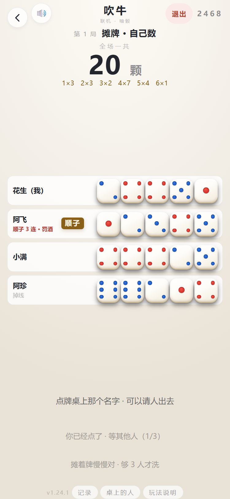
  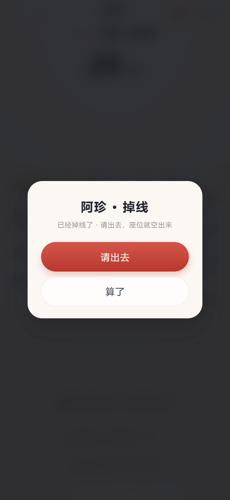
  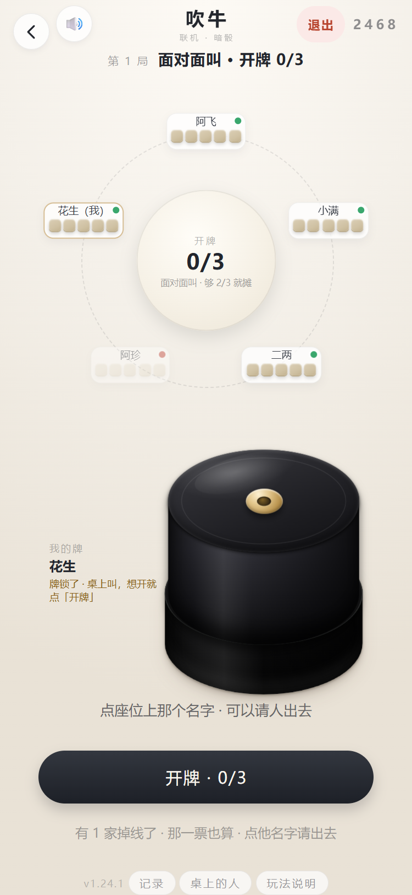

  「面对面叫」和「摊牌」两页都能点 · 掉线的人名字下面挂一行灰字 · 请出去之后票数当场重算

桌上总有人接了个电话就再没回来，座位一直占着，别人还得等他那一手。
**点那个名字**，弹一句确认，就能把他请出去：

- **已经掉线的人，谁点都能请** —— 他反正按不了，留着只是占位；
- **还在线的人，房主点一下直接请** —— 人是他招来的；
- **其他人点一下是发起投票**：在线的三分之二同意才请得出去，45 秒没人接着点就作废，
  自己投过再点一下是撤回。分母不算被踢的那位，不会给他一张否决票。

  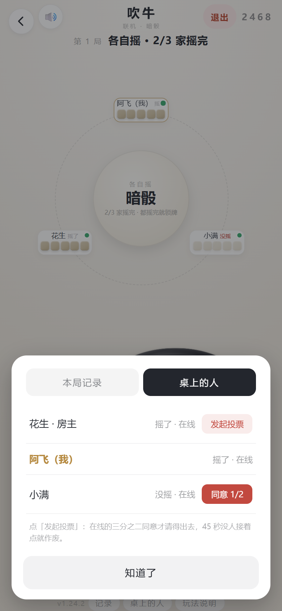
  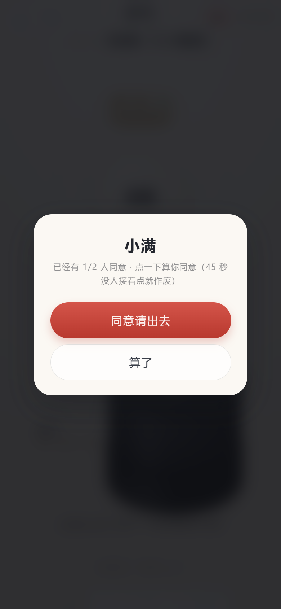

  页脚「桌上的人」→ 每家一行，右边就是按钮 → 点开确认（票数、45 秒作废都写在上面）

**牌摊开了也照样能请。** 以前只有「面对面叫」那一页的名字点得动，摊牌页的座位卡一收，
名字就成了一块死字 —— 人走了、票凑不够，全桌只能退出去重开一桌。现在两页都认。

**只认名字那两个字，不认整行。** 摊着牌的时候手指是在屏幕上找自己的点数的，随手一按就弹
「请出房间」太吓人。

踢人是吹牛里**唯一一件要全桌商量**的事（开牌 / 下一把本来就是 2/3 投票）。
以前吹牛只有房主能请在线的人 —— 普通玩家打开「桌上的人」一个按钮都没有，
跟 350 / 找朋友对不上（用户 2026-11-11 报的）。现在三家同一套规则、同一套按钮。

人一走，座位马上重排，两张票（开牌 / 下一把）的票数也跟着重新算 ——
有时候人一走，当场就够了；反过来只剩一个人在线，一票也就够了。

## 自己退出这一桌

  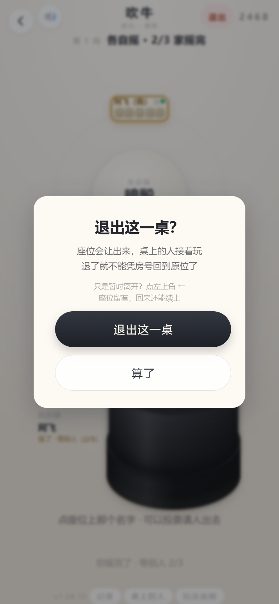

**右上角「退出」= 真的走**，点一下弹确认，确认后座位当场让出来、桌上的人接着玩，
房号和座位 token 一并清掉 —— 回来不会再弹「上一桌还没打完」。

**左上角「←」= 暂时离开**：只关连接，座位留着，接个电话、去洗手间、手机没网，
回来点首页那张「上一桌还没打完」就坐回原位。这两件事以前混在一个箭头上，
所以总觉得「退出了却还在桌上」。350 和找朋友也是同一套。

## 记录 · 桌上的人 · 谁在线

页脚 **「记录」** 是这一桌发生过什么（谁开的局、谁摇完了、谁点了开牌、谁退出了），
越往下越新；**「桌上的人」** 一行一家，写清「摇了 / 没摇 · 在线 / 离线」，标出房主，
右边那颗按钮就是「请出去 / 发起投票 / 同意 N/M」，点一下接上面那句确认。350 一直有「记录」，找朋友一直有这两页，
吹牛的服务端也一直下发 `log`，只是前端没画 —— 现在补齐了。

**在线状态三家一个样**：座位卡右上角一颗常显的小点，绿 = 在线、红 = 离线
（350 那排座位卡本来就写着「在线 / 离线」两个字）。以前只有掉线才把整张卡压暗，
在线是「没有标记」，得反过来猜。

## 为什么只做这些

- **没有叫点**。手机上那一整块面板（几个几、斋、开）整个拆了。
  程序记不住你们嘴上的顺序，记错一次全桌都要重来 —— 不如一个字都不记。
- **不判输赢**。够数够不够、谁喝多少，App 不知道也不猜。
- **摇完就锁**。一人一把只摇一次，没有「等我再摇一下」这种口子。
- **2/3 只算在线的人**。谁手机掉线了都不该卡住整桌 —— 在线只剩一个人，1 票就够。
- **摊着不自动洗**。有人还在对牌，屏幕不能被换掉。
- **掉线不受影响**。位置留着，凭房号回原位；真不回来了，点名字请出去。

> 盅摆在**右下角**：单手拿手机，拇指的自然落点就在那儿 —— 掀盖是这一页做得最多的动作。

> 纯净版也有联机吹牛 —— 它是玩法本身，不是完整版才给的功能。两版进的是同一个房间。
