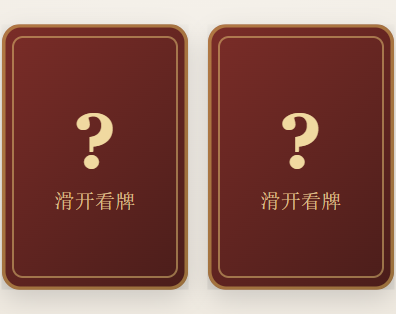
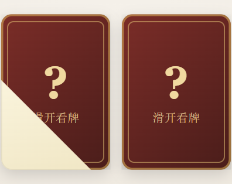
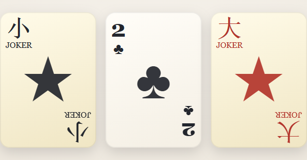
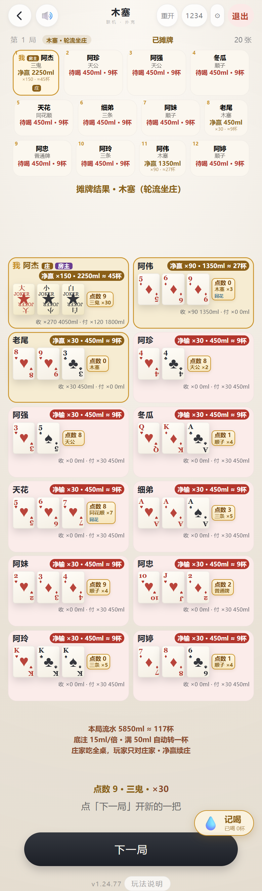
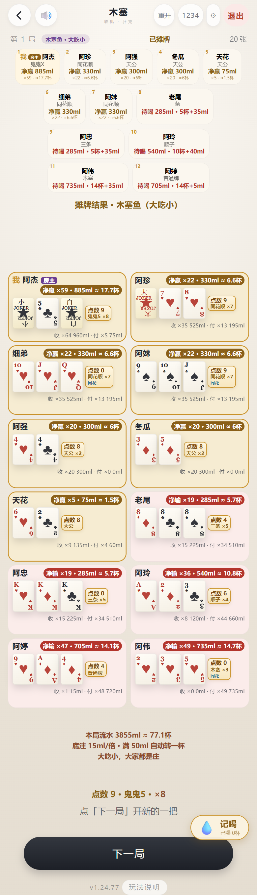
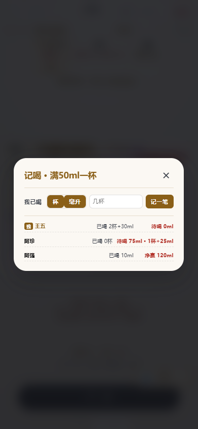
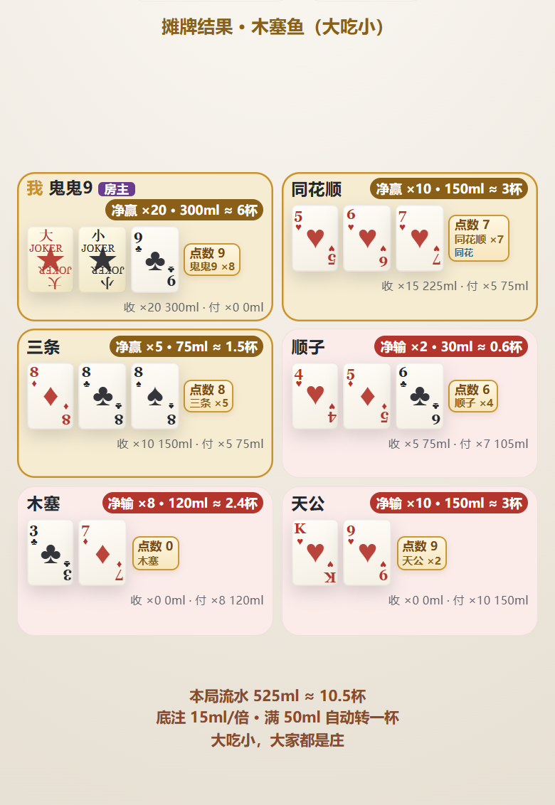
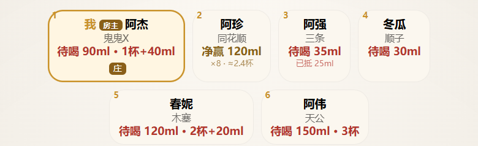
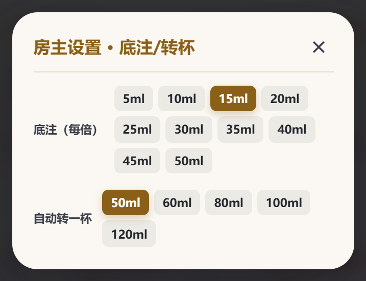

# 木塞（木虱）· 玩法设计文档（v1.0 · 规则已由用户确认）

[← 回首页](../README.md)

> **状态：规则已由用户（潮汕本地玩家）逐条确认，v1.0 定稿；已上线 v1.24.68，没有单机版。**
> **v1.24.70 纠偏（2026-11-20）**：**木塞（坐庄）≈ 木塞鱼（大吃小），唯一差别是木塞鱼多一条「同点数时三倍吃两倍、两倍吃一倍」**。①**「同牌型打平」只针对成型牌型**（顺子 / 同花顺 / 三条等），**不针对普通牌和木塞**；②**普通牌 / 木塞按点数个位分大小，两种玩法都要比**（8 吃 6、6 吃 3、6 吃 5）；③木塞鱼同点数再比倍率（三同花 ×3 吃杂花 ×1、对 8 ×2 吃杂花 ×1）；④**对子加成只认两张手牌点数相同 = 2 倍**，三张含对不加成；⑤天公同倍打平，双倍（同花 / 对子）吃单倍（杂花非对子）。
> **v1.24.69 纠偏（2026-11-20）**：**鬼鬼X = 8 倍**——按手牌张数分鬼牌型：两张鬼（手牌两张）= 双鬼 10 倍；**两鬼 + 任意一张普通牌 = 鬼鬼X 8 倍**（显示具体点数，如鬼鬼9、鬼鬼5，不再只有点数 5 才算）；三鬼 30 倍。木塞赢不了鬼鬼X、天公吃鬼鬼X。
> **v1.24.68 纠偏（2026-11-20）**：**Q+鬼+A 中鬼补 K 组成 Q-K-A 顺子**（A 当 14 接 K，同花则同花顺），不再误判普通牌；摊牌示例修正为**鬼鬼5 8 倍赢三条 5 倍**（三条净输、庄家换人）。
> **v1.24.66 实战纠偏（2026-11-20 已上线）**：三条 10→5 倍、新增鬼鬼5=8 倍、鬼万能补 9 点、循环相克（木塞只赢双鬼/三鬼、鬼鬼x 赢三条）、摊牌显示点数+牌型+同花标注、下一把由净赢最多者先补牌并给座位标 1/2/3/4/5、**坐庄模式庄家固定最后补牌**。
> 用户 2026-11-19 拍板：①规则由用户口述定版（下方全部为其确认值）；②罚杯**不封顶**（几倍喝几杯，原味）；
> ③逛鬼、零点克双鬼**本地都不玩，已删**；④联机玩法——一人一台手机，服务器发牌，手牌只对本人下发。
> ⑤结算分两种玩法（用户追加）：**木塞（轮流坐庄，默认）**与**木塞鱼（大吃小，可选）**，建房时二选一，进房后定死。
> 剩余 [PLACEHOLDER] 只有罚酒软保护的阈值，playtest 定。**本文不是发版说明。**

## 一、Fun hypothesis（一句话地基）

> **木塞好玩的核心是——一手眼看要输的烂牌，被鬼牌救成通杀，倍率把这一把的输赢放大到全桌倒吸一口凉气。**

好玩不在"算得精"，在"翻盘的那一声啊？！"。共情是起点，数值是刹车——先认准这个爽点，再谈倍率。

**"木塞"是什么（关键术语，别搞混）**：木塞既是游戏名，也是**一种牌型**——手中牌点数相加**个位是 0**。
例：3+7=10→0、1+3+6=10→0、J+J+Q（J/Q/K 都是 0 点）→0。这个牌型能克双鬼，是游戏的灵魂机制之一。

## 二、Design pillars（不可妥协的四条体验标准）

| # | 柱子 | 含义 | 每条决策拿它过审 |
|---|---|---|---|
| 1 | 翻盘感优先 | 鬼牌必须能把烂牌救活，这是灵魂 | 砍鬼 = 砍玩法，不做 |
| 2 | 规则要地道 | 潮汕人一看就认：木塞 / 天公 / 顺子 / 鬼一个不少 | 按用户口述，不自行简化 |
| 3 | 倍率只放大、不吞人 | 倍率决定罚几杯，不封顶但必须让玩家看清后果 | 不做任何积分兑换 / 赌注 / 筹码 |
| 4 | 手牌私密 | 补牌决策建立在"只有我看得见"上 | 服务端发牌，手牌只对本人下发；无单机版 |

## 三、规则定稿（用户口述，v1.0）

**牌具**：**54 张标准牌 + 1 张白牌（或广告牌）= 55 张**。大鬼、小鬼、白牌，共三张鬼。
- 鬼的花色：**大鬼算红色、小鬼算黑色、白牌不算花色**（白牌仍是鬼，但不能凑同花）。
**点数**：J / Q / K 记 0 点，A 记 1 点，2–10 记面值。手中牌点数相加取**个位数**，9 最大、0 最小。
例：7+J=7 点，8+9=17→7 点。
**★ 鬼是万能点数（v1.24.66 纠偏）**：含鬼的手牌，鬼自动补到让个位最大 = **9 点**。因为鬼能补出任意点数，
所以只要手里有鬼，无论另外两张是什么，点数一律按 9 算；只有全普通牌才按实际相加取个位。
这条来自实战第 4 局（三家都该是 9 点全平）与第 5 局（带鬼那家补到 9 点该赢），用户截图逐局确认。

一局流程（见核心循环）：发两张 → 各自看牌、决定是否补第三张（最多三张）→ **全员补完进入待开牌，慢慢掀牌看牌，有人点「开牌」且在线 2/3 同意才揭盅** → 摊牌 → 按所选玩法结算（坐庄 / 大吃小）→ 记净杯、庄家视情况轮转。

**手牌掀牌特写（v1.24.77）**：发牌先盖暗牌，轻点掀 34% 慢慢看、再点才全开；补第三张继续盖回去由自己掀。手牌双角写点数、中间放大小花色，大小王一眼可辨——"手牌私密、自己慢慢掀"是联机版的核心体验。

**对局实录（12 人摊牌桌 · v1.24.77）**：两种结算玩法各一桌，每人一行标出牌面、牌型、倍率、净赢净输与收/付，桌底给本局流水与「点数 X · 鬼鬼X ×8」提示。牌型从三鬼 / 鬼鬼 X、同花顺、三条、天公、顺子、木塞到普通牌同屏可对照。

记喝面板（v1.24.77）：净赢按毫升写「净赢 120ml」、待喝写「90ml · 1杯+40ml」、自己那行标「我」。

> **v1.24.74 开牌权交还玩家**：线下真实口径是「大家补好牌了之后，大家喊开就开牌」，所以服务端在**全员补完后不再自动摊牌**，停在待开牌阶段把看牌时间还给玩家；任何人都能发起开牌票（`mopen`），在线人数 **2/3** 同意才 `museReveal`，也可撤回自己的票（`munvoteopen`）。开牌票是**独立票柜**，不跟「下一局 / 重开」票混用。手牌仍由玩家自己慢慢掀——掀牌进度放慢到对角线 1.5 倍、轻点先掀 34% 再点全开、方向在按下那一刻锁定（手指转向牌背不再转圈），这些都是纯前端表现，服务端照权威真牌结算。房主设置（底注 / 转杯）留在顶栏 ⚙，记喝独立成右下拇指区的「💧 记喝」按钮，两者不再混在一个面板里。

### 牌型定义

| 牌型 | 判定 | 备注 |
|---|---|---|
| **木塞** | 个位数相加 = **0** | 游戏名来源；2 张（3+7）或 3 张（1+3+6、JJQ）都算 |
| **天公** | 只发两张、个位为 **9 或 8** | **同花 2 倍、对子（两张同点）2 倍、杂花非对 1 倍**；天公之间双倍吃单倍、同倍打平（不比点数） |
| **顺子** | 三张相连（7-8-9、J-Q-K 等） | 4 倍 |
| **同花顺** | 顺子且三张同花色 | 7 倍 |
| **三条** | 三张同数字（如三个 6） | 5 倍（2026-11-20 用户改口：不是 10） |
| **双鬼 / 三鬼** | 手里两张鬼（手牌就两张）/ 三张鬼（含白牌） | 10 / 30 倍 |
| **鬼鬼X** | 两张鬼 + 任意一张普通牌（X 是那张牌点数，如鬼鬼9/鬼鬼5） | 8 倍（按手牌张数区分，不限点数=5） |

**牌型牌面特写（v1.24.77）**：六种牌型同屏对照，每张牌后紧跟「点数 X · 牌型 ×倍率」高亮标签——含鬼手牌（鬼鬼9）个位自动补 9、同花顺 ×7、三条 ×5、顺子 ×4、木塞（点数 0）、天公 ×2，一桌人扫一眼就知道谁大谁小。

### 大小与特判（用户确认口径）

> **天公输双鬼；木塞（0 点）赢双鬼。** 天公杀比它小的牌，按天公自己的倍率罚。

- **天公 一律输给双鬼**——天公再大也压不过双鬼。天公赢其他散牌时，按天公自己的倍率罚（杂花 1 / 同花 2）。
- **木塞克双鬼**：手里凑出木塞（0 点）能赢双鬼。
  - 两张同花色的木塞赢双鬼 → **2×10 = 20 倍**
  - 三张同花色的木塞赢双鬼 → **3×10 = 30 倍**
  - 杂花木塞赢双鬼 → **1×10 = 10 倍**（杂花本来就只有 1 倍花色加成）。
- **鬼牌花色**：补成同花时，大鬼当红桃/方块、小鬼当黑桃/梅花；**白牌不算花色**，不能用来凑同花。

### 循环相克（v1.24.66 纠偏，用户实战确认）

> 倍数**大的吃倍数小的**；但有几处刻意反过来，构成"循环相克"。**成型牌型（顺子/同花顺/三条/鬼牌型）同牌型打平；普通牌与木塞同牌型仍按点数个位分大小**（鬼万能补 9）。木塞鱼同点数再比倍率：三倍吃两倍、两倍吃一倍。

| 攻方 | 守方 | 结果 | 依据 |
|---|---|---|---|
| 木塞（0 点） | 双鬼 / 三鬼 | **木塞赢**（底 10 / 30 × 花色） | 灵魂机制，用户确认 |
| 木塞（0 点） | 普通 / 顺子 / 三条 / 同花顺 / 天公 / 鬼鬼X | **木塞输** | 木塞只赢双鬼、三鬼，其余全输（含鬼鬼X）；普通牌也赢它 |
| 鬼鬼X（8） | 三条（5） | **鬼鬼X 赢** | 用户明确"鬼鬼x 赢三条"；8 倍 > 5 倍 |
| 鬼鬼X（8） | 木塞 / 普通 / 顺子(4) / 三条(5) / 同花顺(7) | **鬼鬼X 赢** | 8 倍克 8 倍以下；木塞赢不了鬼鬼X |
| 鬼鬼X（8） | 天公 / 双鬼 / 三鬼 | **鬼鬼X 输** | 天公吃鬼鬼X；双鬼三鬼牌型序更高 |
| 天公 | 鬼鬼X | 天公赢 | 用户确认「天公吃鬼鬼X」 |
| 其余 | 其余 | 按牌型序：三鬼>双鬼>鬼鬼X>天公>同花顺>三条>顺子>木塞>普通 | **成型牌型同牌型打平；普通牌/木塞比点数个位**（鬼补9）；**木塞鱼同点数再比倍率**：三倍吃两倍/两倍吃一倍；天公例外双倍吃单倍、同倍打平 |

### 摊牌显示与补牌顺序（v1.24.66 纠偏）

- **摊牌桌**：每人显示名字、庄家标记、本局净赢/净输、摊开的牌、**点数**、**牌型名**、**倍率**、收/付。
- **同花标注**：三张普通牌同花色时，在牌型旁附一个「同花」标签——**只是显示**，不参与牌型判定、不改倍率、不改胜负。别把「同花」当成独立牌型（否则 1+3+6 的木塞、A+2+5 的普通都会被误判）。
- **补牌顺序轮转**：不再固定某座位永远先补。**首局**从座位 0 先补；每把摊牌后记下该把**净赢最多**的人，下一把由他先补；若本把无人净赢则维持原顺序。服务端广播 `first`（本局先补座位）与 `order`（本局实际补牌序），客户端在座位卡左上角标 **1 / 2 / 3 / 4 / 5…**。
- **坐庄模式庄家最后补**（用户 2026-11-20 追加）：轮流坐庄玩法里，庄家**固定最后补牌**——`order` 从先手起循环所有非庄家座位，庄家收尾（例：3 人庄家 0、先手 0 → 顺序 1,2,0）。「净赢最多者先手」只决定非庄家的起点；木塞鱼无庄，照常从先手循环。

**座位卡特写（v1.24.77）**：每把按「净赢最多者先补」轮转、座位左上角标 1/2/3/4/5/6；房主（浅金底 +「房主」）、我（金边）、庄家（金底「庄」）三者一眼分清，座位卡同时显示待喝 / 已抵 / 净赢。

### 倍率表（用户确认，定稿）

| 牌型 | 倍率 | 状态 |
|---|---|---|
| 普通点数 | 1 | 基准 |
| 天公（杂花 / 同花） | 1 / 2 | ✅ 用户确认 |
| ~~两张同花色 / 三张同花色（一般牌型）~~ | ~~2 / 3~~ | ❌ v1.24.66 作废：花色只加在天公 / 木塞 / 普通，三条等固定倍率不叠 |
| 顺子 | 4 | ✅ 用户确认 |
| 同花顺 | 7 | ✅ 用户确认（网上是 6/8，以用户 7 为准） |
| 三条 | 5 | ✅ 用户 2026-11-20 改口确认：不是 10（网上是 5/8，以用户 5 为准） |
| 双鬼 | 10 | ✅ 用户确认 |
| 鬼鬼5 | 8 | ✅ 2026-11-20 实战第 7 局确认 |
| 三鬼 | 30 | ✅ 用户确认 |
| 木塞克双鬼（杂花 / 两张同花 / 三张同花） | 10 / 20 / 30 | ✅ 用户确认 |
| 木塞克三鬼（杂花 / 两张同花 / 三张同花） | 30 / 60 / 90 | ✅ v1.24.66 实现（同式套用，用户未单独确认） |
| 鬼补成牌型 | 按补成的牌型倍率算（大鬼红、小鬼黑、白牌无色） | ✅ 用户确认口径 |

> **网上数字全部作废**：百科说三条 5/8、同花顺 6/8；用户 v1.0 曾定三条 10，2026-11-20 实战后改口 **5 倍**。
> 现定稿三条 5、同花顺 7。**一律以用户最后确认值为准**，不采信网上的多数票，也不沿用已作废的旧值。

### 花色加成：只加在天公 / 木塞 / 普通三类上

用户点破的关键结构——**花色本身是一层倍率加成**，作用在「天公」「木塞/普通」这三类上：

> **花色倍率：杂花 = 1、两张同花 = 2、三张同花 = 3。**
> **天公 / 木塞 / 普通 的最终罚杯倍率 = 花色倍率 × 该牌型底倍率。**
> **对子加成（v1.24.70）**：普通牌若**两张手牌点数相同**（如 8♦8♣），额外 ×2；**三张含对不加成**，含鬼不算对子。所以普通牌最终倍率 = 花色倍率 × 对子倍率（×1 或 ×2）。
> 天公例外：同花或对子都算 2 倍、杂花非对 1 倍，天公之间同倍打平。
> **三条 / 顺子 / 同花顺 / 双鬼 / 三鬼 / 鬼鬼5 用固定底倍率，不叠花色**（同花顺的 7、鬼鬼5 的 8 已含对应概念）。

这套公式在两处得到验证，证明它不是巧合：

| 牌型 | 杂花 | 两张同花 | 三张同花 | 验证 |
|---|---|---|---|---|
| 天公 | 1 | 2 | — | ✅ 用户确认「杂花 1、同花 2」 |
| 木塞克双鬼 | 10 | 20 | 30 | ✅ 用户确认「1×10」把公式补齐 |
| 木塞克三鬼 | 30 | 60 | 90 | ✅ 同式套用（v1.24.66 实现） |

所以"木塞赢双鬼 10/20/30"不是三个要死记的数字，而是 **花色倍率 × 木塞克双鬼的 10 倍底**。
实现时把花色加成抽成独立一层，牌型判定时相乘，别写死成查找表——这样以后加牌型不用重排整张表。

## 四、概率依据（我实算，不引用网上数字）

**2 张牌（52 张普通牌，1326 组合）**：天公（个位 8/9）252 种 = **19.00%**；木塞（个位 0）190 种 = **14.33%**。

**3 张牌（52 张普通牌，22100 组合）**：

| 牌型 | 组合数 | 概率 | 稀有度 |
|---|---|---|---|
| 木塞（个位 0） | 2384 | 10.79% | 常见 |
| 三条 | 52 | 0.235% | 约 1/425 |
| 同花顺 | 44 | 0.199% | 约 1/502 |
| 顺子（含同花顺） | 704 | 3.186% | — |

**含鬼（55 张 = 52 普通 + 3 鬼）3 张手牌鬼数分布**：0 鬼 84.24%、1 鬼 **15.16%**、2 鬼 0.59%、3 鬼 0.0038%（约 1/26235）。

**四个关键结论**：

1. **纠正 v0.1 的错判**：v0.1 说"三鬼数学上不可能"——错在按标准 54 张算。用户确认有白牌第三鬼，55 张牌下三鬼概率 1/26235，**可能但极罕见**。"三鬼 30 倍"是看得见几乎摸不到的传说级高光。
2. **天公 19%、木塞 14% 都很常见**，却排在 0.2% 的稀有牌型逻辑链里——这是"高频小胜 + 稀有翻盘"的双层结构，正是节奏来源。
3. **鬼让翻盘有抓手**：1 鬼概率从 10.69%（两鬼）升到 **15.16%**（三鬼）——白牌让"被救活"的机会更常见，爽点更密集。
4. **双鬼 0.59%**——10 倍双鬼和 30 倍三鬼都是稀有大奖，和天公 19% 形成强烈的运气落差，这就是"翻盘感"的数学来源。

## 五、核心张力：补牌决策（fun 的真正落点）

玩家看两张牌时的真实选择：

- **保天公**：两张个位 8/9，19% 已成，杂花 1 倍 / 同花 2 倍——补第三张就失去天公身份。
- **搏大的**：补第三张搏木塞（0 点、能克双鬼）、顺子 4 倍、同花顺 7 倍、三条 5 倍；白送的机会，最差退回普通点数。

**这里比 v0.1 更有意思**：因为 **0 点的木塞能克双鬼**，玩家可能主动追 0 点（3+7、1+3+6）——一个"故意凑最小点数反而赢最大牌"的反直觉决策，这是木塞独有的策略钩子。保天公还是追木塞，是真选择。

## 六、结算与罚杯（用户拍板：不封顶）

### 两种结算玩法（建房时二选一，进房后定死）

用户追加：木塞鱼"点数最小的被所有人吃一遍"人一多就玩太大，于是加一种**轮流坐庄**的默认玩法，两种都保留。模式由服务端权威记录并广播，客户端只认 `st.mode`。

> **v1.24.70 两者异同**：两玩法牌型体系一致，**唯一差别**是木塞鱼多一条「同点数时三倍吃两倍、两倍吃一倍」。两者都按点数个位分普通牌/木塞大小（8 吃 6）；**「同牌型打平」只限顺子/同花顺/三条等成型牌型**，普通牌与木塞不打平。对子加成只认两张手牌同点 = 2 倍（三张含对不加成）。

| 玩法 | 标识 | 结算口径 | 庄家 |
|---|---|---|---|
| **木塞 · 轮流坐庄**（默认） | `bank` | 庄家跟每个玩家单独比：庄家赢，按**庄家自己的倍率**向该玩家收；玩家赢，按**该玩家自己的倍率**向庄家收。**玩家之间互不结算。** 庄家本局**净赢（收>付）才续庄**，净输或打平都换下一位玩家 | 有，且只有一人；座位卡 / 摊牌桌都标出 |
| **木塞鱼 · 大吃小**（可选） | `fish` | 所有玩家两两比大小，牌大的按**自己的倍率**向小的收一次；同牌力互不收付；中间玩家有收有付、净额自然抵消 | 无，"大家都是庄" |

- **为什么坐庄是默认**：木塞鱼里点数最小的会被所有比他大的人各吃一遍，人一多输得夸张；坐庄模式下玩家只对庄家一人结算，风险可控。
- **净额记杯**：每人记 `净 = 收 − 付`，累计杯数可正可负（不是只记罚）。摊牌桌把"本局净额"和"累计净杯"分开显示：净赢金标 / 净输红标，收、付分列，一眼看出谁吃谁。
- **不封顶**：几倍喝几杯，App 按原味记。尊重用户决定。

### v1.24.72：结算单位改成毫升 + 已喝抵扣

用户原话：早先「净输赢×1杯」的杯太大，改成毫升；底注可自定义 5/10/15/20/25/30ml，转杯值可选 50/60/80/100ml；并追加「人家已经喝掉的部分怎么在游戏里消除」。

- **换算口径**：服务端 `cups` / `result.rows[].net` 仍以**倍**记账（牌型判定与倍率一律不动），只在显示时按 `1 倍 = baseMl 毫升` 折算，累计够 `cupMl` 自动折 1 杯。三处同口径写成「净赢 120ml ≈ 2.4杯」。
- **房主设置**：`msetml` 动作只收白名单档位，只有房主（座位 0）能改，改完全桌广播；非房主在面板里看不到底注 / 转杯两行。
- **已喝抵扣**：`mdrink` 每人只记自己，1~10000ml 累加、跨局保留、散场清零。净欠方（`cups<0`）按 `待喝 = |cups| × baseMl − 已喝` 显示，抵完显示「待喝 0ml · 已抵Xml」；**赢家净赢不扣**——对方喝掉就等于还了。
- **净额双口径展示**：净赢/净输、收/付、座位卡、设置面板都同时保留**未换算的 ×N** 与毫升+杯（如「净赢 ×3 · 45ml ≈ 0.9杯」「收 ×3 45ml · 付 ×0 0ml」），避免只看毫升搞混倍率。
- 原来的「净赢/净输 ×N 杯」文案全部下线；**封顶仍未启用**，下面软保护里的阈值单位要按新底注重新理解。
- **但加软保护（提示，不是拦截）**，否则不封顶在 30 倍三鬼 / 20 倍木塞克双鬼下会出人命：

| 软保护 | 做法 | 性质 |
|---|---|---|
| 醒目结算 | 摊牌后大字显示"本局共罚 X 杯"，赢家牌型高亮 | 必做 |
| 大额二次确认 | 单人罚杯 ≥ [PLACEHOLDER，建议 10] 时，弹一次"确认按 X 杯记吗" | 提示，可确认通过 |
| 只记数字 | App 全程不碰真酒、不碰钱、不做积分兑换 | 合规红线 |

> **呈现矛盾，不假装一致**：不封顶忠于原味、保住"倍率放大到倒吸凉气"的爽点（柱子 1、3），
> 但把"喝多少"的责任完全交给了牌桌上的真人。软保护只保证"看清后果"，不替人做决定——这是设计上的妥协，不是最优解。

### v1.24.77：净赢改毫升 + 纯净版开放木塞入口

- **净赢按毫升**：记喝清单净赢行从倍率「净赢 ×9」改成「净赢 120ml」（baseMl 折算），跟待喝、座位卡口径统一。
- **两版都开放**：v1.24.70~76 期间纯净版入口点「木塞 · 联机」弹「正在开发，待完善」，v1.24.77 起纯净版也能正常建房进房。这只是入口开关的变化，规则、服务端、手牌流程两版完全一致。

### v1.24.76：记喝面板看得懂 + 档位补齐

用户拿实机图指出三处「看不懂 / 不好按」，全部是表现层与档位配置，规则本身没动：

- **认得出自己**：记喝清单里自己那行在名字前加金底「我」标（名字本身叫「我」时不重复加），不再只靠金色高亮认；欠款已抵完时显示「待喝 0ml」，不再写「0ml · 0杯」。
- **待喝通俗化**：座位卡与清单统一成「90ml · 1杯+40ml」——先给原始毫升数，再给按当前转杯折算的杯数，一眼就知道欠多少；彻底去掉 `×N` / `≈N杯` 的绕写法。不满一杯时只显示毫升，不重复拼。
- **档位补齐**：底注从 6 档补到 10 档（+35/40/45/50 毫升），自动转杯从 4 档补到 5 档（+120 毫升），按钮文字带 `ml`。服务端 `MUSE_BASE_MLS` / `MUSE_CUP_MLS` 白名单和报错文案同步——前端加了而服务端没加会被 `museSetMl()` 拒掉，所以两边必须一起补。

**房主设置面板特写（v1.24.76 起）**：底注 10 档（5/10/15/20/25/30/35/40/45/50ml）、自动转杯 5 档（50/60/80/100/120ml），按钮带 ml、当前档高亮；只有房主能改，改完全桌同步。

### v1.24.75：记喝按杯 + 房主标识 + 断线自愈

用户原话：「不满杯的时候记喝可以记毫升，等满足转杯条件记喝可以记杯，我觉得后者两种更合适」。所以记喝不再只能填毫升，而是**杯 / 毫升双单位**：

- **满杯记杯**：默认「杯」，填 2 杯按当前 `cupMl`（50/60/80/100）折算成 100ml 记账；**不满杯的零头记毫升**，切到「毫升」填 30 就记 30ml。两种都落到同一个 `drunkMl`，房主改转杯后杯数按新口径重新折算。展示混排成「已喝 2杯+30ml」，满杯不带小数、零头才写毫升。
- **为什么不做「不满杯免喝」**：用户给了两个选项（不满杯不喝 / 不满杯记毫升），明确选了后者——零头照记，交给真人决定喝不喝，App 只负责把账记准。
- **房主标识**：房主（seat 0）座位卡浅金底 + 「房主」小标，摊牌桌加紫色「房主」标；跟金边「我」、金底「庄」三者一眼分清，不用再猜谁开的房。
- **断线自愈**：联机卡住确认是「1~2 人偶尔卡、有时点击无效、有时重连」，不是全桌一起卡，所以从链路/终端侧修、不动 CF 架构。服务端只对木塞的 ping 回 `pong`；客户端 10 秒一跳，30 秒无回音判定半开连接（手机切后台把 WS 挂起、readyState 还是 OPEN 但服务器收不到）主动重连，切回前台也主动重连，断线 / 恢复都有提示。点击撞上假在线时先重连并提示「请再点一次」，不再静默吞掉操作。
- **手牌放大**：牌面 19vw×27vw → 24vw×34vw，点数、花色、牌背文字同步放大；摊牌桌小牌独立尺寸不受影响。

## 七、逛鬼：本地不玩，已删

用户确认：**逛鬼、零点克双鬼，本地都不玩**。v0.1 里的逛鬼开关整段删除，不进 App。
三鬼来自白牌（第三张鬼），**不依赖逛鬼**。牌具固定 55 张。

## 八、端侧范围：联机版

用户已拍板：**木塞联机版，不做单机版**。手牌私密是这个玩法的命门——传手机看牌不成立，
所以发牌和补牌判定全部放在服务端，每人一台手机只看得到自己的牌。

| 端 | 状态 | 说明 |
|---|---|---|
| 联机 | ✅ v1.24.66 已上线 | 房间 / 座位 / 改名 / 踢人 2/3 / 重开与下一局 2/3 票、掉线自动跳过全部照搬；新增 `g='muse'`，服务端洗 55 张牌、发两张底牌、收补牌决定、摊牌判定、两种结算（坐庄 / 大吃小）、净杯与庄家轮转；v1.24.66 追加先手轮转 / 摊牌点数与牌型显示 |
| 单机 | ❌ 不做 | 用户明确否决；不设入口、不设页面、不设状态机 |
| 公共屏 | 本次未做 | 只读 WS 观众架构可复用，摊牌后显示各家牌型 + 罚杯；不占座位、不进分母 |

> **扑克引擎是整个项目的第一次引入**：现有四玩法全是骰子，木塞要新建牌 / 花色 / 牌型模块，这是成本大头。

## 九、Paper prototype 方案（红线：先纸上跑，再写代码）

一副真扑克（记得加一张白牌当第三鬼）+ 3–5 人，线下跑 10 局，只手记四件事：补牌时有没有纠结、倍率算得清不清、有没有人翻盘欢呼、单局多久。

**失败信号先定义好，不达标就改设计，不硬上**：

- **A**：所有人无脑补 / 无脑不补 → 补牌是假决策，砍掉或加成本。
- **B**：超过 30% 的局要现场查倍率表 → 倍率表太复杂，砍牌型。
- **C**：整晚没有一次"啊？！" → fun hypothesis 不成立，重做。
- **D**：没人尝试追木塞克双鬼 → 0 点反杀的钩子没立住，需强化提示。
- **E**：罚杯 ≥ 10 的局出现时全桌犹豫要不要记 → 不封顶的软保护不够，需重谈封顶（带回用户拍板项）。

跑完 paper prototype 才进代码。

## 十、数值状态清单（三类分开，杜绝 magic number）

| 数值 | 类别 | 说明 |
|---|---|---|
| 全部牌型倍率（天公 1/2、顺子 4、同花顺 7、**三条 5**、双鬼 10、**鬼鬼5 8**、三鬼 30、木塞克双鬼 10/20/30）、花色加成公式（只加天公/木塞/普通）、循环相克、鬼万能补 9、55 张牌具、鬼花色、木塞定义、先手轮转 | ✅ 用户确认 | v1.0 定稿 + v1.24.66 实战纠偏，写进 App |
| 大额二次确认阈值（建议 10 杯） | [PLACEHOLDER] | 软保护触发点，playtest 定 |
| 概率表 | 已实算 | 本文第四节，不引用网上数字，禁止与 350 / 吹牛数字互串 |

## 十一、已确认 / 待确认对照（v1.0 核对记录）

**用户 2026-11-19 已逐条确认**：
1. 天公：杂花 1 倍、同花 2 倍；一律输双鬼；杀小牌按自己倍率。
2. ~~三条 10 倍~~ → **2026-11-20 改口：三条 5 倍**；顺子 4 倍、同花顺 7 倍。
3. 补鬼牌花色：大王红、小王黑、白牌不算同花。
4. 三鬼 = 白牌（第三鬼）；牌具 = 54 张 + 1 张白牌 = 55 张。
5. 双鬼 10 倍、三鬼 30 倍。
6. 木塞 = 个位 0 的牌型（3+7、1+3+6、JJQ）；木塞赢双鬼=花色倍率×10：杂花 10 / 两张同花 20 / 三张同花 30。
7. **花色加成统一公式**：杂花 1 / 两张同花 2 / 三张同花 3，乘牌型倍率（天公、木塞克双鬼已验证）。
8. 逛鬼、零点克双鬼：都不玩，已删。
9. **结算双玩法**：**木塞（轮流坐庄，默认）**——庄家逐个跟玩家比、玩家之间不结算、庄家净赢才续庄；**木塞鱼（大吃小，可选）**——所有玩家两两比大小、净额抵消。谁赢按谁自己的倍率收，建房时二选一。

**用户 2026-11-20 实战截图追加确认（v1.24.66 纠偏）**：
10. **鬼是万能点数**：含鬼手牌个位一律按 9 算（补到最大）；第 4 局三家都 9 点全平、第 5 局带鬼那家 9 点赢。
11. **鬼鬼5 = 8 倍**（两张鬼 + 一张 5）；**鬼鬼x 赢三条**——双鬼 10 赢三条 5，鬼鬼5 8 也赢三条 5。
12. **循环相克**：木塞只赢双鬼、三鬼，其余全输（普通也赢木塞）；鬼鬼5 克 8 倍以下但输天公/双鬼/三鬼；天公克鬼鬼5；其余按牌型序，同档比个位。
13. **先补顺序轮转**：首局座位 0 先补；每把摊牌后由该把净赢最多者下一把先补（无人净赢则维持）；座位卡标补牌顺序 1/2/3/4/5，服务端广播 `first` / `order`。**坐庄模式庄家固定最后补牌**（先手只排非庄家），木塞鱼无庄照常轮。
14. **摊牌显示增强**：摊牌桌显示每人点数 / 牌型名 / 倍率；三张普通牌同花色附「同花」标签，仅显示、不改判定与倍率。

**仍待确认**：
1. 大额二次确认阈值（建议 10 杯）——playtest 定。

## 十二、系统交互矩阵（跟现有玩法的关系）

| 对 | 关系 | 判定 |
|---|---|---|
| 木塞 × 350 | 都取个位数比大小；木塞是扑克+补牌、350 是骰子+累积 | intended，不冲突 |
| 木塞 × 吹牛 | 都有"隐藏信息+摊牌"；吹牛叫点心理战、木塞个人牌型比对 | intended，不冲突 |
| 木塞 × 七八九 / 找朋友 | 复用"座位实时杯数"显示 | intended，直接复用 |
| 木塞 × 罚杯 | 每玩法独立记杯，木塞不与其他玩法累计 | intended |

## 十三、资料来源

- 规则：**用户（潮汕本地玩家）2026-11-19 口述确认**，见第十一节清单。
- 网络参考（仅背景，数字以用户为准）：百度百科「木塞」、搜狗百科「木塞」、360 百科「木塞」、newton 中文百科「木塞」；cs173 广东游「潮汕叫二」。
- 概率为设计方用 Python 实算（2 张 1326 / 3 张 22100 组合；含鬼按 55 张），非引用来源。

> 合规：仅供朋友聚会罚酒娱乐，倍率只决定罚几杯，**不涉及钱、押注、积分兑换**。完整条款见 [terms.md](terms.md)。
