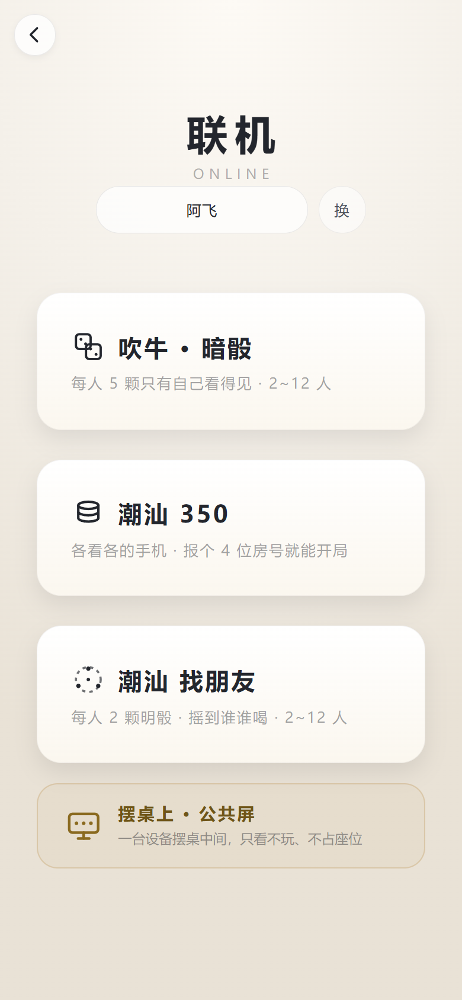
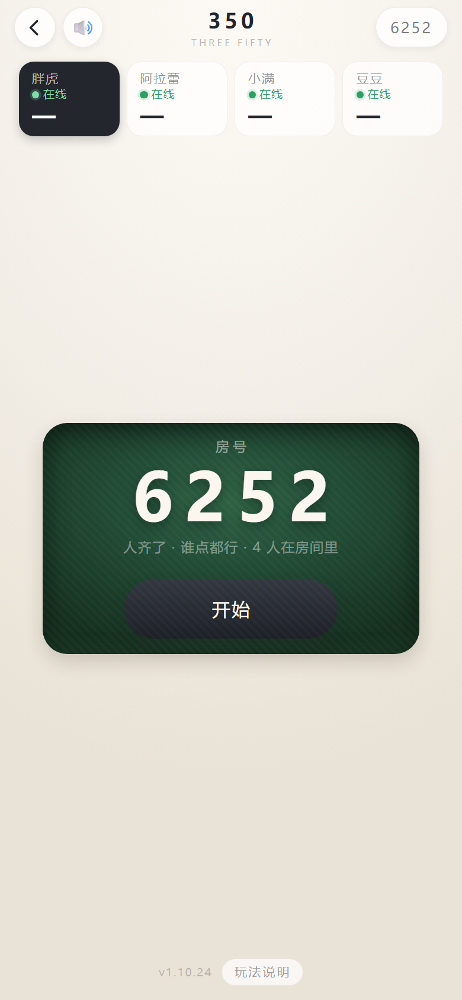
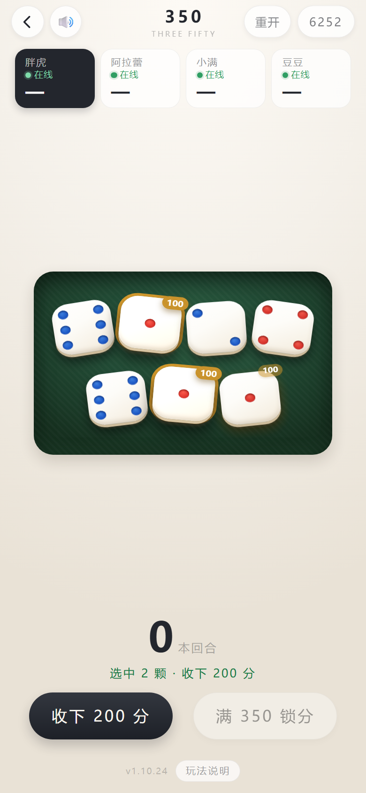

# 联机 · 潮汕 350

[← 回首页](../README.md)

各看各的手机，不用连同一个 WiFi，也不用指定谁当主机。

联机现在有两个玩法：**潮汕 350**（这篇）和 [潮汕 找朋友](play-find.md)。
开房、房号、掉线回位、踢人、重开投票这一整套是两边共用的。

面对面坐着打的话，还有一块 **摆桌上 · 公共屏**：找台旧手机或 pad 摆在桌子中间，
输一次房号，房号 / 轮到谁 / 各家几杯 / 刚发生什么就全在大屏上，隔一张桌子也看得清。
它**只看不玩**：摇骰、看自己的牌这些操作还在各自手机上，大屏上一个能点的东西都没有，
也不占座位 —— 桌上 4 个人还是 4 个人，重开要几票依然按 4 个人算。
卡片中间的数字带单位（「400 分」），不用猜那是分数还是名次。

## 联机（潮汕 350）

  
  
  

  联机 → 选玩法 → 报房号等人 → 开局打（房号是随机四个数字，每桌不一样）

**怎么开一局**：一个人点「开房」，屏幕上给你一个 **4 位房号**，念给桌上的人；别人点「进房」把号码敲进去就坐下了。
**2~12 人**都能开（单机是 4 人起，联机两个人就能打）。人到齐，房主点「开始」。

**不用连同一个 WiFi，也不用指定谁当主机**：两台手机隔着城也能打。这个玩法本来就是「手机放桌上等轮到我」，
所以谁锁屏、谁掉线，**只影响他自己那一手**，整桌不会跟着停。

**每一步都等服务器回话**：350 是明骰，桌上七颗大家都该看见同一副。
本地先猜一个再被服务器改，就会出现「我这儿显示 3 个 5，结账时说只有 2 个」——这种架最伤和气。
80~120ms 的等待用「按钮先灰下去 + 骰子抖一下」盖过去，手感跟单机差不多。

**掉线 / 退出去再进来**：房间和座位都留着，凭房号 + 本机存的座位记号**回到原位**，还是原来那一手、那个分。
大厅里会挂一张「接着上一桌」的卡，点一下就回去，不用重新报房号。

**踢人**：

| 谁发起 | 怎么算数 |
|---|---|
| **房主** | 点一下谁，确认就出去了，不用等人同意 |
| **其他人** | 只能发起「请出去」，45 秒内要凑够**除他本人以外、在线人数的三分之二**（4 个人时 2 票、6 个人时 4 票） |

被请出去的那位会收到一句「被请出了房间」，回大厅还能再进。**一次只吵一件事**：踢人投票会顶掉还没投完的「重开」票。

**中途重开要投票**：打了一半点「重开」不是立刻洗牌，先记一票，**在线人数三分之二**同意才重开（4 个人时 3 票），
45 秒没人接着点就作废。打到结算之后再点重开就不用投票了 —— 那时候桌上已经没人还在算分。

**本局记录**：页脚的「记录」摊开这一局发生过的事 —— 谁进房、开局、谁开了谁、
收下哪几颗、换到谁、谁喝了几杯、重开。**最多留 30 条**，越往下越新，打开就停在最新那条。
以前这里只有一句 1.5 秒就消失的提示，低头看一眼手机，刚才那杯怎么来的就没了。
记录是**服务端**记的：换手机、断线重连回来，翻到的还是同一份。
（纯净版也有 —— 它是牌桌上的公开功能，不是隐藏开关。）

**两个版本能进同一个房间**：纯净版只是少了那几个隐藏功能，联机那份代码（`net.js`）两版是**同一个文件**，
协议、房间、房间号全一样。桌上一半人用完整版、一半人用纯净版，照样开一局 —— 实测过（完整版开房、
纯净版进房、同看一副 7 颗骰子）。以后要防着谁偷偷改点数，就让全桌都装纯净版。

**联机要一台服务器**：联机不是点对点，得有个地方跑规则 —— 我们把它放在 **Cloudflare** 上
（Workers + Durable Objects，一桌 = 一个实例，用那 4 位房号当名字）。
**地址不写在这里**：它在 `net.js` 顶上的 `DEFAULT_API` 里，想自己搭一套就照那个位置改成自己的域名。
单机两个玩法跟这台服务器没有半点关系，不点联机就一个请求都不会发。
