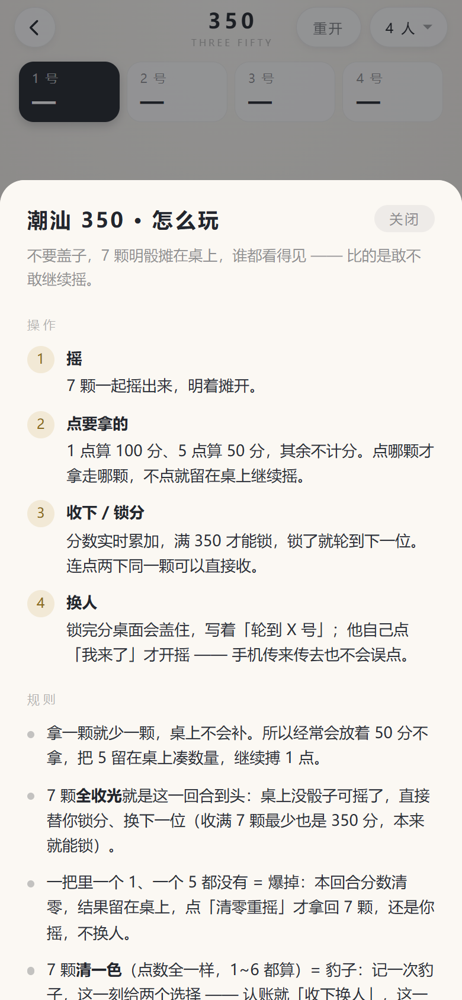
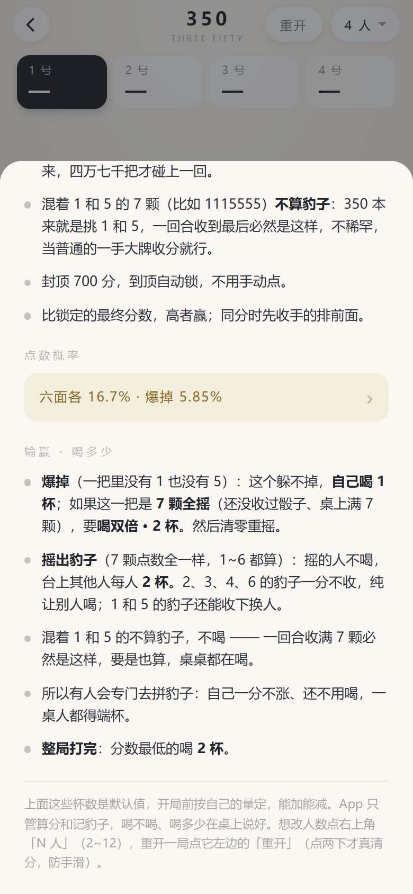
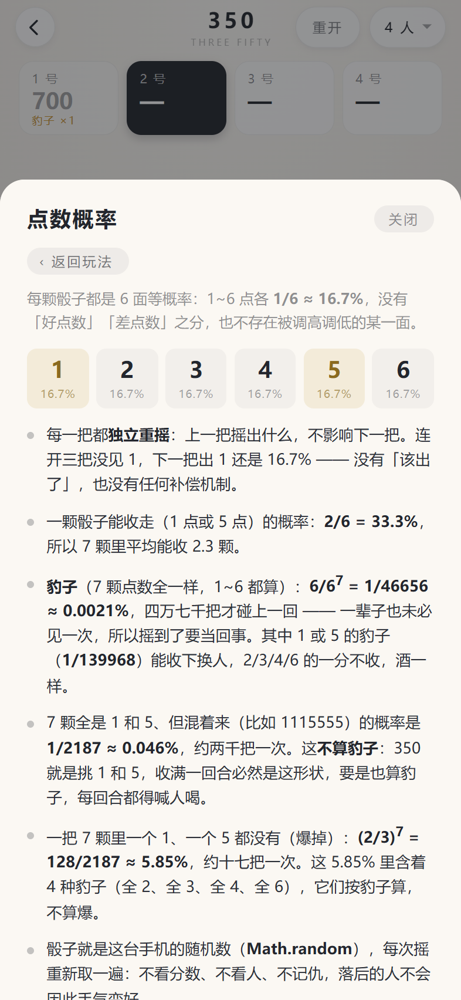

# 玩法说明与点数概率

[← 回首页](../README.md)

三个玩法（吹牛 / 350 / 找朋友）里都有「玩法说明」按钮，规则写在 App 里，不用每次开局口头讲一遍。

## 玩法说明

  
  

  同一个说明层：上面是操作和规则 → 往下滚是「输赢 · 喝多少」

**概率单独一页**：整段数字塞进玩法会把规则拉得很长，所以玩法里只留一行入口
（「六面各 16.7% · 爆掉 5.85%」），点进去单独看，顶上有「‹ 返回玩法」。

  

  六个面各 1/6 ≈ 16.7%（六格一样高）；1 颗能收走 33.3%；豹子（1~6 都算）1/46656 ≈ 0.0021%；
  混着的 1/5 是 1/2187 ≈ 0.046%（不算豹子）；爆掉 128/2187 ≈ 5.85% —— 每把独立，没有「该出了」也没有补偿

每个玩法页底栏都有「玩法说明」，从底部升起一张卡片：上面是**操作**（分步骤，配序号），
下面是**规则**（计分、爆掉、封顶、胜负怎么算），末尾一句补充说明。

内容按玩法各写各的，讲的是 App 里真的实现了的规则：

- **吹牛骰子（单机）**：App 只管摇和盖，所以说明写的是桌上通用的叫点打法 —— 1 点万能、轮流往上叫、
  不信就开、斋了 1 就只是 1。各地讲究不一样的地方，最后一句专门提醒「开打前先说好」
- **吹牛骰子（联机）**：把「线上只负责给骰子」这句话放在最前面。**七步**（开一桌 / 摇·摇完就锁 /
  面对面叫 / 开牌·2/3 / 摊牌 / 下一把·2/3 / 点名字请人出去）配**七条**：为什么不用单机版、摇完就是认账、
  2/3 只算在线的人、摊牌只展示不判、叫点全靠嘴、掉线不卡桌、踢人的分寸。
  **叫点顺序、谁先叫、喝几杯一律不写死** —— 这些在桌上说，说明里只留一句「App 不参与」。
  它跟上一版最大的差别是**「按开始」这一步整个没了**：一人只能摇一次，摇完就是认账，
  最后一家摇完牌自己就锁，多按那一下只是多一个能被卡住的地方
- **350 规则**：完全按代码里的判定写 —— 1 点 100、5 点 50、不点就不拿、一炮无分清零、
  7 颗清一色（**1~6 都算**）记豹子、满 350 才能锁、封顶 700、同分先收手的排前面
- **350 输赢**：多一段「**输赢 · 喝多少**」—— 爆掉自己 1 杯（**7 颗全摇爆掉双倍 2 杯**）、
  豹子其他人各 2 杯、整局最低的 2 杯，并注明杯数只是默认值，开局前按自己的量定；
  规则里也写清了豹子那一步的选择（收下换人 / 清零重摇，2/3/4/6 的豹子只能接着摇）

摇出豹子、摇到爆掉的时候，底部那行提示也把杯数一起说了：**「豹子！其他每人喝 2 杯 · 收下换人，或清零重摇」**、
**「豹子 · 其他每人喝 2 杯 · 这手不收分，接着摇」**、**「爆了 · 喝 1 杯 · 分数清零」**、
**「爆了 · 7 颗全摇 · 喝双倍 2 杯」**；
结算页标题下面写着「同分先收手的排前面 · **最低的喝 2 杯**」。
不用翻说明，当下就知道该谁端杯。

点右上角「关闭」或卡片外面的空白都能收起来；内容超过一屏时可以滚，每次打开都从顶上开始。
