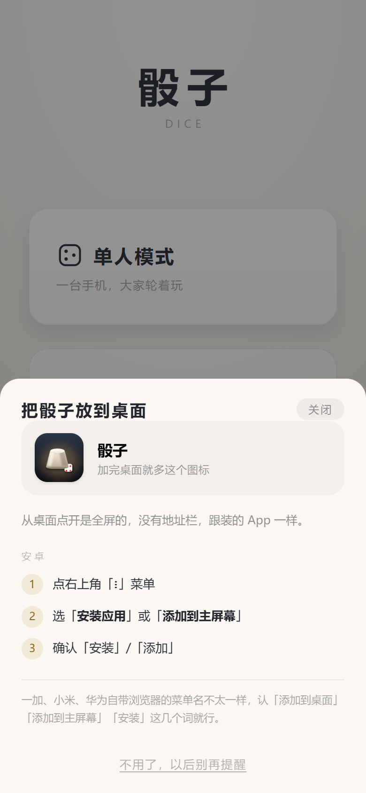
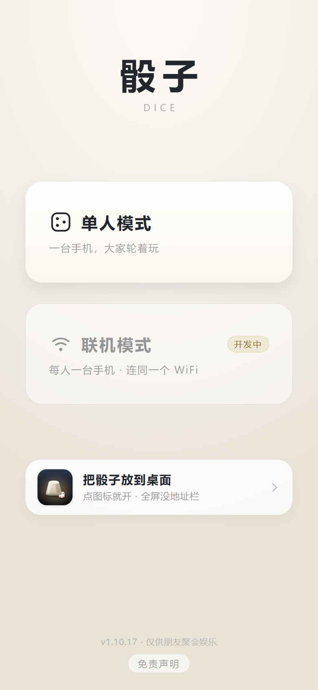
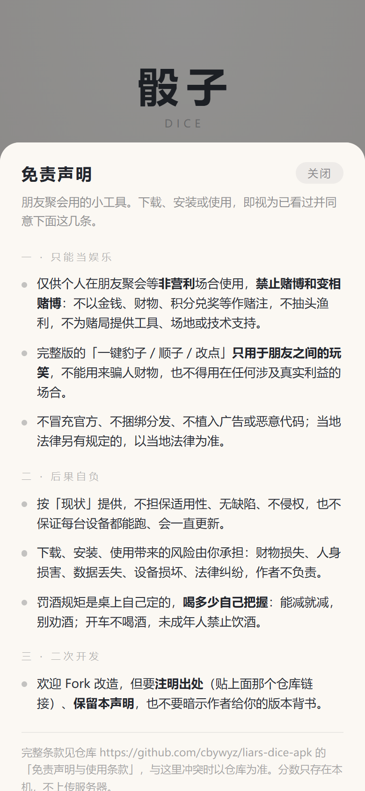

# 网页版 · 地址、离线、加到桌面

[← 回首页](../README.md)

网页版不用装，点开就玩；加到桌面之后跟 APK 几乎没区别，**更新还是「刷新即最新」**。

## 网页版（两个地址）

| 版本 | 地址 |
|---|---|
| 完整版 | https://cbywyz.github.io/liars-dice-apk/ |
| 纯净版 | https://cbywyz.github.io/liars-dice-apk/clean/ |

两个地址是同一套源码出来的，点开就玩，不用装。iPhone 用 Safari 打开后「分享 → 添加到主屏幕」，
安卓在浏览器菜单里选「安装应用」；加完的图标、名字、启动画面跟 APK 一样，打开也是全屏无地址栏。

### 部署在哪

| 跑什么 | 在哪 | 怎么更新 |
|---|---|---|
| 网页（完整版 + 纯净版） | GitHub Pages | push 到 `main` 自动重发，40 秒左右 |
| 联机（房间 / 规则 / 记分） | **Cloudflare** Workers + Durable Objects | 单独部署，跟页面不是一回事 |

联机之所以要另找地方：页面可以只是一堆静态文件，但联机得有个地方记住「这一桌现在轮到谁、谁收了几分」。
那台服务器的地址**不写在这里**（它在 `net.js` 顶上的 `DEFAULT_API` 里），想自己搭一套就照那个位置换掉。
另外有一份自用的 Cloudflare 镜像：**两版都放**（根路径完整版、`/clean/` 纯净版），页面和联机同一个域，
联机时省一次跨域。域名同样不公开。

### 其实网页版比 APK 省事

同一套代码，网页版加到桌面之后用起来跟 APK 没区别 —— 而且**更新不用重装**：

| | 网页版（加到桌面） | APK |
|---|---|---|
| 图标 / 名字 / 启动画面 | 一样 | 一样 |
| 打开是不是全屏无地址栏 | 是（`display: standalone`） | 是 |
| 断网能不能玩 | **能**（第一次联网打开过之后，整套文件存在本机） | 能（文件就在包里） |
| 发新版怎么更新 | **直接刷新就是最新**，不用重装、不用清缓存 | 得下一次新的 APK 覆盖安装 |
| 发给朋友 | 发个链接就行 | 得传 APK 文件，安卓还会弹「未知来源」 |
| 占多少空间 | 约 200 KB 缓存 | 约 270 KB |
| 首次打开 | 要联网下载一次 | 装完就能用 |

所以**日常推荐直接用网页版加到桌面**。还留着 APK 的理由就两条：
一是想彻底不碰浏览器（有些机型把「添加到桌面」管得很严），二是需要把安装包发给别人、或者在没有网络的环境里装机。

  

### 离线是怎么做到的

`sw.js` 是个 Service Worker，**装到桌面后第一次联网打开时**把页面、两个玩法脚本、样式、音效一起存进
`Cache Storage`（约 200 KB）；之后断网打开直接读本机那份。策略是**网络优先**：

- 联网：每次都去拿最新部署 → **刷新即最新**，这条不能被缓存破坏
- 慢网：1.5 秒还没回来就先拿缓存顶上，不让用户对着白屏等
- 断网：直接读缓存，能进 350、能摇、能收分

缓存名里带**这一版网页内容的哈希**（`liars-dice:full:<hash>`），内容是新的名字才变，浏览器就当成一个新 SW
重新装一遍，`activate` 里把上一版删掉 —— 不用手动清缓存。用内容哈希而不是提交号，是为了**只改 README、
只改 CI 的时候名字不动**：已经加到桌面的用户不会白重下 200KB，开着的老页签也不会被刷一次。
完整版和纯净版在同一个域名下共用 `Cache Storage`，所以缓存名分了 `full` / `clean` 两组，
`activate` **只删自己这一组**的旧版，两版都装着也不会互相清掉。

实测（`_real/test_pwa.py`，真断网真刷新）：SW 激活、缓存键不带 query、断网 reload 出画面、
断网进 350 摇出 7 颗、改了文件再刷新拿到新版、两版缓存并存 —— 16 条全过。

| 设备 | 怎么装 |
|---|---|
| iPhone / iPad | Safari 打开链接 → 底部**分享** → **添加到主屏幕** → 桌面出现图标，全屏、无地址栏、断网可玩 |
| 安卓（不想装 APK） | 浏览器打开链接，菜单里选「安装应用」（优先）或「添加到主屏幕」 |
| 电脑 | 直接当网页玩 |

iPhone 不能装 `.apk`，那是系统限制；要做真正的 iOS App 需要 Mac + Xcode + 每年 99 美元开发者账号，不值当。

### 首页就有「把骰子放到桌面」

上面那张表不用记：网页版首页底部自带一条入口。**点它一下，能直接装就直接调起系统的安装框**
（安卓 Chrome / Edge 会把安装事件交给网页），点「安装」图标就上桌面，中间不再多一页；
浏览器给不了安装框、或者用 iPhone，才打开说明页按机型讲步骤。

- **iPhone / iPad**：讲 Safari 的「分享」按钮在哪，并直说**只能用 Safari** —— iOS 不允许别的浏览器加桌面图标
- **安卓**：讲右上角菜单里的「安装应用 / 添加到主屏幕」，**任意浏览器都行**（自带、Chrome、Edge 一样走）；
  菜单叫法不一样，认这几个词就行。只有「加完桌面没图标」时才需要去开「桌面快捷方式」权限
- **从微信 / QQ 点开的**：先教怎么「在浏览器打开」，内置浏览器里根本没有这一项
- **手机自带浏览器（华为 / 小米 / OPPO / vivo / 夸克 / UC / QQ）**：它们**没有实现一键安装**
  （点了不会弹系统框，这是浏览器的事，网页改不了），所以给的是菜单路径 ——
  华为浏览器叫「**添加到桌面**」，一直在菜单里；加出来是**桌面快捷方式**，打开会带地址栏。
  想要全屏无地址栏，就用 Edge 或 Chrome 打开同一地址走「安装应用」
- **弹了系统框又点「取消」**：会把说明页打开，顶上提一句可以刷新再来，下面照样给手动加的步骤
  —— 同一个页面里安装事件只能用一次，所以是「刷新再点」而不是「再点一次」

已经是从桌面图标打开的（`display-mode: standalone`），或者点过「不用了，以后别再提醒」，这条就不再出现。
**APK 里也不会出现** —— App 本身就是装好的，再劝人加桌面纯属添乱（`file://` 下直接跳过）。
加完**图标、名字、启动画面都跟 APK 一样**，打开也是全屏无地址栏 —— 网页版和 App 用起来几乎分不出来。

  
  

  首页底部一条入口 → 点一下直接调系统安装框，弹不出来才是这页步骤

两条实测出来的经验，都写在这一页里了：

- **优先走「安装应用」**（浏览器菜单里那一项）。Chromium 系装的是 WebAPK，**图标由系统自己放到桌面**，
  不碰「创建桌面快捷方式」这个权限 —— 首页那条入口能弹系统框时，走的就是这条路
- **「添加到桌面」加完桌面却没图标**，不是浏览器不行，是它**没有被允许「创建桌面快捷方式」**：
  华为 / 荣耀在 设置 → 应用和服务 → 应用管理 → 该浏览器 → 权限 → 桌面快捷方式 → 允许；
  小米 / OPPO / vivo 同样在「应用管理 → 权限」里。**同一个 Edge，授权之后就能加**（实测）
- 网页**没法替你跳进系统设置页**（Android 不允许网页拉起 settings intent），所以这一段只把路径写清楚，
  另外给一颗「复制网址」，方便换浏览器打开

### 第一次打开先弹免责声明

第一次打开会先压一层免责声明，点「我知道了」之后不再自动弹；之后从首页底部那颗
**「免责声明」**随手能再看。点空白处只收起来、不算看过 —— 手滑点掉的那次不该把说明吞掉。

三条，就三句：**只能朋友之间娱乐**、**不得用于任何非法用途**、**其他功能与本工具无关**，
外加一句分数只存在本机。**不提钱、不提酒、不点名隐藏功能、不放仓库链接** ——
这是给桌上朋友看的一句话说明，不是分发协议；弹层只占四成屏，首页的标题和两张卡还看得见。

  

  三条讲完，占四成屏，不挡首页

